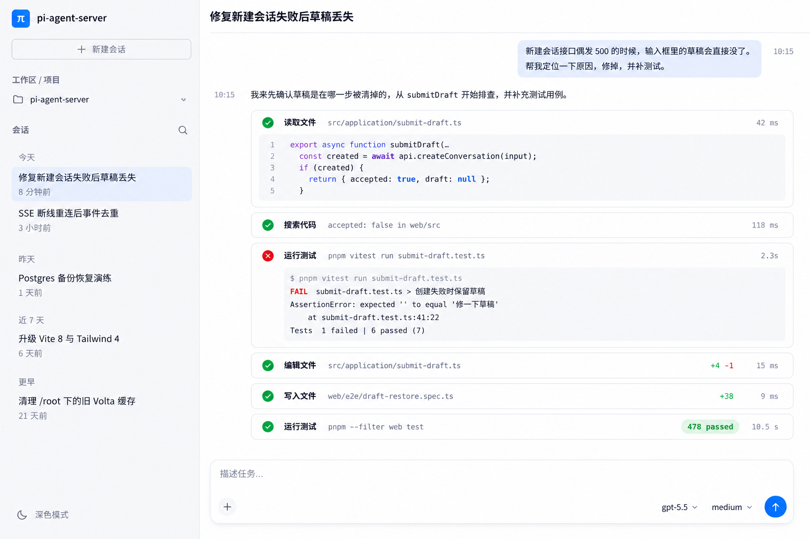
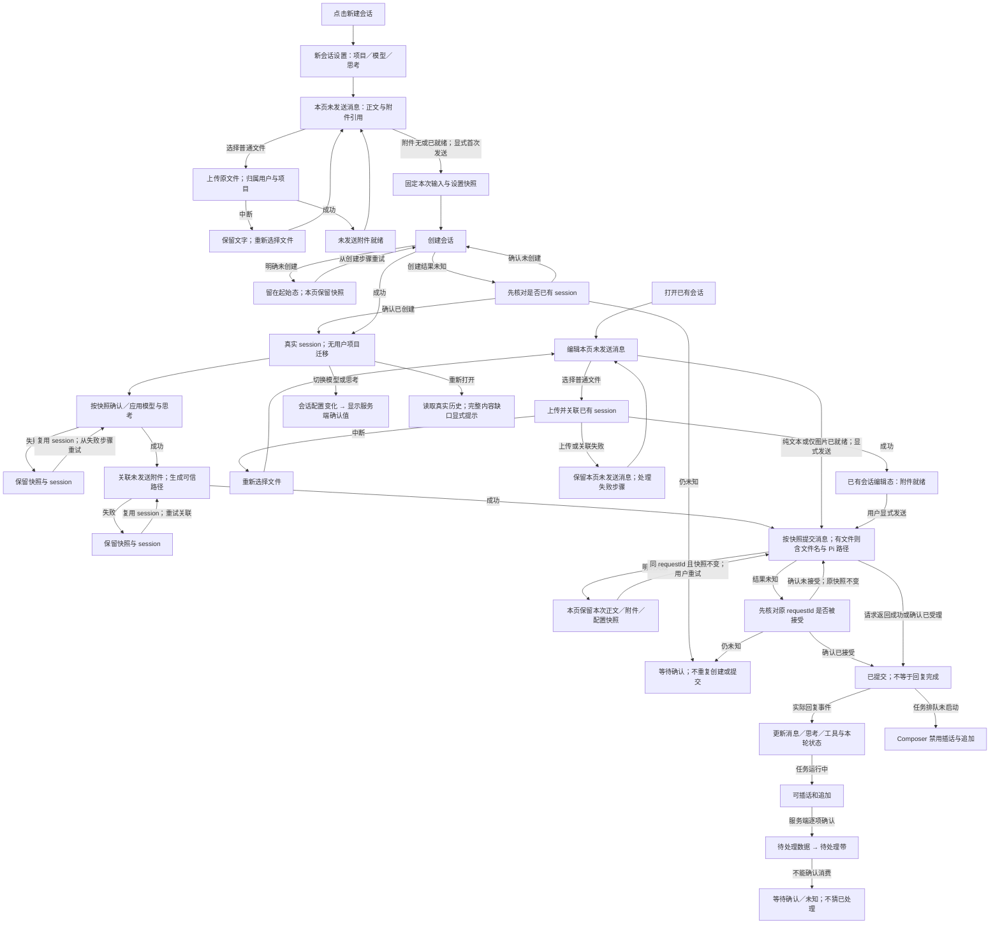

# 界面设计规范 · 两栏对话工作区

适用 Web、移动与 TUI（终端采用等义映射）。本文件区分**目标设计、实施阶段与待核验契约**，不将目标或规划当作已实现功能。阶段三 A 引导/追加队列已实现并通过隔离验证；Inspector 已提供独立步骤快照、带来源的系统提示词及原事件流。步骤到聊天的定位与高亮仍待后续实施。其他阶段的完成状态也须以代码与真实运行证据为准。

## 视觉参考与使用边界

两栏工作区的主视觉参考为归档图片：[两栏对话工作区](docs/design/reference-gpt-workspace.png)。新增[控制队列参考图](docs/design/reference-control-queues.png)仅用于阶段三 A 引导/追加交互的补充指引，不替代或覆盖主参考及既有侧栏 280px、Logo 26px 和原工具名。旧 Stitch 方案已废弃，不再作为视觉或验收依据；此前 Crossband 横带、固定来源槽、全屏分割网格与强反相消息等约束同样废除。



主参考图用于确定左侧项目/日期会话导航、主区阅读层级、工具轻卡和底部统一输入框的关系；队列补充图仅引导追加的引导/追加入口与队列呈现。图片不是产品数据或实现证据。图中的会话、路径、模型、耗时、diff 数字、测试失败及「478 passed」均不得作为演示真数据、默认值或验收结果复制。不得据补充图覆盖 280px 侧栏、26px Logo 或真实工具原名。字体使用已实施的七级系统栈规范（见 2.2–2.3），不照搬 DM Sans；暗色、移动端与异常状态需按本文件补足，不从截图推断已经完成。

业务、附件、数据与部署契约继续保留（包括第 1 节统计、第 4 节工具、第 8–11 节数据流及第 13–14 节部署限制）。与当前代码不一致的条款是目标或待核验项，不是现状断言；新视觉不能删减既有验收能力。

---

## 1. 设计方向与原则

**单一方向**：现代、简洁、以阅读和输入为中心的对话产品。界面主体是一条可舒适阅读的对话流，其他一切（导航、题头、输入区、详情面板）都是它的支撑结构。

原则：

1. **信息层级优先**。用户先看见内容，再看见结构与控件。层级由排版尺度、间距与留白建立，不由边框、卡片堆叠或装饰建立。
2. **以内容为准的宽度**。正文限制在可读行长内，多余视口宽度转成留白，而不是拉伸文字。
3. **少容器、多留白**。不使用卡片包裹每一段；只有在需要与正文区分时才使用轻底色或分隔。
4. **强调色只有一个**。它用于主操作、流式进行指示与当前选中；不用于装饰、不用于大段背景。
5. **状态用文字表达，颜色只作辅助**。任何状态、类型、结果都有可读文字。
6. **输入区是重心**。Composer 始终可达、始终不被遮挡、始终反映本页内存中的真实草稿。
7. **不虚构**。没有数据就显示空态；不造占位内容、装饰数据或连接状态。

阶段一保持现有 StatsBar 与模型选择的位置及行为不变；阶段二目标是模型/思考/发送统一在 Composer 右侧操作区，StatsBar 仍在 Composer 下方。轮数和 model turn 数采用服务端 JSONL 持久记录的宿主实际执行累计，按所有分支稳定 ID 去重（重试/活动 follow-up 同轮、多 turn；idle 新任务新轮），不以用户消息数推算；工具数仅计当前已加载分支时间线。旧历史无记录显示未知，有缺口只显示已记录数并在详情说明全历史未知；按 [统计契约](docs/usage-measurement.md) 使用单行 11px 中性文字与 14/16px SVG：`1轮 · 3 turn · 工具2次`、速度、末次响应 totalTokens（K/M）、缓存命中、上下文百分比；390px 隐藏次要缓存，不换行、不横向溢出。整行按钮打开现有 Modal，全部原值按「末次响应」「会话累计」「上下文」分组保留；无有效值不显示空组标题，默认不在文档流展开详情。仅格式化后端值，不自行加总 token、计算缓存命中率或估算速度。数字 compact、tooltip 保留完整值；null/缺失/非法值省略，真实 0 保留，USD 费用始终为估算（0 不宣称免费）。末次为最后 assistant 的 SDK usage，输入不含缓存，输出含 reasoning；完成速度只显示生成时段至少 10ms 的后端 output tok/s，不以请求总耗时或字符数计算。活动输出仅显示服务端现有字符估算的 ~N tok/s，沿用最近两秒 delta 失活门槛；暂停、工具等待、断线不显示旧速度。请求耗时与首段延迟独立；无 delta 的相等回填延迟不显示。流式/排队旧快照的口径、非实时说明和估算说明收进 title 与详情，不在主栏常驻状态文案；累计和上下文在详情标上次结算/export 快照、非实时。累计是 SDK allEntries、含所有分支条目，非 active branch、不另加独立 subagent ledger；上下文是估算而非累计，压缩后可仅有窗口。已有授权 export 的 optional usageSnapshot 可恢复，不读取全局历史或主动创建 runtime；旧服务无计数字段时未知；无 runtime 的 JSONL 历史可只读恢复执行计数，其他统计缺失仍未知。controller 按会话隔离快照，导航和模型变更清 context，取消的旧导出不能覆盖新会话或新模型上下文。

明确不使用：固定来源槽列、横向色带/分割线网格、全屏多栏仪表盘式布局、大面积反相的短消息块、纯装饰性描边与玻璃拟态、插画与渐变背景。

---

### 主区轨迹入口（已批准头部方案）

会话题头仅保留一个轻量 `file-text` 库图标＋「轨迹」按钮，删除原「对话／轨迹」双入口及导航容器。按钮重复点击打开／关闭 Inspector；关闭为中性色透明底，开启为克制的 neutral 底色，不加蓝色下划线或大 pill，也不增加更多操作入口。参考本次批准的静态头部稿，稿中按钮「步骤」按用户确认改为「轨迹」；样例内容不进入产品。

使用 button disclosure 语义，`aria-expanded` 表达开关状态、`aria-controls` 关联真实 Inspector id，不使用 tab 或 `aria-current`。X／Esc 关闭后回焦此按钮；≤600px 仍隐藏而不卸载聊天。按钮保持导航 12px、手机 44px 触控和现有无焦点视觉效果，标题保持 18px；保留自然高度 observer 与右栏底线同步。右栏「步骤（实际数量）／系统提示词／事件流」及关闭按钮不改。

## 2. 设计令牌

### 2.1 色彩

阶段二采用冷浅中性 + 单一蓝强调，不再沿用阶段一的暖中性视觉基线。全局色彩与阴影集中于 `web/src/styles/tokens.css`，由 `styles.css` 独立引入；`styles/ui.css` 的 `[data-ui]` foundation aliases 引用同一语义 token，Portal 不另设一套色板，关闭 foundation 工具样式也不移除全局主题。

当前实现值：亮色 page/surface `#FFFFFF`、sidebar `#F6F7F9`、raised `#F5F6F8`、正文 `#111629`、次要文字 `#626B82`、辅助文字 `#626C82`、边线 `#E0E5EE`、强调 `#006BF0`、淡蓝背景 `#E7EFFF`；暗色 page `#17191E`、surface/sidebar `#1D2027`、raised `#252933`、正文 `#ECEDF2`、次要文字 `#B1B9CB`、辅助文字 `#949EB4`、边线 `#353B49`、强调 `#8FB0FF`。暗色是在参考亮色布局上补足的实现，不宣称还原了不存在的暗色稿。下表描述语义；完整状态色与阴影以 token 文件为准。

| 语义令牌 | 亮色目标 | 暗色目标 | 用途 |
|---|---|---|---|
| `--bg-page` | 白／近白冷中性 | 中性深底，不沿用暖墨作为批准值 | 页面底色 |
| `--bg-surface` | 白色轻表面；侧栏以冷浅灰区分 | 中性深色轻表面 | 题头、侧栏、Composer、浮层 |
| `--bg-raised` | 冷浅灰 | 比页面略亮的中性深灰 | 代码块、控件内区 |
| `--bg-hover` | 冷中性轻变化 | 中性轻变化 | 悬停/按压 |
| `--text-primary` | 深冷中性正文 | 浅中性正文 | 正文，对比度按第 6 节验收 |
| `--text-secondary` | 中等冷灰 | 可读浅灰 | 次要说明、必要标签（≥ 4.5:1） |
| `--text-tertiary` | 较浅冷灰 | 弱化中性灰 | 时间戳、计数等小文字（≥ 4.5:1） |
| `--line` | 细弱冷灰 | 细弱中性灰 | 必要结构分隔与轻卡描边 |
| `--accent` | 蓝 | 可读亮蓝 | 主操作、流式指示、当前选中 |
| `--accent-solid-bg` / `--accent-solid-fg` | 蓝底与高对比文字 | 蓝底与高对比文字 | 主按钮（≥ 4.5:1） |
| `--accent-soft` | 淡蓝 | 低强度蓝底 | 用户消息、选中背景、强调标签底 |
| `--success` / `--warning` / `--danger` | 可读绿／琥珀／红 | 对应可读状态色 | 成功／注意及等待确认／失败及破坏性操作 |
| `--thinking` | 弱化冷中性色 | 弱化中性色 | 思考标签，不作大面积底色 |

规则：
- 状态色只出现在小面积（图标、短标签、状态词），任何信息不单靠颜色区分。
- 助手正文不套卡；背景层级限 page / surface / raised，左栏以浅中性底与主区区分，用户消息用淡蓝或中性轻底。
- 分隔线只在必要处出现（题头下沿、侧栏边界）；工具轻卡和 Composer 可用细弱中性描边，不使用网格交叉线。

### 2.2 字体

只使用系统字体，不加载网络字体。

- 界面与正文比例字体栈：`-apple-system, BlinkMacSystemFont, "Segoe UI", Roboto, "PingFang SC", "Hiragino Sans GB", "Microsoft YaHei", "Noto Sans CJK SC", sans-serif`
- 等宽字体栈：`SFMono-Regular, "SF Mono", Menlo, Consolas, "Liberation Mono", monospace`
- 等宽用途：模型完整 ID、session/请求 ID、路径、`provider/model`、思考档位原值、工具名称与参数、代码、结果数据、数值统计。
- 其余文字使用比例字体；代码块保留语法底色 `--bg-raised`，不加边框。

### 2.3 字号与行高

此次七级字体规范已实施，并按用户要求所有档位统一缩小 2px（字体栈、字重与角色映射不变；下列参考图保留历史原样，以当前表格为准）；会话主标题另按明确指定使用专用 18px 例外。绝对字号以 `web/src/styles/tokens.css` 为单一来源；旧语义变量只作 alias，带 `ui:` 前缀的 Tailwind 字号亦映射到此尺度。参考：[字号角色表](docs/design/typography-scale-reference.png)、[字体栈与步骤层级](docs/design/typography-stack-steps-reference.png)。

| 令牌 | 值 | 用途 |
|---|---|---|
| `--font-xs` | 10px | 时间戳、标签/数量、附件大小 |
| `--font-sm` | 11px | 步骤摘要、工具参数（含代码）、次要信息、左栏日期 |
| `--font-base-sm` | 12px | 按钮、导航、分组标题、工具输出（含代码） |
| `--font-md` | 13px | 模型选择、工具原名、主聊天思考内容、v5 左栏项目与会话标题 |
| `--font-base` | 14px | 用户/助手与 Markdown 正文、输入正文；移动端及矮视口不缩小正文 |
| `--font-lg` | 16px | Logo 旁品牌名称 |
| `--font-xl` | 20px | Markdown 一级标题，及其他 20px 层级 |
| `--font-session-title` | 18px | 会话主标题专用例外，长标题允许换行；桌面与移动端一致 |

步骤面板优先使用 **12px 标题（含工具名）+ 11px 摘要 + 10px 时间**，不套用主聊天的 13px 工具名或 14px 正文。Markdown 标题使用 20/16/14px，配合 600 字重和段落间距保持层级；正文行高 1.65、标题 1.3（题头 1.35）、代码 1.55、输入 1.5。允许正文内必要的相对字号继承；会话主标题是唯一独立绝对字号例外，其余界面字号遵循七级尺度。移动端输入同为 14px，遵循本次统一缩小要求；不禁用 viewport 缩放，iOS 聚焦自动缩放需真机验证。

不使用超过以上尺度的展示型大字；首屏没有营销式标题。

### 2.4 间距、圆角与层次

- 间距基数 4px，刻度：`4 / 8 / 12 / 16 / 24 / 32 / 48 / 64`。
- 消息条目之间 `--space-16`；同一消息内段落 `--space-12`；标题上 `--space-24` 下 `--space-8`。
- 列表项左右内边距 `--space-12`，上下 `--space-8`。
- 正文列左右内边距：`--space-24`（≥640px）/ `--space-16`（<640px）。
- 圆角：控件与用户消息约 `8px`，工具轻卡 `8–12px`，Composer `12–16px`，代码块 `6px`；圆形用于附件和发送等图标按钮，不将整段内容胶囊化。
- 阴影主要用于浮层；Composer 可有极轻底部阴影，不以厚阴影制造工具卡层次。
- 动效只用于状态变化反馈：展开/收起、进入/退出、流式光标，时长 120–180ms，无入场动画、无视差、无循环装饰动画。尊重「减少动态效果」。

### 2.5 宽度与断点令牌

| 令牌 | 值 |
|---|---|
| `--sidebar-width` | 默认 280px，可拖拽 180–400px；根据用户反馈收窄，不机械复制参考稿较宽的侧栏 |
| 外壳宽度 | 100% 视口（侧栏贴左；额外留白位于主区阅读列两侧） |
| `--reading-max` | 1200px；消息／工具与 Composer 对齐，侧栏收窄至 280px 后，1536px 下主区卡片可达到 1200px 上限 |
| `--user-bubble-max` | `min(520px, 76% of --reading-max)` |
| 按需详情宽度 | 最大约 380px（覆盖抽屉；统计与超大 diff 片段可独立 Modal，不占常驻栏位） |
| 断点 | `640px`（窄屏）、`905px`（侧栏收起阈值）、`1180px`（侧栏可停靠）；不设第三栏停靠断点 |
| 高度阈值 | `480px`（矮视口紧凑模式）、`360px`（极矮视口） |

---

## 3. 布局与响应式

### 3.1 结构

**两栏结构**：左侧导航 → 主区（题头 + 消息/工具阅读流 + 底部统一 Composer）。不采用旧 Stitch 的常驻右栏；详情与统计／超大 diff 片段仅按需打开覆盖抽屉或 Modal。阶段三的右侧步骤定位入口也是按需辅助，不是第三个常驻工作区。

- **导航侧栏**：上部产品识别与「新建会话」，项目选择/过滤，会话搜索与按日期分组的真实会话（今天、昨天、近 7 天、更早），底部主题入口。日期分组基于真实时间，缺少时间不编造相对日期。停靠宽度按参考图比例校准，保留现有拖拽能力；浅中性底与主区区分。选中行使用淡蓝背景，不必加彩色竖线；标题与真实时间为主次两行。项目切换只过滤列表，本身不迁移会话；native 索引重分类仍可更新服务端归属（见第 8 节）。项目选项仅来自有可访问会话的项目及本页刚创建的空项目；底部单一主题菜单提供「浅色／深色／跟随系统」三项单选，以选中状态表达系统跟随；展开、收起与手机侧栏均可恢复跟随。所选浅色／深色／跟随系统模式以 `pi.theme-mode.v1:<origin>` 缓存到 localStorage，刷新同步恢复模式与有效主题，不缓存系统模式解析后的色彩。未设置或非法值默认跟随系统；仅系统模式响应 matchMedia 变化，手动浅色／深色忽略操作系统变化。存储读写失败时优雅降级，本页仍可切换主题。产品标识按本轮授权改用用户图标库 `web/src/icons/svg/brand-pi.svg` 的 img，保留 26×26px 与品牌文字 8px 间距；旧 PNG 留存但不再用于 UI。
- **题头**：最小高 56px（紧凑模式 44px），左侧为导航入口与会话标题，右侧仅保留详情入口及必要操作。模型与思考选择统一放在 Composer 配置行，本轮数值置于输入区下方或详情面板，不在题头重复堆叠。会话主标题保持 18px 并允许换行完整显示；桌面并排 Inspector 顶栏跟随聊天题头实际高度（含底部 1px 分隔线），标签与关闭按钮垂直居中；≤600px 栏切换时 Inspector 独立使用基准题头高度，不继承隐藏聊天的长标题高度。模型触发器始终显示完整 ID（见 5.4）。整个界面不显示连接状态。
- **消息流**：单一居中列，宽度 `--reading-max`，与 Composer 同宽同轴，滚动到底时末条内容与 Composer 之间保留 `--space-24`。
- **左栏项目切换（批准稿）**：以 [项目切换参考](docs/design/project-switcher-reference.png) 规范左栏常驻项目上下文与搜索。280px 侧栏依次为品牌（26px SVG + 8px gap、16px 品牌文字）、全宽轻描边新建会话、单行项目触发器（左）+ 搜索按钮（右）、真实日期会话、底部「主题」。移除装饰性 folder 图标与常驻「+」按钮；项目名左边缘移至 16px，紧邻 chevron 箭头（4px gap，展开时 180° 旋转），长名称文本省略；右侧独立保留搜索按钮。项目名、展开 chevron 与搜索 SVG 采用 line-height 20px 与 flex 居中统一至水平中心线（中心差 ≤ 1px，移动端保持 44px 触控）。项目下拉面板宽度基于整行可用宽度（280px 侧栏约 249px，180px 约 149px，400px 约 369px），绝非文字 trigger 宽度；12+ 项目列表在内部独立滚动，底部「+ 新建项目」常驻可见并不撑大外侧栏；键盘上下箭头仅滚动项目列表，End 直达新建项目，Enter 打开创建表单，Escape/取消回焦触发器及提交新建。**Web UI 彻底不暴露项目删除入口**（下拉项目与非默认项目均无删除按钮，不提供删除请求与确认；后端 API、路由、RBAC 及客户端 SDK 仍完整保留 `deleteProject` 能力）。搜索默认隐藏，点击右侧搜索按钮在下方展开 32px 输入框；query 非空时渲染 × 仅清空输入不关闭，query 为空时隐藏 ×；按 Esc 或点击搜索按钮清空并关闭搜索；切项目重置搜索；纯文本安全高亮与无匹配清空动作保持。侧栏左边缘完全统一为 x=16px：日期分组、会话标题、更新时间全部统一起始于 16px（删除原有标题和时间的 12px 多余缩进），与项目名同处一条左边缘基线；选中与 hover 状态依然保持 0..width 全宽覆盖；项目/会话标题 13px、日期 11px、时间 10px；桌面约 56px 高，选中浅蓝、hover 中性底。原生会话整行 click/Enter/Space 与重命名/导出/删除 actions 隔离保留。手机操作目标至少 44px；180–400px 长名称省略且不遮挡搜索。
- **Composer**：主区底部统一圆角输入容器，正文输入在上，左下附件入口，右下模型完整 ID、思考原值与操作。空闲/新会话发送或 Enter 启动 primary 任务；运行中默认提交 follow-up 进入真实追加队列，无发送模式栏，通过追加条目的「引导」按钮提升为 steer；Composer 没有停止按钮或预留控制行，后台 abort 与程序 API/hooks 保留。初始态与会话态复用结构；新会话项目仅由左栏选择，Composer 内不出现项目字段、只读名称或重复选择器，仍以本页内存为准。窄屏允许操作行换行，不裁切模型 ID。使用正常 flex/grid 文档流占位，不以 absolute/fixed 覆盖消息流；键盘弹出仍可达。配置、附件和错误增高时同步缩小消息滚动区；StatsBar 保留于下方。
- **按需详情**：会话属性、真实事件记录、工具原始参数/结果与复制能力继续保留；任何宽度均初始关闭，以覆盖层或 Modal 打开，不设置常驻右栏，不显示连接状态条目。

### 3.2 响应式行为

- **≥1180px**：侧栏停靠，消息流居中于剩余空间内的 `--reading-max`。
- **905–1180px**：侧栏收起为可达的覆盖层（按钮或 Tab 打开），消息流占满可用宽度但仍受 `--reading-max` 限制。
- **<905px**：仅对话主区；侧栏与详情面板均为可达的覆盖抽屉，初始收起，打开时保留滚动位置。
- **超宽视口**：外壳占满视口，侧栏贴左并保留现有宽度与拖拽；主区填满剩余空间，多出的宽度成为主区阅读列两侧留白；正文列、题头与 Composer 仍受 `--reading-max` 限制，同宽同轴，不放大文字填空。
- **视口高度 <480px（短宽视口）**：题头压缩到 44px 并把次要数值收进详情面板；Composer 文本区起始单行；短屏不为整体预留固定高度，限制输入和附件各自内部滚动；1235×390 长草稿加附件的回归阈值为 45vh、390×390 为 60vh，以保留完整附件操作行（不是容器 CSS max-height）；侧栏与面板默认收起；滚动定位保证末条消息与 Composer 输入行同时可见；不出现整屏空白填充。
- **视口高度 <360px**：进一步隐藏本轮统计，仅保留标题、模型 ID、输入行与必要图标按钮。
- **移动端（约 390px）**：正文 14px；侧边栏覆盖；题头保留导航入口、标题与既有必要操作。Composer 模型／思考在上操作行，附件与发送在下操作行，运行／空闲保持相同两行几何，避免任务结束时阅读视口突变；相比单行工具栏增加约 52px。主要触控目标 ≥ 44×44px，软键盘行为仍需真机验证。窄且矮（≤480px 高）的视口沿用既有单行紧凑 toolbar；390×390 实测长草稿加就绪附件的 Composer 为 166px，附件滚动区 72px，失败时附件区可至 96px（错误行约 80px），可完整展示一行并操作删除／重试，输入、发送和剩余消息滚动仍可达。证据：`/tmp/reading-first-actual/final/short-composer-draft-attachments-390.{png,json}`、`mobile-attachments-error-390.{png,json}`。

以上宽度与断点属于本规范的设计取舍，不是产品硬约束。

### 3.3 TUI（设计建议）

- 单列阅读流，宽度按终端可用列自适应，正文建议不超过 100 列。
- 不使用固定来源槽或横带：内容类型以**行首短标签 + 缩进**区分（如「你」「助手」「思考」「工具」），标签后跟一个空格，不用反相大块。
- 用户消息用轻缩进与浅色底纹（若终端支持），助手正文不缩进、无背景。
- 工具过程未结束时默认展开、结束后自动折叠为紧凑可读摘要（并行任务/等待快照可多行），用户手动开合后保留偏好；展开显示原始参数与结果，顺序与真实时间线一致。
- Tab 可到达导航、消息列表、Composer 与其他可用区域；Web 聚焦不改变视觉样式，且不引起重排。
- 不照搬 CSS 尺寸或颜色令牌，按终端调色板等义映射。

---

## 4. 对话内容呈现

### 4.1 用户消息

- 自然宽度：贴合内容，上限 `--user-bubble-max`，右对齐于正文列。
- 轻量背景：亮色可用 `--accent-soft` 淡蓝，暗色用同义轻底，`--text-primary` 文字，8px 圆角，**无强反相、无描边、无头像与姓名前缀**。
- 保留原文换行；附件以 chip 形式显示在气泡内正文之下（见 5.5）。
- 时间戳 `--font-micro`、`--text-tertiary`，置于气泡下方右侧，仅在悬停/聚焦或紧凑模式常显。

### 4.2 助手消息

- **无卡片**：正文直接落在页面底色上，左对齐、占满 `--reading-max`。
- Markdown 层级按 2.3 的标题尺度；列表、引用、表格按标准排版，表格用行间隔线而非全边框网格。
- 代码块：`--bg-raised` + 等宽字体 + 6px 圆角，右上角提供复制按钮（图标带可访问名称）；长行内部横向滚动，不换行时保留缩进。
- 流式输出：末尾使用 1 个 `--accent` 光标点，完成后消失；不显示「正在输入」装饰条。
- 不显示「模型」标签、来源槽或头像。

### 4.3 思考内容

- 默认可见的折叠行（标签「思考」+ 状态/时长文字），展开原文无装饰边线、无缩进、无卡片；字号 13px、展开原文行高 1.65，正文 secondary、预览更浅。
- 思考与原消息的真实先后顺序保留；不聚合、不重排、不改原文。text.trim() 为空时不渲染行或箭头（含历史与流式初始空白），同 id 的手动开合状态仍保留；真实文本到达后正常展示。header 预览先对完整文本归一空白再取前 60 字，展开正文保留完整原文，reducer/export/raw history 不过滤数据。

### 4.4 工具过程（渐进披露，顺序不变）

- 每条工具调用保留摘要行：工具名（等宽）+ 展开/收起一致的可读摘要 + SVG 状态 + 紧随右侧的 12px chevron；整行可点击。工具与思考采用生命周期默认：tool_start 的 done=false 默认展开，tool_update 的 partialResult 实时替换正文并保持展开，tool_end 的 done=true 自动收起（含 isError 失败）；恢复历史 done=true 初始收起。用户手动展开或收起后，partial/done 更新不覆盖该选择。仅使用现有 done/isError，不新增 pending 或子 run 状态；工具自身结束不代表 subagent 子任务完成。展开完整参数在上、结果在下，协议原值保留。折叠不渲染正文，但摘要随真实最新快照刷新、不累加重复输出；最终结果优先于 partial（含 0、false、空字符串）。摘要使用标题栏实际剩余宽度，仅由 CSS 在空间耗尽时省略；不以固定字符数或 64ch 提前截断，title 保留完整归一化摘要，不截断展开原文。bash 展示 command 与最新输出末尾非空行，read/write/edit 展示路径及修改批次数，未知字段安全文本 fallback。subagent 展示每个代理名与 task；wait 展示目标 runIds / 全部待收集及最新真实等待文本；status/logs/steer/stop 仅显示目标参数与真实返回快照，不猜测跨工具关联或持续进度。SVG 仅依据工具 done/isError：进行中 spinner（尊重 reduced motion）、成功 check、失败圈叉，aria-label/title 保留状态文字，错误不全靠颜色，不造百分比。工具块状态 SVG、展开 chevron 在桌面与触屏始终可见（opacity:1），不显示更多 ellipsis 按钮，包括成功、失败、进行中，不依赖 hover 或焦点；Inspector 的独立规则不变。当前协议无 pending/waiting 枚举，不将已返回结果中的子任务 waiting 文本映射为工具等待状态。工具调用完成不等于后台子任务完成，wait 超时或子任务失败不自行改成工具失败。工具摘要聚焦不改变文字、背景、边框、阴影或图标显隐；仅 hover 背景铺满整条摘要行并贴合卡片圆角，不留下内层白边，不给展开正文染色；其他控件遵循第 6 节全局焦点规范。
- 阶段一保留现有工具 DOM/class 与视觉；阶段二目标为参考图式统一工具轻卡：中性 surface 底、细弱 `--line` 描边、8–12px 圆角，无厚阴影或彩色竖线。header 与展开正文同卡，代码/日志内区使用 `--bg-raised`，左右及正文底部约 12px 内边距。工具卡不新增左侧类别图标；Inspector 使用独立的步骤类型图标，并保留原始工具名。正文仍自然无底，思考弱化，无新增「工具调用」可见标签。
- subagent 仅在 args.tasks 为非空且每项含真实 agent 字符串与 task 字符串的数组时识别任务；多项在完整工具名旁独立弱化显示「并行 N」，不从结果文本推断数量或 run 关联。摘要先列全部代理名（保留同名与完整长名），再显示截断任务；窄屏分层，数量不收缩，两短名不被任务挤掉。展开以原顺序轻间距/细分隔展示各代理完整 task 与 cwd 等其他字段，去掉笼统 tasks 标签，不套厚卡；单项不标并行，非法/空 tasks 安全回退。长名可在摘要视觉省略，但展开可完整查看；状态仅属于调用自身。
- header 保持工具完整名称与真实参数/最新快照摘要同行，仅摘要 ellipsis；极长工具名可换行全显。保留独立状态与 12px chevron 尾槽，两个图标始终可见、相邻 SVG 间距一致，并相对整个 header 垂直居中（一行、parallel 两行及极长名称换行均如此）；左右 glyph inset 保持校准，不提供 more 按钮或菜单。嵌套 CodeBlock 仅轻底与弱边框，不形成厚卡片，保留高亮、diff、复制及段落/code 间 12px 间距。
- 展开默认显示参数字段名/值与可读结果正文：字符串保留原文；标准 `content` 中的文本块按顺序完整显示，保留换行，不摘要、不截断。运行中随真实 partialResult 最新快照更新（不追加快照、不人造打字），最终结果替换部分结果；没有中间事件不虚构流式输出。运行中默认展开，用户主动展开/收起选择保留。
- 工具信息采用 Web 阅读层级，不照搬 TUI 外观或全等宽排版：工具名与简短参数同行，正文紧接完整参数与实际进度/输出；不显示重复「参数」「结果」标题，但保留参数先、结果后的 semantic region / aria-label。CodeBlock margin 归零，Markdown/原文切换贴输出右侧，不为标题预留空行；保留代码高亮复制与 edit DiffBlock。
- 参数采用紧凑键值布局：多个短键值同行并按可用宽度换行，简单数组使用完整紧凑 JSON（如 runIds=["1","2"]），不拆成 ol 或增加横分隔；长提示词使用自然宽正文，复杂数组按条目分组，不逐层增加字段缩进。undefined、null、空对象及空数组不渲染可读参数区；false、0 与含字段的对象仍展示。工具协议参数原值不改写，不再提供工具卡底部的原始数据操作。write 顶层 content 复用代码组件，由同级 language 或 path 扩展名指定高亮，未知语言使用 plain，不自动识别自然语言；保留缩进、空行和复制原文，不作为 Markdown 渲染。代码复制使用 SVG，小型工具栏不重复参数已有的语言语境。
- edit 参数区已由 header 展示完整 path（title 可达），合法单项或 edits 批次直接按原顺序展示 diff，不重复 path、edits 标签、编号或修改前/后标题。片段 scope 仅 aria-label 表明，不渲染说明段落；正文不提供重复原文 details/面板。保留 +/-、无末尾换行标志及简短无修改语义标记；超大输入不伪造 diff，以简短状态与 raw Modal 查看/复制完整 oldText/newText。未知字段紧凑 generic 展示，非法 edit/batch 完整 generic 回退；write 合法参数仅展示写入 CodeBlock，不重复 content 标签或 header path；edit/write 仅对已完成且非错误的准确已知常规成功回执隐藏正文、空结果区与摘要重复回声（含 SDK edit 的标准字符串 diff／patch 元数据形态），失败、警告、未知结构及运行中 partial 保留，底层参数与结果不改写。
- 结果中明确文件语言的代码优先高亮；日志使用 pre 保留空格与换行。仅 subagent / subagent_wait 适配器的文本结果（含 partial）默认安全 Markdown，手动原文选择跨快照与完成保留，无文本结构数据仍安全回退；其他非日志文本采用保守的 Markdown 信号（独立标题加列表或行内代码）自动展示，并提供可访问的原文/Markdown 手动切换；不依赖工具名称制作子任务专属卡片。沿用安全 Markdown renderer，不启用原始 HTML 执行或 rehypeRaw；完整结果协议数据保留；正文代码复制仍复制原文。
- 通用参数 renderer 按字段递归展示嵌套对象及数组条目，保留完整值和顺序（包括 agent/task/tasks/cwd），除上述已知 subagent 任务结构的轻分组外，不猜测未知工具结构。结果正文原位显示，结构数据完整可读；多 run 文本保留原文顺序，不搬移或重复展示。仅真实 partial snapshot 更新，不伪造无中间事件工具的打字效果。
- 摘要行无更多图标按钮或菜单；展开内容仅包含正常参数与结果，不提供工具卡原始数据查看／复制入口、专用 Modal 或 footer 占位。正常开合、partial 快照替换及最终结果优先规则不变，协议参数、结果与 metadata 保留但不声称正文显示所有 metadata。未知／非文本内容安全占位，不引导到已删除入口。共用 Modal（统计与超大 edit diff fallback）、CodeBlock 原文复制、事件日志及传输数据继续保留。所有内容安全文本渲染，不把工具数据当 HTML，不引入隐藏网络。
- 耗时、diff 计数、测试结论只有真实协议或工具结果提供时才显示；缺失就省略，不用本地动画或截图示例推算。
- **真实时间顺序是硬约束**：折叠、分组视觉或连续多步只影响可见性，绝不重排、合并或按类型分区。
- 连续多步时，各步之间 `--space-8`，形成一条纵向顺序列表；不使用网格。

本轮移除工具卡原始数据入口后，可使用 `volta run pnpm --dir web exec playwright test --config playwright.workspace.config.ts` 复验正常展开与无 footer；截图为 `web/test-results/workspace/tool-expanded-no-footer.png`。下文历史验收中的原始数据弹窗项仅记录当时覆盖，不再是当前能力或验收组。

#### 工具展示实现边界

- `web/src/tools/contract.ts` 统一定义结构化 header（icon、badge、priorityLabels、summary/preview）与参数/结果 React slots；`ToolCallCard` 仅持有通用容器、调用状态与手动开合，不识别工具参数 schema。
- 纯数据入口 `tools/metadata.ts` 按 toolName 注册摘要与图标；React 入口 `tools/presentation.ts` 注册 renderer，专属 bash、文件与 subagent 模块单向依赖通用 renderer。Inspector 使用独立会话步骤投影，不从工具摘要恢复顺序，也不推断 subagent 子任务状态。新增工具未注册时仍以 generic 字段/数组/文本安全展示。
- adapter 不执行网络请求、不拥有运行生命周期、不推断子任务状态、不改写输入；`tools/raw.ts` 仅保留通用可读文本 stringify，不再序列化工具卡检查数据。`tool-summary.ts` 与旧 helper 导出仅为兼容 facade；纯摘要模块不得导入 React renderer 或全量 barrel。CodeBlock、DiffBlock、Modal 继续是独立组件。提取不得更改既有 DOM/class、视觉或数据契约。

### 4.5 系统与错误内容

- 错误显示在 Composer 之上的独立状态条（`--danger` 文字与左侧标记，`--accent` 不用于错误），可展开详情、可复制、可清除；**不插入对话正文，不伪装成消息**。
- 未知载荷、无法识别的事件同样不伪装成消息：以待核实的状态条目呈现。
- 一次性提示（成功/注意）用同一条状态带位置、对应语义色文字，数秒后淡出且可停留（减少动态效果时常显并可手动关闭）。

### 4.6 长对话

- 虚拟化不影响顺序与滚动位置恢复；向上翻页加载历史时在顶部显示一条「加载更早内容」的次要文字行。
- 历史缺口（含思考、附件等不完整）必须显式提示为次要文字行，不能用占位内容填补。
- 无会话时不造对话、历史、事件或 Inspector。

---

## 5. 状态与边界情形

### 5.1 起始态（没有活动会话）

- 页面为自然留白：正文列区不放置 Logo、标语、插画或示例数据。
- 起始提示位于弹性消息区底部、紧邻 Composer 上方，与阅读列同轴；保持自然文档流，长草稿与短屏不遮挡控件。
- Composer 与已有会话保持同一底部位置，避免首次发送时大幅跳动；输入容器内显示**新会话配置行**（项目、模型、思考），来源为当前页面内存中的选择，不在消息区重复展示设置。
- 新建只进入此起始态；**首次显式发送才创建会话**。

### 5.2 空历史（已有会话且确认历史为空）

- 单行次要文字说明「该会话暂无历史消息」，与起始态在文案与位置上可区分；不显示装饰图形。

### 5.3 加载与等待

- 局部使用文字进度（如「读取历史…」）或极轻量骨架（不超过两行、无闪烁动画），不显示连接状态。
- 提交通知与服务端权威驻留队列分开：待处理带只呈现提交/确认状态，队列行只来自 control-queue 权威快照，不把本地 pending 冒充队列项。阶段三 A 支持按权威 ID 删除仍驻留的单条引导/追加项，以及将追加提升为引导；已出队的控制返回冲突并刷新权威状态，不复活。出队不表示任务完成或已消费；公开事件同步存在传播延迟，GET/操作会即时核验。

### 5.4 长标识符与不可截断信息

- 模型触发器必须直接显示完整 model ID，不中段省略、不依赖悬停 title 补全；长 ID 允许换行，配置行自然增高，手机同样适用。`provider/model` 列表项保留完整值。
- session/请求 ID、文件路径与名称可在紧凑摘要中中段省略，但必须有键盘和触控均可用的展开/复制入口，不仅依赖 title；详情与破坏性操作中的 ID 不省略。
- chip 内的 ID 可换行，容器随之增高，不使用固定宽度硬裁切。

### 5.5 附件

- 附件以 chip 呈现：文件名（可中段省略，支持键盘/触控展开全名）+ 大小/类型（`--font-micro`）+ 真实状态文字。仅未发送附件提供移除按钮和上传状态；已发送附件只展示服务端已提供的信息及可用操作，不提供解除已发送引用的虚假按钮。
- 图片 chip 为缩略图 + 状态；点击后可预览（浮层，含关闭与可访问名称）。
- 附件条位于输入框上方，横向可滚动，不占用正文列宽度也不撑破 `--reading-max`。
- 未就绪的 chip 显示原因文字，不显示假成功态；移除按钮只解除本页未发送消息中的引用（原件保留，见第 9 节）。

### 5.6 长草稿

- Composer 输入区随内容自动增高：桌面最小 38px，手机最小 30px；组件测量内容高度上限 220px，并受 CSS 40dvh 上限约束，超出后内部滚动。短屏（≤480px 高）输入区上限 32px（≤360px 高为 60px）。不以 stack 最小高度或 textarea flex-grow 填充旧控制行空白。
- 本轮隔离 Chrome geometry（1440/1280×844，light/dark）：Composer v2 采用 14px 圆角与轻阴影，空白及单行 Composer 均为 124px（移动端基线 160px，触控区域 ≥ 44px、视觉 32px 圆角 8px 发送矩形），主题按钮与 `.stats-summary` 纵向中心差为 0px。左侧仅低权重 ghost 附件按钮，右侧紧凑垂直居中模型完整 ID、思考深度（下拉箭头局部 top: 1px）与发送按钮；框外 StatsBar 分设左侧执行组与右侧上下文百分比。截图保存于 `/tmp/pi-composer-v2-final/`，测量与单行／多行回归在 `web/e2e/composer-geometry.spec.ts`。
- 输入框有明确的可访问名称与占位提示；不显示字符计数装饰。
- 提交失败时保留**本次提交快照**供重试，之后继续编辑的新内容与该快照隔离（见第 8、9 节）；界面须让「快照待重试」与「当前编辑内容」视觉可区分，例如在输入区上方显示一条「本次提交内容已保留」的次要状态行。

---

## 6. 交互与可访问性

- 所有展开/收起 chevron 统一为 12px SVG，保留占位，以 inline-flex / align-items:center 与关联文字/状态行中心对齐，SVG display:block，不用位移修正。思考、工具摘要、原始数据及事件详情箭头紧随内容右侧；项目/模型菜单保留固定右侧操作槽，完整模型 ID 可换行，箭头与触发器中心对齐。工具块 chevron 例外：与状态图标一起始终可见、相对完整摘要行居中。其他 chevron 桌面 hover:hover + pointer:fine 默认透明，仅交互区域 hover 显示；focus、focus-visible 与 focus-within 均不改变显隐。触屏 nohover/coarse 常显；透明不影响点击、键盘导航或可访问名称。

- **焦点**：Web 全局（含 native 控件与 Radix Portal）禁用 focus / focus-visible outline 与显式焦点 ring，不清除正常 border、hover border 或浮层阴影。focus / focus-visible / focus-within 不产生任何视觉变化：背景、颜色、边框、阴影、文字装饰、透明度及 chevron 显隐均保持聚焦前样式，不添加替代反馈。Radix 菜单 data-highlighted 仅用于导航，不触发背景；pointer hover 仍保留背景反馈，checked/selected/open/error 等独立状态保留。文本编辑控件 caret 不受影响。不改变实际 focus、Tab、Esc 与关闭回焦逻辑，获得焦点不引起布局重排。Tab 顺序：题头操作 → 消息流（含展开控件）→ 待处理带 → 附件 chip → 输入区 → 动作按钮 → 侧栏/面板。
- **键盘**：所有可用操作键盘可达；展开/收起可用 Enter 或 Space；图标按钮必须有可访问名称（含中止用的纯图标按钮）。
- **Web 图标**：以用户提供的 `web/src/icons/svg` 为单一图形源，静态 `?raw` 显式白名单内联，不接受 API／上传／任意 SVG 字符串。原 SVG、manifest、sprite 与库 README 不修改。装饰 SVG 保留 data-icon、size、className、aria-hidden 与 focusable=false，控件保留可访问名称；中性色继承主题及禁用态，保留白色成功勾与品牌渐变等有意义多色。send 仅引用原白箭头，不内联背景 rect，沿用现有圆形蓝按钮；sidebar→panel-left、file→file-text、chevron/down/up→对应 chevrons、check→check-mini、paper-plane→steer。步骤 user→user、thinking→sparkles，通知和速度统计不跟随替换；ThinkingRow 不新增主图标。ToolStatusIcon 独立保留 label/lifecycle，成功／失败使用 check-circle/error-circle，spinner 缺项保留。缺项 activity（含现有通知）、tokens、context、agents、tool、markdown、menu、shared、inspector、download 与 dot 集中在 Icon fallback 中，spinner 在状态组件保留；不以错误语义替换。步骤编号继续 HTML 动态数字，不使用静态 step-number。停止资源仅接入库，不恢复已删除入口；系统主题跟随不受图标切换影响。
- **对比度**：正文与必要标签 ≥ 4.5:1；大号文字（≥18px 或 14px 粗体）≥ 3:1；图标与状态标记 ≥ 3:1（Web 不显示焦点视觉反馈）。`--text-tertiary` 只用于辅助信息，不承载唯一含义。
- **触控**：目标 ≥ 44×44px；相邻 chip 间距 ≥ 8px。
- **减少动态效果**：去除所有过渡与流式动画，仅保留状态文字变化。
- **放大阅读**：页面在 200% 缩放与窄宽度下不丢内容、不隐藏操作；正文列宽度按视口收缩而不固定为像素硬值。
- **状态可理解**：所有状态有文字，明暗两套使用相同布局与相同层级。
- Composer 交互：Enter 发送、Shift+Enter 换行；输入法合成期间不误发；同一次提交进行中避免重复提交。

---

## 7. 视觉验收矩阵

以下矩阵定义「需要实际运行并在目标呈现中观察」的组合。**本文件不声称任何组合已经验证通过**；未执行的行必须记录为未验证或阻塞。

| 编号 | 视口/条件 | 必须观察的要点 | 通过判据 |
|---|---|---|---|
| V1 | **1235×390**（短宽） | 题头压缩、侧栏/面板收起、Composer 高度上限、末条消息与输入行同时可见 | 无整屏空白；Composer ≤ 视口高 45%；附件行可操作、无遮挡、无横向滚动 |
| V2 | **2470×780**（超宽） | 外壳占满视口、侧栏贴左、`--reading-max` 生效 | 正文与 Composer ≤760px 同轴；控件未被拉宽变形；留白位于主区内 |
| V3 | **1280×800**（桌面基准） | 侧栏停靠、题头、消息流、Composer 对齐同轴 | 正文列与 Composer 同宽；焦点顺序清晰；对比度达标 |
| V4 | **390×844**（手机） | 覆盖式导航/面板、键盘弹出、触控目标 | Composer 随键盘可达；chip 可点区域 ≥44px；无内容被裁切 |
| V5 | 长标识符（完整模型 ID、`provider/model`、长路径、长 session ID） | 模型 ID 完整换行；其他摘要可展开 | 模型触发器无省略；完整值键盘/触控可读出与复制；容器不横向溢出；破坏性操作不省略 ID |
| V6 | 附件（多图 + 普通文件混合，含上传中/失败/已就绪/仅引用） | chip 状态、预览浮层、移除仅解除引用 | 状态有文字；无假成功；不显示原件被删除的暗示 |
| V7 | 长草稿（数十行文本） | Composer 增高到上限后内部滚动、快照保留提示 | 输入不被裁切；重试快照与当前编辑内容视觉可分 |
| V8 | 长对话 + 工具多步 | 渐进披露、真实顺序、原始参数/结果完整；步骤定位为后续目标 | 折叠不重排；原文不摘要；向上加载不跳位；未来定位须展开目标工具并短暂高亮，不虚构步骤 |
| V9 | 起始态 / 空历史 / 错误条 / 待处理带 | 四类非正文状态的区分 | 起始态无装饰数据；空历史 ≠ 起始态；错误不进正文 |
| V10 | 明暗主题 × 200% 缩放 × 减少动态效果 | 层级、对比度、可达性 | 布局一致；对比度满足第 6 节；无动画依赖 |
| V11 | TUI（终端呈现，若适用） | 标签 + 缩进代替槽位与横带；Tab 可达；焦点清晰 | 顺序与 Web 一致；不照搬 CSS 尺寸 |

每行验收需在真实运行环境中以截图、录屏或终端画面取证，逐项与第 2–6 节令牌比对；仅凭代码或样式声明不视为视觉验收。

---

## 8. 会话与数据不变量（业务契约，沿用）

- 新建只进入起始态，**首次显式发送才创建会话**。
- 新会话设置（项目、模型、思考）与未发送消息正文、未发送附件引用及尚未提交的配置变更仅保存在当前页面内存。
- 未发送状态不写入 localStorage/sessionStorage；刷新或关闭页面即失去，不能刷新恢复或跨设备同步。已上传的服务器原件不因此自动删除。导航提示另存于 localStorage，仅含项目／会话 ID：刷新时可经最新授权列表校验恢复会话选择，并按服务端当前 `projectId` 解析 native 重分类；不恢复草稿、附件、提交快照或未提交配置。
- 提交失败时，只要页面仍打开，就保留**本次提交快照**（正文、附件引用、配置）；之后继续编辑的新内容与该快照隔离。
- 真实历史照实显示。
- 完整内容回放是目标。
- 会话项目创建前选定，界面无用户迁移操作；不保证 `projectId` 永久不变。默认 cwd 变化时，native 索引可重分类符合条件的 shared native 会话并更新 `projectId`，不迁移 private/managed 记录或原始文件（`src/storage/kysely-native-session-index.ts`）。
- 模型与思考可在会话中切换。
- 模型触发器显示完整 model ID。
- 列表可写 `provider/model`。
- 思考档位保留原值。
- 无会话时不造对话、历史、事件或 Inspector。
- 起始态自然留白，不用 Logo、标语或假数据填空。
- 整个界面不显示连接状态。
- 中止用有可访问名称的纯图标。
- 统一状态词「排队中 / 进行中 / 已完成 / 已中止 / 失败 / 未设置」。
- 缺省不造值。
- 数值 `0` 不当成缺失。
- 工具名称、参数、结果和失败细节完整原文可展开；未结束默认展开、结束默认折叠，保留用户手动偏好；折叠仅提供真实快照摘要预览，不改写原值。
- 错误与未知载荷不伪装成消息。

## 9. 输入、附件与等待（业务契约，沿用）

- 图片可粘贴、选择并预览；首版沿用现有 `images/base64` 通道，不与普通文件的路径方式混同，也不扩张现有限制。
- 非图片原件上传应用服务器受控目录；服务器登记 `fileId`、文件名、大小、类型、状态及 Pi 可见路径（也可在发送时解析路径）。
- 未发送附件可在创建 session 前上传，按用户与项目归属；首次显式发送创建 session 后再关联，已有会话直接关联。
- 当前消息用服务器记录的文件名和 Pi 可见路径供 Agent 使用现有文件工具按需读取；`fileId` 只用于应用内部归属核验，不信任前端回传路径，不保证所有格式可解析。
- 不采用 CDN、前端转换／全文提取或统一服务端解析层；不新增附件读取工具。
- 纯路径粘贴只作为文字，不读取本机文件。
- 上传中、上传中断、上传失败或关联验证失败均不得把文件当作就绪附件发送；中断后须重新选择文件，不显示假成功。
- 上传完成只更新本页未发送附件状态，**不会自动发送**；已有会话的纯文本、仅图片或普通附件就绪，也都由用户显式发送。
- 移除附件仅解除未发送消息中的引用，不删除服务器原件；取消、放弃或删除会话也不触发服务器文件清理。
- 首发本地 `addUserMessage/beginRequest` 进入 `submitting`，不是 `queued`；普通 HTTP accepted 不证明排队，也不证明运行。只有服务端 queued SSE 或明确 queued admission 显示真实排队，迟到的 HTTP queued 不回退 SSE 已确认的运行/终态。等待 agent_start 期间首发仍禁用，不误发第二个 primary/追加；普通提交不显示上下两条大 banner，保留禁用按钮和未确认原稿，unknown/failed 仍明确提示。未知文本提交回滚本地气泡时保留 request ownership，防止异请求抢占；历史恢复/重连不制造 queued。
- 当前 Composer 在运行中（`streaming && !queued` 且首发已确认）发送/Enter 默认提交追加（follow-up），通过追加条目的「引导」按钮 promotion 转为 steer，不提供发送模式栏或默认直接 steer；空闲/新会话发送 primary。`queued` 时禁止控制，不能写成「排队仅可追加」（`web/src/components/Composer.tsx`）。
- 插话和追加仅在运行中可提交，且同一时刻避免并发控制提交；统一发送操作默认提交 follow-up；Composer 不提供停止按钮，后台 abort 与程序 API/hooks 保留。追加支持完整文字/图片 payload，文件附件显式阻止；准入仅清除原 snapshot 而非等待 consumption，新草稿/附件不丢；promotion 后的消费不重复清稿。提交通知不冒充权威队列行。队列只显示真实驻留 SDK 对象，可删除指定未出队项，或将 follow-up 提升为 steer；已出队返回冲突并刷新，不重建对象。网络提交结果未知时不自动重发。队列出队、任务完成和 `steering_consumed` 精确确认是不同事实；后者仍独立确认并清除对应引导草稿。

## 10. 区域结构

```yaml
# when = 出现条件；source = 可显示的数据；action = 用户可做的事
regions:
  - name: 导航侧栏
    source: 有可访问会话的真实项目与会话列表，加本页刚创建的空项目；不把所有注册项目或任意空项目暴露为选项
    responsive: ≥1180px 停靠；更窄时为初始收起的覆盖抽屉，可达且保留滚动位置
    children:
      - name: 项目选择与会话搜索
        action: 切换列表视图，不提供用户迁移；归属以服务端当前值为准
      - name: 日期分组
        source: 真实会话时间；缺失不造相对时间
      - name: 主题入口
        action: 明暗切换或跟随系统
      - name: 项目管理
        action: 新建项目（Web UI 不提供项目删除，后台与 SDK 仍保留 deleteProject）
      - name: 会话行
        action: 进入已有会话、读取历史、改名、导出或删除
      - name: 新建会话
        action: 仅进入起始态；不立即创建记录
  - name: 对话主区
    responsive: 单一居中正文列，宽度 --reading-max；窄屏全宽；TUI 单列并以行首标签+缩进区分内容类型
    children:
      - name: 题头
        when: 有活动会话
        source: 会话标题、服务端当前项目归属及必要操作
        action: 改标题、打开按需详情；模型/思考位于 Composer，本轮统计在 StatsBar
      - name: 消息流
        when: 有活动会话
        source: 实际返回的历史与实时消息、思考、工具
        action: 按原顺序阅读、展开工具/思考原始内容、复制
      - name: 起始留白
        when: 没有活动会话
        source: 当前页面内存中的新会话设置与未发送消息；不伪造历史
      - name: 空历史说明
        when: 已有会话且确认历史为空
        source: 真实历史结果；区别于起始态
      - name: 提示与错误状态条
        when: 有真实的一次性提示或错误
        source: 实际事件、操作结果或当前错误状态；独立于对话正文
        action: 查看、复制、清除
      - name: Composer
        responsive: 窄屏随键盘保持可见；附件条横向可滚动；高度受视口约束
        children:
          - name: 新会话设置带
            when: 没有活动会话
            source: 当前页内存中的项目、模型、思考选择
          - name: 附件条
            when: 已选择图片或普通文件
            source: 本页未发送附件引用；上传中、失败或服务器已确认的文件信息
            action: 预览、移除引用、重新选择中断的文件；未就绪时说明原因
          - name: 待处理带
            when: 有插话或追加等待
            source: 服务端可确认的逐条状态；无法确认则显示等待确认／未知
          - name: 输入与动作
            source: 本页内存的未发送消息；显式发送时固定本次快照
            action: 编辑未发送消息；左附件，右模型/思考与发送（空闲 primary、运行中 follow-up）；无停止按钮或预留控制行，后台 abort 与程序 API/hooks 保留；追加条目按钮提升为引导；队列权威 ID 可单条删除或提升，pending 通知不冒充队列项
  - name: Inspector（按需并排右侧栏，默认关闭）
    when: 有活动会话且用户打开
    tabs: 步骤（默认）→ 系统提示词 → 事件流
    source: 步骤为完整语义条目，按权威来源数组顺序展示用户、助手思考、助手文本、工具调用、独立工具结果及可投影的通知／系统事件／错误等内容；事件流保持现有行为
    responsive: 桌面第三列 380px 挤出会话区，无遮罩；≤600px 右栏占可用宽度，隐藏但不卸载聊天；关闭或 Esc 回焦轨迹入口并保留草稿；左移动导航仍独立覆盖
    action: 查看步骤与系统提示词来源；不得按类型或时间重排步骤
  - name: 按需详情
    when: 有活动会话且用户打开
    source: 会话属性与真实事件记录；不含连接指示
    responsive: Inspector 详情使用上述按需右侧栏，初始关闭；不覆盖聊天
    action: 查看和复制原值
```

## 11. 关键交互的数据流

箭头按「**用户动作 → 数据变化 → 界面反馈**」阅读；图中的「创建成功」「提交成功」是不同边界，**请求提交成功不代表回复完成**。该流程保留与视觉方案无关的业务依据；门禁与归属按已查明的当前行为标注，恢复等目标路径仍需分别验收。



上传就绪不会自动发送。提交失败时，只要本页仍打开，就保留**本次**未发送消息与新会话设置快照；之后用户继续编辑的内容与它隔离，修改输入须用新 `requestId`。刷新／关闭不恢复未发送内容；普通文件上传中断须重新选择。图片沿用现有 `images/base64`，普通文件由服务端以文件名及可信 Pi 路径提供给 Agent；纯文本路径不读取本机文件。

## 12. 三阶段实施规划与状态边界

### 阶段一：基础设施隔离，现有视觉行为不变

目标：引入 Tailwind v4 隔离样式，不启用 preflight、不产生全局 reset；Radix/shadcn 只按需引入 primitive 与可维护源码，不整套替换控件。建立明暗语义 token、中文文案与路由基础，解耦 controller 和呈现层。禁止借基础改造提前改版、改事件顺序、生命周期、草稿存储或提交策略。

阶段一已接入 `/p/:projectId` 和 `/p/:projectId/s/:sessionId` 的 URL／状态同步，显式地址优先于最近选择；会话必须经授权元数据校验，返回／前进不重新发送任务。路由单测覆盖异步导航、编辑取消恢复、失效 export、失败重试和首发归属；生产深链接仍需部署验收。项目来源以 `SessionService.listProjects` 返回的有可访问会话项目为准，controller 只补入本页刚创建的空项目；空项目不保证刷新后仍列出，不以注册项目全集造导航。导航持久提示与草稿严格分离，恢复 ID 必须重新校验权限与当前归属。

验收：既有明暗样式、DOM/class、菜单/Modal、工具手动开合与自动生命周期、完整模型 ID、统计及输入附件行为无回归；controller 仍按会话隔离、旧异步结果不覆盖新导航状态。路由基于真实项目/会话，中文界面不改写模型 ID、原始工具标识与协议值；工具名称直接展示原始标识（如 read、bash、edit），不做中文翻译或操作名称映射。本次已落地隔离样式与七类 Radix 基础组件、App 中文文案表、路由适配，以及历史投影／附件动作／SSE／运行控制提取；旧业务组件未替换。验收记录：Web 555 项单测、构建、根类型检查及 9 项 foundation 浏览器测试通过。浏览器验证包括键盘／焦点／Portal 主题，以及空态和历史会话在 1280／390 宽度、明暗主题下的基础样式开关截图一致；不将该证据扩大为全部业务状态或阶段二视觉验收。

### 阶段二：新稿两栏视觉落地

目标：落实第 2–6 节左栏项目/日期会话/搜索/新建/主题、主区右对齐用户消息与自然助手正文、原位顺序工具轻卡、底部统一 Composer（左附件，右模型/思考/发送）。移除旧 Stitch 常驻右栏思路，统计详情、超大 diff 片段和管理操作仍按需可达。

已实现：左侧项目唯一入口、真实日期分组／搜索／会话管理、主题及系统跟随；主区宽阅读列、淡蓝用户消息、轻描边工具卡和统一输入框；模型与思考有各自入口，共用配置浮层并按活动入口管理焦点。所有工具直接展示原名，标题栏不含更多按钮；展开内容仅保留正常参数与结果，无原始数据 footer，运行控制不变。Inspector 按需并排右侧栏（≤600px 使用无覆盖的栏切换），不提前实现阶段三步骤定位。本轮用户反馈调整后，侧栏默认 280px，工具名不翻译，展开底部不再提供原始数据文字操作；Web 569 项单测及构建通过，已核对隔离 workspace 实际截图。原 571 项中已移除不再需要的中文映射测试，原名安全渲染覆盖保留。

验证使用隔离 fixture，不将截图中的测试会话当作实际执行记录；可复验 `volta run pnpm --dir web exec playwright test --config playwright.workspace.config.ts`，截图产物位于 `web/test-results/workspace/`。桌面、手机和暗色已有真实渲染与交互检查，不宣称像素级一致。完整第 7 节矩阵仍需逐项验收，特别是真机软键盘、200% 缩放与完整异常组合；保持第 8–11、13–14 节契约。已补充模型／思考入口切换与焦点、异常工具标识、无序更新时间分组、窄矮屏附件操作及任务完成时弹窗滚动位置的回归覆盖。阶段二首轮终验：Web 571 项单测、构建、根类型检查通过；根复跑 P2 7 项、原始数据弹窗 2 项、foundation 9 项、workspace 1 项均通过。另已专项验证工具信息布局、流式正文、附件首发、长模型配置及滚动跟随；上述结果不替代全量部署或真机验收。

### 阶段三：追加引导与真实顺序步骤定位

阶段三 A（本轮已实现并完成下述隔离验证）：现有发送/Enter 在空闲或新会话启动 primary，运行中默认提交 follow-up 进入真实追加队列，无 mode 选择栏或直接 steer 默认发送；通过追加条目的「引导」按钮 promotion 转为 steer；Composer 无停止按钮或预留控制行，后台 abort 与程序 API/hooks 保留；排队中的主请求不可提交控制。增加服务端权威驻留队列、单项删除与 follow-up→steer 提升。待处理提交通知不是队列行。保证边界见 [docs/control-queues.md](docs/control-queues.md)。

Inspector 步骤契约：标签顺序为「步骤 / 系统提示词 / 事件流」，默认打开「步骤」。步骤包含完整语义条目：用户、助手思考、助手文本、工具调用与独立工具结果，以及可安全投影的通知、系统事件、错误、压缩与自定义条目；不把思考并入助手文本，也不以聊天中合并后的工具卡反推步骤。按投影数组原顺序显示，不按类型或时间重排。参考图仅约束 Inspector，不改变已确认的侧栏 280px、Logo 26px、Composer 124px（移动端 160px）、无 mode/stop 控件、无 focus 效果、主题持久化或工具块无 raw footer 等决定。

快照语义与边界见 [docs/session-steps.md](docs/session-steps.md)：live projection 以保存分支基线和 runtime 观察补充，刷新是完整快照；历史按已保存分支／块顺序呈现。重启后不能恢复此前未持久化的并行工具实际完成时序，不得称为永久完整 SDK 事件档案。System Prompt 必须通过独立只读 GET 获取并标示 `live_effective`、`creation_snapshot` 或 `unavailable`；创建快照不是运行实际提示词，当前 getter 也不证明已发送给模型。冷 GET 不创建 runtime，沿用 export 权限和 source guard；现有事件流功能不变。

步骤展示纠偏：以 `docs/design/reference-session-steps.png` 的紧凑序号／竖线／图标／标题时间／正文层级为结构依据，沿用当前减 2px 的字号，不复制示例条数。连续模型变更与思考级别变更显示中文类型及 DTO 实际值；系统提示词历史记录保留，空正文不从未知分节猜值。折叠显示安全可读摘要，展开保留完整公开内容、未知字段与空值。来源／排序说明收进 title，时间 title 保留记录／观察来源；省略限制以轻量星号提示，展开显示已知中文说明，未知说明原文保留。工具结果浅色块与 SVG 按真实 status 呈现，不从正文推导成功；无查看／复制原始数据按钮。不得为贴近参考而过滤元数据、重排数组、改变计数或分页。

步骤定位滚动／高亮若尚未实现，仅作为后续目标：点击滚动至真实条目，必要时展开目标工具并短暂高亮；目标缺失明确提示。不得在本轮文档中表述为已实现。

状态边界：工具仅依据 done/isError；调用返回不等于后台子任务完成，不从结果中的 waiting 文本推导新状态。队列是驻留 SDK 对象的权威快照，非本地提交待处理项；公开事件对出队边界的传播可能延迟，GET 与操作即时核验，非 drain 内原子 UI 通知。已出队返回冲突、刷新权威状态且不复活。队列出队不等于任务完成；`steering_consumed` 仍独立按精确身份确认并清除引导草稿。阶段三 A 已通过单测、隔离 SDK/HTTP 与浏览器验证；步骤定位仍是待实施规划。

阶段三 A 复验可运行 `volta run pnpm --dir web exec playwright test --config playwright.control-queue.config.ts`；移除停止 UI 的本轮复验：Web 639 项通过，后端／Web 构建及根类型检查通过，control-queue 4 项与 steering 12 项通过（共享 4 项队列场景）；实际浏览器截图确认无停止按钮或额外控制行，保留直接 API abort 的安全协议覆盖。此前根终验：后端 1804 项通过、123 项跳过，Web 624 项通过，后端／Web 构建及根类型检查通过；浏览器 P2 7 项、原始数据弹窗 2 项、滚动 2 项、foundation 9 项、workspace 2 项、steering 专项 10 项及 control-queue 专项 2 项通过（两个专项共享 2 项队列场景，不重复计为独立覆盖）。steering 专项包含真实 SDK 无网络模型替身与隔离 Fastify 的准入、队列增删／提升、精确消费、图片、跨会话及 reload 验证；真机软键盘和生产部署不在本轮验证范围。后续步骤定位验收覆盖定位用户/助手/折叠工具、历史缺口/目标缺失、流式更新及跨会话隔离；滚动不改原顺序，工具展开不丢用户偏好，高亮不遮挡内容，键盘与触控可用。阶段三验收不能替代第 7 节及部署验收。运行时与空闲输入区维持稳定的整体高度，不提供停止按钮或预留停止控制行，避免任务结束时弹窗背后的阅读视口突变；队列区域独立滚动，不挤掉输入与发送入口。停止安全协议通过直接 API 验证，后台 abort 与程序 API/hooks 能力保留。

### 契约核验清单（区分代码事实与未验收路径）

本清单逐项区分已查明的代码事实与仍需实测的契约路径，不用整条「待核验」覆盖已知行为。原第 4 节中带行号的旧观察（如点击新建即创建记录、仅暂存文本、只有 `prompt/images`、有限次重发与回滚等）不作为当前事实，也不得据此声称功能缺失。

需保留的契约核验点（代码事实不等于运行验收）：

1. **首发创建时机**：起始态与「首次显式发送才创建会话」的一致性，以及创建结果未知时先核对、不重复创建的路径 —— 待核验。
2. **未发送草稿与快照隔离**：代码将草稿与未发送附件保存在本页内存，不从导航持久提示恢复它们；刷新可恢复经授权列表重新校验的会话 ID，不恢复正文、附件或提交快照（`web/src/recent-selection.ts`、`web/src/hooks/useWebAppController.ts`）。提交失败后快照与后续编辑隔离的完整交互仍需实测。
3. **未知结果不盲重试**：请求结果未知时是否先核对原 `requestId` 是否被接受、是否只在快照不变前提下重试；修改输入是否使用新 `requestId` —— 待核验。
4. **附件通道分离**：图片是否仍走 `images/base64`；普通文件是否有独立的上传、`fileId` 归属核验与「服务器生成可信 Pi 路径」链路，且不信任前端回传路径 —— 待核验。
5. **原件不删除**：移除引用、取消、放弃或删除会话是否都不触发服务器文件清理 —— 待核验。
6. **插话/追加门禁**：已查明 Composer 的 `submitControl` 和两个按钮均在 `queued` 时阻止插话与追加；运行中才提供两者。服务端控制经 `SessionService.controlSession` 委托 runtime，不能用服务端接口存在推断排队追加可用。逐条消费确认与未知状态的端到端表现仍需实测。
7. **完整历史回放**：历史中思考与附件内容的读取缺口是否显式提示而非静默省略或占位填补 —— 待核验。
8. **工具正文可访问性与真实顺序**：名称、参数、结果、失败细节是否完整可展开且不摘要；折叠呈现是否会改变服务端返回的时间顺序 —— 待核验。
9. **完整模型 ID 与思考档位原值显示**：显示的是否为完整 model ID / `provider/model` 与原始档位值，缺省不造值、`0` 不当缺失 —— 待核验。

上述已查明的代码事实不等于端到端或视觉验收通过；未验收路径不得被画成已上线，也不得继续引用旧清单宣称其「尚未实现」。

## 13. 部署验收

- **Web 与 API 分开托管**：Fastify 不托管 Web（`src/server/app.ts`）；React/Vite 客户端由外部静态服务或反向代理提供。前端已接入深路径；外部 SPA fallback 只应覆盖前端导航路径，不得兜底 API（含 `/v1`）、SSE 或 `/assets` 等静态资源请求；未知 API 与缺失资源应保留各自错误响应，不能返回 `index.html`。深链接直达、刷新、返回／前进及路径鉴权需部署实测，不能由前端代码推断完成。

- 验证应用受控目录与 Pi 工作进程／容器文件目录的实际映射及挂载，再使用服务端生成的路径；不得假设目前已有共享文件系统或可见路径。
- 实测 `read/ls/find/grep` 的实际可访问范围与 PDF／Word／Excel／PPT 所需解析器能力。目录分类、路径可见性不等于 Pi 通用工具权限沙箱；允许上传不保证 Agent 能解析。
- 校验用户、项目、会话及 `fileId` 归属，实际内容与 MIME、文件名、路径遍历和符号链接；不信任客户端回传路径。首发创建、设置、附件关联与任务提交跨数据库、文件系统、Pi runtime，不能假装为一个原子事务：须验证失败步骤恢复、重复请求去重及排队中引用始终可用。
- **首版完全不清理服务器原件**：未关联上传和已关联文件均无 TTL、保留期限、租约或引用清理机制；移除只解除未发送消息引用，取消、放弃、删除会话不删除文件。以后若需清理另行设计；任务排队或执行时更不能清理。

## 14. 产品初始限制

- 普通文件：单个 **20 MiB**、每条最多 **5 个**、合计 **50 MiB**；允许文本、代码、CSV、JSON、PDF、Word、Excel、PPT，拒绝压缩包和可执行文件。此为**产品设计初始值，未实测容量**；实际内容安全检查和执行环境可解析性须验收。
- 图片不扩张当前服务端限制：PNG／JPEG／WebP、最多 4 张、单张解码后最多 4 MiB、单条总量最多 6 MiB（`src/agent/image-input.ts`）。普通文件参数按上述初始值设计；部署容量仍需实测验收，不把设计值说成已上线限制。

---

阶段三 A 已通过单测、隔离 SDK/HTTP 与浏览器验证；本轮 Inspector 的步骤、系统提示词及事件流已接线，历史顺序与数据来源限制按第 12 节及 [会话步骤契约](docs/session-steps.md) 说明。控制队列参考图只作追加交互引导，主视觉参考与既有侧栏、Logo、工具名保持不变。步骤定位仍待后续实现；其他部署和视觉验收仍须按第 7 节及第 12–14 节取得真实运行证据。
