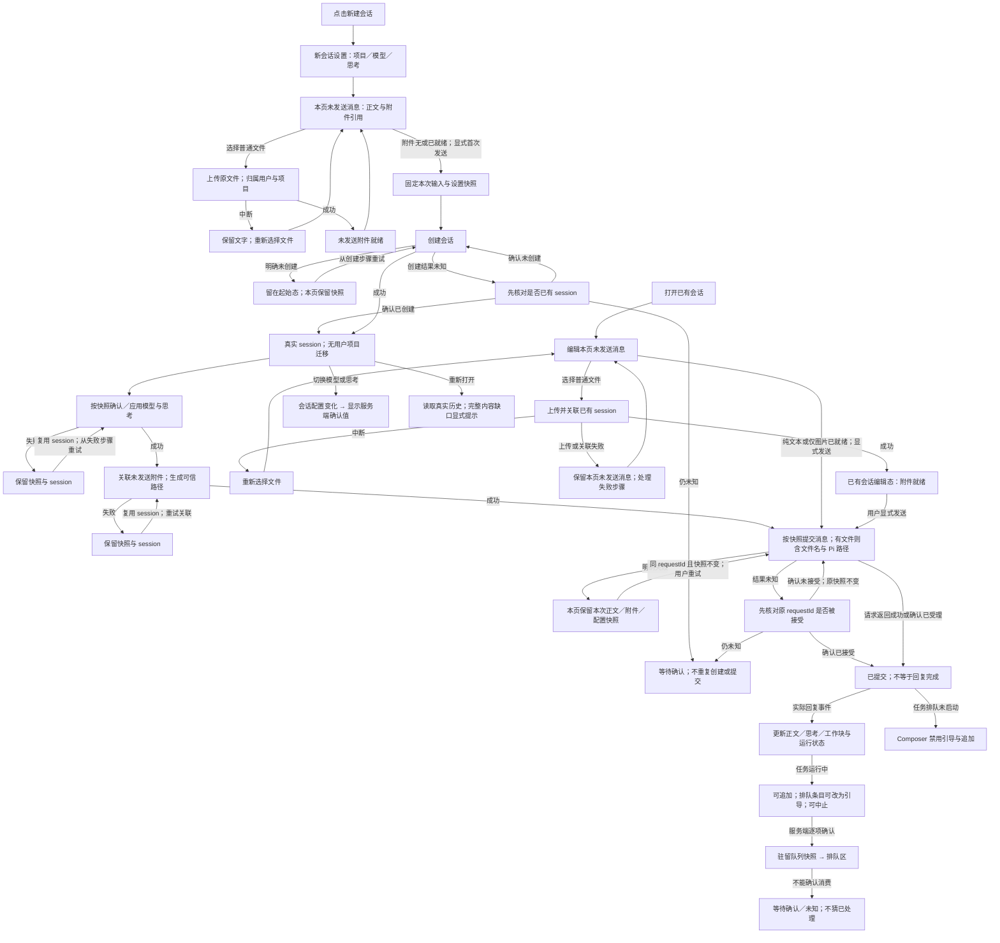

# 界面设计规范 · 稿纸

本文件定义 Web UI 的**目标设计**，并在每一节区分「目标」「已实现」和「待核验」。目标不等于现状：凡未在第 13 节记录为已实现并取得运行证据的条目，均为待实施。业务与数据契约（第 11–12、14–15 节）独立于视觉方案，改版不得削弱。

本版推翻此前的「两栏对话工作区 / 冷中性 + 单一蓝强调」方案。旧视觉参考图（`docs/design/*.png`）仅作历史记录，不再作为视觉或验收依据；其中的 280px 侧栏、26px Logo、14px 正文、卡片式工具块、全局禁用焦点样式等约束一并废除。

**视觉基准**：设计画布「Pi Web UI 视觉方向」中的 D 方向（「稿纸 × 运行态」，浅色与深色各一张）。画布为私有 Artifact，需所有者共享后方可查看；画布中的会话、路径、耗时与计数均为示意，不是产品数据或验收结果。

---

## 1. 方向与原则

**稿纸（Ledger）**：借鉴终端界面的克制与秩序，但服务于长时间阅读。界面像一本按时间记录的工作日志：左侧是时间与角色，右侧是内容；过程被收拢，结论被突出；正在发生的事情一眼可见。

原则：

1. **文字即界面**。层级由字号、字重、字体和留白建立；不靠卡片、阴影、圆角和装饰性图标。
2. **比例字体承载内容，等宽字体承载结构**。正文、标题、用户输入用比例字体；时间、标签、工具名、参数、路径、ID、计数、快捷键用等宽字体。
3. **结论优先，过程可展开**。一次回合里的工具调用收拢为「工作块」，默认只占一行；最终回复是视觉重心。
4. **一个强调色，只表示「正在发生」或「可操作的当前项」**。运行中、流式光标、当前选中、链接使用强调色；装饰、大面积底色不用。
5. **状态用符号加文字**。颜色只辅助，所有状态都有可读文字或可访问名称。
6. **键盘优先，鼠标完整可用**。常用操作有快捷键并直接标注在界面上；任何快捷键能做的事，都有可点击的等价入口。
7. **运行态全局可见**。任务是否在跑、跑了多久、卡在哪一步、排了什么，不需要打开面板就能看到。
8. **不虚构**。没有数据就不显示或显示空态；不造进度百分比、示例数据或连接状态。

明确不使用：消息气泡、头像、卡片堆叠、渐变、玻璃拟态、插画、大号营销标题、彩色左边框卡片、emoji 图标。

---

## 2. 设计令牌

令牌集中定义于 `web/src/styles/tokens.css`，组件只引用语义令牌，不写裸色值。明暗两套使用相同布局、相同层级。

### 2.1 色彩

| 令牌 | 浅色 | 深色 | 用途 |
|---|---|---|---|
| `--bg` | `#FAFAF8` | `#131416` | 页面底色（侧栏与主区同底，以分隔线区分） |
| `--card` | `#FFFFFF` | `#1A1B1E` | Composer 输入区、浮层 |
| `--hl` | `#EFEEE9` | `#1E1F23` | 选中行、行内代码底、悬停 |
| `--ink` | `#1B1B19` | `#E6E6E1` | 正文、标题、主按钮底 |
| `--body2` | `#55554F` | `#B4B4AE` | 工具摘要、次级正文 |
| `--dim` | `#686862` | `#92928B` | 时间栏、标签、元信息（≥ 4.5:1） |
| `--faint` | `#9A9A94` | `#6B6B66` | 步骤序号、占位文字、快捷键提示；不承载唯一含义 |
| `--line` | `#E4E3DE` | `#26272B` | 结构分隔线（实线） |
| `--dash` | `#D6D5CF` | `#34353A` | 工作块、排队区边界（虚线） |
| `--acc` | `#2547D0` | `#8AA4FF` | 运行中、流式光标、链接、当前可操作项 |
| `--acc-soft` | `#EEF1FC` | `#1B2238` | 运行中步骤行底、子代理实时面板底 |
| `--err` | `#B3261E` | `#F2827A` | 失败、错误、破坏性操作 |
| `--invert` | 同 `--bg` | 同 `--bg` | 主按钮文字 |

规则：

- 强调色与错误色只用于小面积：符号、短文字、单行底色、2px 进度条。
- 分隔线：实线表示结构边界（侧栏、题头、Composer 工具栏），虚线表示过程边界（工作块、排队区）。不使用全边框表格或网格交叉线。
- `--faint` 文字对比度低于 4.5:1，只能用于序号、占位和重复出现的提示，不能是唯一的信息来源。
- 实施时须以工具实测两套主题下全部「文字 / 底色」组合的对比度，未达标的值以实测为准调整，并回写本表。

### 2.2 字体

- 比例字体：`"IBM Plex Sans", "PingFang SC", "Hiragino Sans GB", "Microsoft YaHei", "Noto Sans CJK SC", sans-serif`
- 等宽字体：`"IBM Plex Mono", "SF Mono", Menlo, Consolas, "PingFang SC", monospace`
- **字体文件随 Web 构建自托管**（woff2，仅 400/500/600 三个字重，latin 子集），不从 Google Fonts 或其他外网加载：服务面向内网部署。中文始终由系统字体承担。字体加载使用 `font-display: swap`，加载失败时回退到系统栈，布局不得依赖字体度量。
- 字体许可（SIL OFL 1.1）随字体文件一起放入仓库。

### 2.3 字号与行高

| 令牌 | 值 | 字体 | 用途 |
|---|---|---|---|
| `--fs-tag` | 11px，字距 0.08em | 等宽 | 角色标签 `YOU / PI / SYS / 排队`、分组标题 |
| `--fs-meta` | 12px | 等宽 | 时间栏、题头元信息、Composer 工具栏、快捷键提示 |
| `--fs-step` | 13px | 等宽 | 工作块步骤行、代码块、工具参数与结果 |
| `--fs-ui` | 14px | 比例 | 侧栏会话标题、排队条目、次级说明 |
| `--fs-body` | 16px | 比例 | 用户与助手正文、输入框；移动端不缩小 |
| `--fs-h2` | 18px / 600 | 比例 | 回复内二级标题 |
| `--fs-title` | 20px / 600 | 比例 | 会话主标题、回复内一级标题 |

- 正文行高 1.75；步骤行固定 26px 行高；时间栏与标签 28px 行高，与正文首行基线对齐。
- 行内代码 0.875em 等宽，`--hl` 底，2px 内边距。
- 不使用 20px 以上的字号。

### 2.4 间距、形状与动效

- 间距基数 4px：`4 / 8 / 12 / 16 / 20 / 24 / 32 / 48`。账本条目之间 26px；条目内段落 12–14px。
- **圆角只给控件和浮层，版面结构保持直角**。圆角与字号一样是令牌，唯一定义在 `web/src/styles/tokens.css`；`styles.css` 只能写 `border-radius: 0` 或 `var(--radius-*)`，Tailwind 基础组件只用 `ui:rounded-sm / md / lg`（分别映射到 `--radius-item / control / float`），由 `web/src/shape.test.ts` 守护。

  | 令牌 | 值 | 用途 |
  |---|---|---|
  | `--radius-item` | 3px | 浮层内的选项行、计数与标签徽标、步骤编号、Markdown 高亮 |
  | `--radius-control` | 4px | 按钮、输入框与搜索框、Composer、附件 chip、排队条目、「回到最新」 |
  | `--radius-code` | 4px | 代码块、diff、系统提示词、图片预览、行内代码 |
  | `--radius-float` | 6px | 下拉列表、菜单、tooltip、popover、命令面板、Modal、minimap 预览 |
  | `--radius-pill` | 999px | 状态圆点、滚动条滑块、2px 细条（拖拽手柄、minimap 刻度） |

  保持直角：侧栏、轨迹栏、Inspector 等整块面板；带左侧竖线标记的元素（子代理通知、状态带、选中会话的焦点标记）；需要逐行连成整块的底色（diff 增删色带、步骤与子代理列表行、工作块运行行）；下划线式 Tab 与命令面板顶部的通栏输入框。
- 不使用阴影；浮层（菜单、命令面板、Modal）以 `--card` 底 + 1px `--line` 边框与页面区分。
- 动效只表达状态变化：
  - 展开 / 收起：120–160ms，高度与透明度。
  - 运行中呼吸：透明度 1 ↔ 0.35，周期 1.6s，用于运行符号与状态点。
  - 流式光标：7×14px `--acc` 方块，1.06s 步进闪烁。
  - 不确定进度：2px 轨道上的扫光，周期 1.8s，**永不表示百分比**。
- 「减少动态效果」开启时：所有循环动画停止，保留静态符号与文字；展开 / 收起无过渡。

### 2.5 宽度与断点

| 令牌 | 值 |
|---|---|
| `--sidebar-width` | 默认 272px，可拖拽 200–360px，宽度按用户偏好保存 |
| `--ledger-gutter` | 时间栏 76px + 标签栏 44px，栏间距 20px |
| `--ledger-max` | 960px（含时间栏与标签栏） |
| `--prose-max` | 720px（最终回复正文的最大行宽） |
| `--inspector-width` | 380px |
| 断点 | `640px`（窄屏）、`905px`（侧栏改为覆盖抽屉）、`1180px`（侧栏停靠） |
| 高度阈值 | `480px`（矮视口紧凑模式）、`360px`（极矮视口） |

---

## 3. 布局

### 3.1 结构

```
┌───────────┬──────────────────────────────────────────────┬──────────────┐
│ 侧栏       │ 题头：项目路径 / 会话标题           运行状态 · 轨迹 │ Inspector    │
│ 品牌 · 新建 ├──────────────────────────────────────────────┤ （按需，380px）│
│ 项目       │ 时间栏 │ 标签 │ 内容                             │              │
│ 会话分组    │ 15:13 │ YOU  │ 用户消息                          │              │
│           │ 15:13 │ PI   │ 正文 · 工作块 · 正文                │              │
│           │       │ 排队  │ 驻留队列条目                       │              │
│ 快捷键提示  │       │ YOU  │ Composer                         │              │
│           │       │      │ 统计栏                            │              │
└───────────┴──────────────────────────────────────────────┴──────────────┘
```

- **侧栏**：见第 7 节。
- **题头**：左侧两行，上行为项目 cwd（等宽 12px），下行为会话标题（20px，单行，超出省略，完整标题在 title 中）；右侧依次为运行状态（第 5.2 节）、`轨迹 ⌘I` 文字按钮。题头与账本同列：标题左缘对齐时间栏，右侧操作右缘对齐 Composer 右缘（侧栏为抽屉时左侧为导航按钮让位）。题头下沿 1px `--line`。不显示连接状态。
- **账本流**：三列网格（时间栏 / 标签 / 内容），最大宽度 `--ledger-max`。**内容列在主区（打开 Inspector 时为剩余空间）居中**，时间栏与标签挂在其左侧边距中，像书页旁注；题头、排队区、Composer、统计栏与内容列同列。主区放不下居中所需宽度时退回左对齐（不出现横向滚动）。滚动区只包含账本流本身；minimap 贴主区右缘。
- **长列表**：账本条目与 Inspector 步骤行使用 `content-visibility: auto` 与 `contain-intrinsic-size: auto <估计高度>`（条目 160px、步骤 72px），屏幕外条目跳过样式、布局与绘制；DOM 保持完整，页内查找、轨迹定位、锚点与滚动跟随不受影响；渲染过的条目记住真实高度。不做虚拟列表：条目高度差异大、可展开折叠，且多项功能依赖完整 DOM。实测（生产构建，1564 步骤会话）：打开「步骤」标签 339→220ms，其中布局 128→6ms；屏幕外条目的布局分摊到滚动时，单帧不超过 16.8ms。定位（minimap、轨迹跳转）期间整列临时全部渲染（`ledger-navigating` / `steps-navigating`），平滑滚动按真实位置瞄准，滚动结束后恢复跳过；其间「跟随到底部」不得被导航的起始帧或列表尺寸变化重新开启。
- **排队区与 Composer**：固定在主区底部，沿用同一三列网格，标签栏分别显示 `排队` 与 `YOU`。高度随内容变化时同步缩小滚动区，不覆盖账本流。
- **统计**：摘要显示在 Composer 下方的统计栏，三组依次为做了多少（`2 次任务 · 3 次调用 · 工具 1 次`）、花了多少（`会话 1.3万 tok · 缓存 67% · $0.004`）、上下文（`4400 / 100万`，≥80% 警示）；运行中前两组改为本次任务（`本次 第 4 次调用 · 工具 6 次 · ~124 tok/s`、`本次 5200 tok`）。点击打开统计详情 Modal（居中，不随底部各行对齐），按口径分组为两列定义列表，口径说明收进 ⓘ。细则见统计契约「Web 统计栏与详情」。题头不显示统计。统计口径沿用 [统计契约](docs/usage-measurement.md)：只格式化后端值，不自行加总 token、不估算速度；null / 缺失省略，真实 0 保留；费用始终标注为估算。
- **Inspector**：按需打开的右侧第三栏，挤压主区，不加遮罩，见第 8 节。

### 3.2 响应式

- **≥1180px**：侧栏停靠；账本流三列。
- **905–1180px**：侧栏变为覆盖抽屉（`⌘B` 或题头导航按钮打开），初始收起，打开时保留列表滚动位置。
- **640–905px**：仅主区；Inspector 打开时占满主区宽度，隐藏但不卸载账本流，关闭后恢复滚动位置与草稿。
- **<640px（手机，约 390px）**：时间栏隐藏，标签与时间合并为内容上方一行（`PI · 15:13:44`）；工作块步骤行隐藏耗时列，摘要单行省略；触控目标 ≥ 44×44px；Composer 工具栏允许换行，完整模型 ID 不截断。
- **视口高度 <480px**：题头合并为单行（仅标题与运行状态）；Composer 输入起始单行，附件区与输入区各自内部滚动；保证最后一条内容与输入行同时可见。
- **视口高度 <360px**：隐藏题头统计，仅保留标题、运行状态、输入行与主按钮。
- 页面在 200% 缩放下不丢内容、不出现整页横向滚动；超宽内容（代码、长路径）在各自容器内横向滚动。

---

## 4. 账本流

### 4.1 条目结构

每个条目占一行网格：

| 列 | 内容 |
|---|---|
| 时间栏 | `HH:MM:SS`，等宽 12px `--dim`，右对齐；悬停 / 长按显示完整日期时间。历史条目使用导出记录的时间；实时条目（SSE 不带时间）使用本页首次观察到它的时间，刷新后以记录时间为准；历史加载完成时已存在且无记录时间的条目留空，不推算 |
| 标签栏 | `YOU`（用户）、`PI`（助手，`--acc`）、`SYS`（系统事件），等宽 11px |
| 内容 | 见下文 |

同一回合内助手的多段输出（文字、工作块、文字）属于同一个 `PI` 条目，不重复打时间和标签；只有新的回合或新的角色才开启新条目。

### 4.2 用户消息

- 16px / 500 字重，比例字体，无气泡、无底色、无头像。保留原文换行。
- 附件 chip 显示在正文下方（第 6.4 节）。
- 被提升为引导（steer）并已确认送达的消息，在标签栏显示 `YOU ↑`，并在时间栏 title 中注明「引导」。

### 4.3 助手正文

- 16px / 1.75，正文最大宽度 `--prose-max`。
- Markdown：一级标题 20px、二级 18px、三级 16px / 600；段落间距 12px；列表缩进 1.25em；引用以 `--dim` 文字和 `│ ` 前缀呈现，不加色块；表格只有行间分隔线。
- 键值型内容（如运行记录）建议渲染为两列定义列表：左列等宽 12px `--dim`，右列正文。
- 代码块：等宽 13px，`--hl` 底，`--radius-code` 圆角，右上角复制按钮（可访问名称「复制代码」）；长行在块内横向滚动。
- 流式输出：末尾显示流式光标；完成后移除。不显示「正在输入」等装饰。
- 中止后保留已输出的部分，并在末尾追加 `--dim` 文字「已中止」。只有导出中存在明确的 `stopReason: "aborted"` 时，历史恢复才显示该标记。

### 4.4 思考

- 思考与其他内容保持真实先后顺序，不聚合、不重排、不改原文。
- 在工作块外：显示为一行 `--dim` 等宽文字 `思考 · 12s`（时长仅在有真实数据时显示）+ 前 60 字预览，流式中也默认折叠，点击展开原文（14px 比例字体 `--body2`）。
- 在工作块内：作为一种步骤行出现（第 4.5 节），不计入步骤数。
- `text.trim()` 为空时不渲染；同一 id 的手动开合状态在流式更新中保留。预览先归一化空白再截取，展开显示完整原文；reducer、导出、原始历史不过滤数据。

### 4.5 工作块

**定义**：一个 `PI` 条目内，两段助手正文之间连续出现的工具调用（及夹在其中的思考）组成一个工作块。工作块只影响可见性，**绝不重排、合并或按类型分组**；块内步骤严格按真实时间线顺序排列。

**块头**（一行，等宽 13px）：

```
− 12 步  ▮▮▮▮▮▮▮▮▮▮▮▮  5m18s · 1 失败 · 进行中
```

- 开合符号：`−` 已展开，`+` 已收起。
- 步数：只计工具调用。
- **步骤色条**：每个工具调用一格（6×14px），按顺序排列。成功为 `--ink`，失败为 `--err`，运行中的格宽 30px、`--acc` 描边并呼吸，无填充比例。超过 48 步时，前 47 格逐步显示，最后一格显示 `+N`。色条为装饰（`aria-hidden`），同样的信息以文字给出。
- 汇总：总耗时（仅当首末步都有真实时间时显示）、失败数（为 0 时不显示）、运行中显示 `进行中`（`--acc`）。

**步骤行**（展开时，上下各一条 `--dash` 虚线，行高 26px，五列）：

| 序号 | 状态 | 工具名 | 摘要 | 耗时 |
|---|---|---|---|---|
| `01`，`--faint` | `✓` / `✗`（`--err`）/ `◐`（`--acc`，呼吸） | 原始工具名，不翻译；列宽取本工作块最长工具名（等宽，按字符计，上限 28 字符，超出换行显示完整），并容纳「正在思考」 | `--body2`，单行，空间不足时由 CSS 省略 | 有 `durationMs` 时显示，右对齐 |

- 运行中的步骤行使用 `--acc-soft` 底。
- 点击步骤行展开该步骤的完整参数与结果（规则见第 4.6 节），再次点击收起。
- 思考步骤行：序号列留空，状态列 `·`，工具名列 `思考`，摘要为前 60 字预览。

**生命周期与开合**：

- 工作块中有任一步骤运行时，块自动展开；块内全部步骤结束且其后出现助手正文或回合结束时，块自动收起为一行。
- 单个步骤：`tool_start`（done=false）时步骤行展开显示实时 partialResult；`tool_end`（done=true，含 isError）时自动收起；历史恢复的已完成步骤初始收起。
- 用户手动开合工作块或步骤后，后续 partial / done 更新不覆盖该选择。
- 状态只依据工具协议的 `done` / `isError`，不新增 pending 状态；工具调用完成不等于后台子任务完成，等待超时或子任务失败不改写成工具失败。

### 4.6 步骤详情（工具参数与结果）

以下规则沿用并适配原工具展示契约：

- **摘要**：bash 显示 command 与最新输出的末尾非空行；read / write / edit 显示路径（edit 附修改批次数）；subagent 显示每个代理名与任务；subagent_wait 显示目标 runIds 或「全部待收集」及最新真实等待文本；status / logs / steer / stop 只显示目标参数与真实返回快照。未知工具安全回退为文本。摘要随最新快照刷新，不累加重复输出；最终结果优先于 partial（包括 0、false、空字符串）；`title` 保留完整归一化摘要。
- **展开内容**：参数在上、结果在下，以语义区域和 `aria-label` 区分，不显示「参数」「结果」可见标题。参数采用紧凑键值：短键值同行并按宽度换行；简单数组用完整紧凑 JSON；长提示词用自然宽正文；undefined、null、空对象、空数组不渲染，false 和 0 照常显示。协议原值不改写。
- **subagent**：仅当 `args.tasks` 为非空数组且每项都有字符串 `agent` 与 `task` 时按任务识别；多项时在工具名旁显示 `并行 N`。展开按原顺序列出每个代理的完整 task、cwd 等字段；非法结构安全回退。
- **write**：顶层 content 以代码块展示，按同级 language 或路径扩展名高亮，未知语言用 plain，不当作 Markdown 渲染。
- **edit**：直接按原顺序展示 diff，保留 `+/-`、无末尾换行标记；超大输入不伪造 diff，提供 Modal 查看与复制完整 oldText / newText。edit / write 已完成且为已知标准成功回执时，隐藏重复的结果回声；失败、警告、未知结构与运行中 partial 照常显示。
- **结果正文**：明确语言的代码高亮；日志用 `pre` 保留空白；subagent / subagent_wait 的文本结果默认按安全 Markdown 渲染并可切换原文；其他文本按保守信号（独立标题加列表或行内代码）自动选择，并提供原文 / Markdown 切换。不启用原始 HTML。
- 运行中随真实 partialResult 快照替换正文，不追加、不模拟打字；没有中间事件的工具不伪造流式输出。
- 耗时、diff 计数、测试结论只在协议或结果真实提供时显示。
- 所有工具数据按文本安全渲染；不提供工具级原始数据面板（原始事件见 Inspector 事件流）。

**实现边界**（沿用）：`web/src/tools/contract.ts` 定义结构化 header 与参数 / 结果 slot；`tools/metadata.ts` 按工具名注册摘要，`tools/presentation.ts` 注册 renderer；通用容器不识别具体工具的参数结构；adapter 不发网络请求、不推断子任务状态、不改写输入；未注册工具以通用字段 / 数组 / 文本展示。

### 4.7 子代理实时面板

子代理 run 记录不包含发起它的工具调用 ID，界面**不从结果文本解析 runId 来猜测关联**。因此面板是会话级的：主请求运行期间，若当前会话存在运行中的子代理，面板显示在进行中的 `PI` 条目末尾（即当前工作块之后），`--acc-soft` 底：

- 每个运行中的 run（最多 3 个）一组：`◐ worker #1  任务摘要  01:48`。计时为当前时间减去 `run.startedAt`，`startedAt` 来自服务端记录。
- 不确定进度条（2px 扫光），不显示百分比。
- 最近 3 条子代理工具步骤：`工具名  摘要`，来自 agent-team 持久化 transcript 的会话时间线；最新一条未完成时末尾显示流式光标。
- 工具步骤下方一行子代理最新的助手文本：取最新一条助手正文的最后一个非空行，单行省略（完整行在 title 中），比例字体 14px `--body2`；正在流式输出时为 `--ink` 并在末尾显示流式光标。子代理还没有助手文本时不显示这一行。
- `打开子代理会话 ↗`：在主区打开该 run 的只读会话。

**子代理列表与只读会话**：Inspector「子代理」列表每行为 `状态符号  代理名 #run  ……  耗时`，状态符号固定在行首一列（与步骤行同一套：`✓` / `✗` / `◐` / `⊘` 已停止 / `·` 状态未知），耗时为等宽紧凑写法（`10s`、`2m16s`）右对齐，第二行为任务摘要。只读会话顶部信息条只显示状态、代理名、模型与耗时，**不重复任务文字**（任务即会话第一条）；主代理发出的条目标签为 `主代理`，时间栏在时间下附注其类型（`初始任务` / `引导`，与控制队列的「引导」同义），尚未送达的输入以同样的行显示送达状态（`等待送达` / `送达未确认` / `发送失败`）。子代理会话各行的时间取自子代理记录中每条消息的时间戳；类型由服务端的结构化字段 `hostInput` 给出，界面不解析展示文字。
- 面板只在主请求运行期间显示；读取失败保留上一次真实快照，不补造内容。run 结束后从面板消失，完整记录在 Inspector「子代理」标签与只读会话中查看。
- **子代理数据只有一个来源**（`useSubagents`），**由服务端推送驱动、不定时轮询**：Inspector 列表、只读会话与本面板共用每次列表读取；每个 run 的详情只在其 revision / streamRevision / 状态变化时读取一次，三处共用（缓存跨信号保留，切换会话时清空）。打开会话、切到「子代理」标签、选中 run、页面回到前台时各读取一次；之后每收到 SSE `subagents_changed` 读取一次。服务端在 agent-team 记录（启动 / 消息落盘 / 引导 / 结束）、实时输出或旧版收集结果变化时发送该信号，按 250ms 合并且必发最后一次，主请求已结束、子代理仍在后台运行时同样发送。读取失败 1 秒后重试；兜底：仍有运行中的子代理且 15 秒未收到信号时补读一次（覆盖不发记录事件的旧版扩展）。面板计时在本地每秒刷新，不依赖读取。
- 数据来源与边界见 [子代理会话与扩展接入](docs/subagent-conversations.md)。

### 4.8 系统事件与错误

- 上下文压缩等可投影的系统事件，以 `SYS` 条目呈现为一行 `--dim` 文字（如「上下文已压缩」及真实前后数值），不伪装成助手消息。
- 错误与未知载荷**不进入账本流**：在 Composer 上方显示独立状态行（`--err` 文字 + `!` 前缀），可展开详情、复制、关闭。
- 一次性提示（成功 / 注意）使用同一位置，`--dim` 文字，数秒后淡出；减少动态效果时常驻并可手动关闭。

### 4.9 长对话

- 虚拟化不改变顺序，不破坏滚动位置恢复；向上加载更早内容时，顶部显示一行 `--dim` 文字「加载更早内容…」。
- 历史缺口（思考、附件等不完整）以 `SYS` 条目显式说明，不用占位内容填补。
- 用户手动上滚后，新内容不抢夺滚动位置；账本流底部显示 `↓ 新内容` 文字按钮，点击或按 `End` 回到底部并恢复跟随。

---

## 5. 运行态

### 5.1 状态词与符号

统一状态词：**排队中 / 进行中 / 已完成 / 已中止 / 失败 / 未设置**。符号只与文字或可访问名称配合使用：

| 符号 | 含义 | 颜色 |
|---|---|---|
| `▶`（呼吸） | 会话进行中 | `--acc` |
| `◐`（呼吸） | 步骤进行中 | `--acc` |
| `●` | 会话有未查看的新回复 | `--acc` |
| `·` | 空闲 | `--dim` |
| `✓` | 步骤成功 | `--ink` |
| `✗` / `!` | 步骤失败 / 会话最近一次失败 | `--err` |
| `⊘` | 已中止 | `--dim` |

### 5.2 全局可见

- **题头**：显示「图标 + 状态词 + 时间」。图标是一组 16px 线性符号：同一个圆环，环内画出状态，颜色经 `currentColor` 取自令牌；状态词保持 `--body2` / `--dim`，只有失败与待确认中止着色。

  | 图标 | 显示 | 颜色 |
  |---|---|---|
  | 虚线圆环 | `等待运行确认` | `--dim` |
  | 圆环 + 指针 | `排队中` | `--dim` |
  | 圆环 + 实心圆点（呼吸） | `运行中 02:14` | `--acc`，计时 `--ink` |
  | 圆环 + 对勾 | `已完成 5m18s` | `--ink` |
  | 圆环 + 实心方块 | `已中止 12s` | `--dim` |
  | 圆环 + 叉 | `失败 8s` | `--err` |
  | 圆环 + 实心方块 | `再按 Esc 中止`（1.5 秒确认窗口，覆盖当前状态） | `--warn` |

  SSE 事件不带服务端时间，计时只在本页观察到请求从提交 / 排队进入运行时开始；中途打开一个已在运行的会话时只显示 `运行中`，不显示计时。结束状态停留约 4 秒后消失，空闲时题头不显示运行状态；统计只在 Composer 下方的统计栏。
- **侧栏**：当前会话行左侧符号与右侧计时同步。**其他会话的运行 / 新回复状态需要服务端在会话列表中提供运行状态字段**；接口提供前，侧栏只对当前会话显示运行态，不推测其他会话。
- **浏览器标签页标题**：进行中时前缀 `▶ `，便于在其他标签页感知。

### 5.3 等待首字

助手首字到达前，`PI` 条目内容区显示一行等宽文字（28px 行高，与时间栏同一节奏），末尾是回复将要使用的流式光标。最后一个条目已是 `PI`（例如工作块正在进行）时并入该条目；否则在回复将出现的位置新开一个 `PI` 条目，首字到达时回复从同一行开始，不跳位。

这一行只说屏幕上别处没说的事：

- **等待运行确认**：只显示光标。题头已显示 `等待运行确认`，不重复。
- **工具执行中 / 思考中**：不显示。工作块里呼吸的 `◐` 步骤行与「思考中」行已说明 PI 在做什么。
- **其余等待**：`等待模型回复` + 光标（`--dim`）。
- **事件流断开后重连中**：`连接中断，正在恢复…`（`--warn`，无光标）。只有已建立的事件流断开（或连接失败后正在重试）才算；新会话首个请求创建运行时期间的「正在连接」不是断开，不提示。

不显示泛化的「正在输入」。

### 5.4 中止（连按两次 Esc）

- **停止按钮**：主请求进行中时，Composer 主按钮原位切换为 `■ 中止`（可访问名称「中止当前任务」），单击立即中止。按钮是有意操作，不需要二次确认。
- **键盘**：
  1. 第一次按 Esc（没有可见浮层、不在输入法组字中、非按键重复）进入「待确认」状态：题头运行状态处显示 `再按 Esc 中止`（`--err` 文字），Composer 提示行同步显示。
  2. 1500ms 内再次按 Esc 执行中止；超时、按其他键、窗口失去焦点均取消待确认状态，恢复原显示。
  3. 有可见浮层（菜单、命令面板、Modal、Inspector 抽屉、移动侧栏）时，Esc 先关闭浮层，不计入中止序列。
- 中止后：题头显示 `已中止`，部分输出保留并标注「已中止」（第 4.3 节），运行中的步骤状态以服务端返回为准。
- 程序 API / hooks 的 abort 能力不变。
- **状态**：现有实现为单次 Esc 中止，改为连按两次属于第 13 节 P3 的实施内容。

### 5.5 排队区

- 位置：Composer 正上方，同一三列网格，标签栏显示 `排队`；条目之间与下沿使用 `--dash` 虚线。
- 条目：`01  完成后把报告摘要发我      ↑ 改为引导  删除`。序号等宽 `--faint`，正文比例 14px 单行省略（title 显示全文），操作为文字按钮。
- **只显示服务端权威的驻留队列快照**；本地提交中的控制请求显示为 Composer 上方的提示行（`追加提交中…` / `等待确认` / `结果未知`），不冒充队列条目。
- 「改为引导」将追加（follow-up）提升为引导（steer），保留控制身份与图片；已出队的条目返回冲突后刷新快照，不复活。
- 排队区内部可独立滚动，最多显示 4 行高度，不挤掉输入区。

### 5.6 完成与回到空闲

- 回合结束：工作块自动收起；题头短暂显示结果；侧栏符号回到 `·`。
- 如果用户此时不在该会话，侧栏该行显示 `●` 新回复，直到打开查看（依赖第 5.2 节的服务端字段）。
- Composer 主按钮恢复为发送；输入区高度不变，避免结束瞬间阅读视口跳动。

---

## 6. Composer

### 6.1 结构

- 1px `--ink` 边框、`--radius-control` 圆角、`--card` 底；上部为输入区，下部为工具栏（1px `--line` 分隔）。
- 工具栏（等宽 12px `--dim`）：左侧 `+ 附件`；右侧依次为快捷键提示、完整模型 ID、思考档位原值、主按钮。
- 新会话时，项目只由侧栏决定，Composer 内不出现项目字段。

### 6.2 状态

| 状态 | 占位文字 | 主按钮 | Enter | 提示 |
|---|---|---|---|---|
| 空闲 / 新会话 | 描述任务，或 / 调出命令 | `发送 ⏎`（`--ink` 底） | 发送 primary | `⇧⏎ 换行` |
| 进行中 | 追加指令，当前任务结束后执行 | `■ 中止` | 提交 follow-up 进入队列 | `⏎ 追加 · Esc Esc 中止` |
| 主请求排队中 / 提交中 | 不变 | 禁用 | 不提交 | `等待运行确认` |
| 只读 / 历史加载中 | 不变 | 禁用 | 不提交 | 原因文字 |

- 运行中与空闲时 Composer 高度一致，状态切换不引起布局跳动。
- 输入法组字期间 Enter 不提交；同一次提交进行中不重复提交。

### 6.3 输入区

- 自动增高：桌面最小 1 行，最大 220px 且不超过 40dvh，超出后内部滚动；矮视口（≤480px）最大 32px（≤360px 为 60px）。
- 提交后输入区立即显示为空：提交进行中（新建会话 / 配置 / 发送）时，已提交的正文与附件不在输入区显示，期间可继续输入新内容；服务端确认受理后才真正清除。
- 提交失败时保留**本次提交快照**，输入区上方显示一行「本次提交内容已保留 · 重试」，与当前继续编辑的内容视觉上可区分（第 11 节）。失败或结果未知时，若输入区未改动，已提交的正文与附件重新显示。
- 不显示字符计数。

### 6.3.1 补全菜单（`@` 文件与 `/` 命令）

与 Pi 编辑器一致。已有会话读该会话冻结的项目目录；新会话草稿（尚未发出第一条消息）读所选项目的当前目录，`/` 菜单只列模板与 skill，手动输入 `/compact`、`/reload` 会保留输入并提示需先发送第一条消息：

- **`@` 文件**：光标前的记号以 `@` 开头（行首或空白之后）时，在 Composer 正上方弹出项目路径建议，最多 20 条，按名称完全匹配 → 名称前缀 → 名称包含 → 路径包含 → 模糊匹配排序，目录同分优先；空查询列出项目根目录。每行为图标、名称（等宽）与所在目录（`--dim`）。选中文件插入 `@相对路径 `；选中目录插入 `@目录/` 并保持菜单打开以继续选择子项；含空白的路径写成 `@"路径"`。只插入路径文本，由模型自行读取，不上传文件内容。
- **`/` 命令**：消息以 `/` 开头且还没输入空格时弹出命令列表：内置 `compact`、`reload`，以及提示词模板与 `skill:名字`（右侧以 `--dim` 标注「模板」/「skill」）。前缀匹配排在包含匹配之前。选中后补全为 `/名字 `，回车才执行或发送。
- **键盘**：`↑` / `↓` 移动，`Enter` / `Tab` 选中，`Esc` 关闭菜单（不计入连按两次 Esc 中止）；菜单关闭后 `Enter` 恢复为发送。鼠标点击选中且不夺走输入框焦点。输入框以 `aria-activedescendant` 指向当前项。
- **执行**：`/compact [总结要求]` 与 `/reload` 由服务端执行，不作为消息发送；只能在会话空闲时执行，运行中提交会保留输入并提示原因；开始执行即清空输入框，失败时若尚未输入新内容则把命令放回输入框以便重试。压缩过程沿用压缩状态行（第 4.8 节），可用中止按钮或连按两次 Esc 取消；完成后统计栏的上下文显示为 `? / 窗口`（与 Pi 一致，悬停说明要等下一次模型回复），刷新页面不再重放已结束的压缩状态（自动压缩同样如此，所属任务结束后即不再恢复）；`/reload` 完成后在 Composer 上方显示一次性提示「已重新加载：上下文文件 N · 模板 N · skills N · 扩展 N」（`--dim`，约 6 秒后消失）。模板与 skill 命令作为普通消息发送，由 Pi 展开。

### 6.4 附件

- 附件 chip 位于输入区上方，横向滚动：`文件名 · 大小 · 状态`，等宽 12px，1px `--line` 边框、`--radius-control` 圆角；图片 chip 为缩略图加状态，点击预览。
- 未就绪的 chip 显示原因文字，不显示假成功；只有未发送附件提供移除按钮，移除只解除引用。
- 运行中的追加支持文字与图片，普通文件附件被明确阻止并保留在草稿中。

### 6.5 模型与思考

- 模型触发器始终显示**完整 model ID**，不中段省略；空间不足时换行，工具栏随之增高。
- 思考档位显示原值；列表按 `off → minimal → low → medium → high → xhigh → max` 排序并去重，未知档位排在末尾。
- 选择面板打开时，当前项滚动到可见区，保留搜索焦点。

### 6.6 数字人

一只原创的线描小猫（默认名「小派」），按吉祥物的思路设计：整只猫是一条连续的「麻薯」轮廓，头大身短、没有脖子，顶上两只圆角耳朵，坐姿，前面露出两只小爪，身后一条卷尾巴。眼睛低而分得开，脸上只有眼睛、小鼻子、「ω」嘴和两组三道短斜线的腮红，不画胡须和条纹，小尺寸下依然清楚。它与稿纸同一套线条语言：单一线宽、只用 `currentColor`，只有眼睛、鼻子和张开的嘴填充。浅色主题下眼睛带透出页面底色的高光（`--companion-shine`）；深色主题下眼睛是浅色实心点，不加高光，以免看起来像瞳孔。两耳之间的嫩芽是它的「灵魂」：空闲时摆动，PI 工作时变为 `--acc` 并脉动，失败时垂下。

- **起始态**：在对话区垂直居中，水平方向与下方 Composer 同一条中轴（同在账本内容列上）：约 128px 的角色在上，它说的话在下，居中排列。第一行是问候，第二行是起步建议，优先由模型生成（见下方「开场白」）；本地句子的问候按时段（凌晨、早上、中午、下午、晚上、深夜）和项目名，第二行从三类里随机挑一条：接着上次的会话（标题与多久之前）、本项目有多少模板与 skill、提示可以用 `@` 引用文件。下方最多 3 个快捷入口，只来自项目里真实存在的模板与 skill，排成等宽的网格（宽度够时两列，换行的入口与第一列左对齐），点击填入 `/名字 ` 并聚焦输入框，仍需回车。下方不再附加说明文字。
- **会话中**：约 44px（线条略粗，小尺寸下不发虚），坐在 Composer 上沿靠右的位置，底边压在输入框的边框线上，随输入框一起移动；控制队列出现时，队列下方会留出它的位置，不遮挡队列按钮。只做表情、不说话；悬停时显示一句当前状态的话。点击收起成一个小圆点，再次点击叫回。
- **表情**，按优先级从高到低：
  1. 任务刚结束：完成时开心，中止或失败时沮丧。终态停留约 4 秒，与运行态一致。
  2. 补全菜单打开时好奇。
  3. 正在打字（停顿 1.5 秒内）时倾听。
  4. PI 运行中时干活（眼睛左右扫，身体轻轻起伏，两只前爪交替踩动）；等待运行确认或排队时思考（眼睛上看，三个点闪烁）。
  5. 输入框获得焦点时倾听（眼睛向下看输入框）。
  6. 5 分钟没有任何活动时打瞌睡。
  7. 其他情况为空闲：呼吸、随机眨眼。

  尾巴平时慢慢摇，干活时摇得快一些，开心时飞快地摇，沮丧时垂下。开心时眯眼张嘴、从两侧举起小爪挥动并蹦跳，周围闪出 `--acc` 星光；沮丧时眉毛内侧上扬、身体微缩；倾听和好奇时歪头，好奇时嫩芽弹一下。
- **灵动**：
  - 空闲和好奇时，眼睛和脸会转向鼠标所在的方向，离得越远转得越多，到约两个身宽外不再增加。
  - 空闲时每隔 3.5–8 秒随机做一个小动作：举爪挥手、蹦一下、歪头、左右偷看、踩踩爪、扭一扭、嫩芽弹一下，不会连续重复同一个。
  - 鼠标悬停时挥手打招呼；点击时被戳得一缩一弹；呼吸是轻微的挤压与拉伸。

  每次发送时点一下头。它只接收 Composer 报告的活动类型，从不读取输入的文字。
- **人设**：点击起始态的角色可以改名（最多 12 个字），并在「简洁 / 活泼 / 正式」三种说话风格间切换；风格改变问候与状态话的语气，不改变内容。名字、风格与是否收起由服务端按调用者保存（`GET` / `PUT /v1/companion/persona`，表 `companion_personas`），换浏览器或设备也会跟着走；本浏览器的 localStorage 留一份副本，打开页面时先用副本显示，服务端的值到达后再替换（若此时已在本页改过则保留本页的修改）。服务端还没有记录而本浏览器有旧设置时，自动上传一次。保存按修改顺序依次发出，最后一次生效；保存失败、服务端未配置存储或角色无权新建会话时，只保存在本浏览器。
- **动效**：全部用 CSS 实现。在「减少动态效果」设置下全部停止，视线跟随和随机小动作也关闭，只保留静态表情。
- **开场白**：起始态先向服务端要一句由默认模型写的开场白（`POST /v1/projects/:id/companion/greeting`）。模型只看到调用者本来就能看到的信息：项目名、模板与 skill 的名字和说明、时段、调用者在该项目里最近的会话标题与时间，以及名字和说话风格。等待期间角色处于思考表情，问候的位置显示三个跳动的点；5 秒内没拿到、模型出错、未配置默认模型或设置了 `PI_COMPANION_GREETING=off` 时改用本地词库的句子，迟到的回复直接丢弃，文字不会在阅读中途变化。服务端按调用者和情境缓存约 30 分钟，同一时刻的相同请求只调用一次模型。
- 名字与风格仍保存在本浏览器；服务端保存偏好留待后续。

---

## 7. 侧栏

- **品牌行**：`pi/agent`（等宽 14px / 600，斜杠为 `--acc`），右侧 `+ 新建  N` 文字按钮。新建只进入起始态，首次显式发送才创建会话。
- **项目切换**：一个带边框的等宽触发器 `默认项目  ⌘P`，打开项目面板：可搜索的项目列表（当前项带 `✓`）+ 底部常驻 `+ 新建项目`。项目来源仅为有可访问会话的项目和本页刚创建的空项目。**Web UI 不提供项目删除入口**（后端 API、路由、RBAC 与客户端 SDK 保留 `deleteProject`）。
- **会话搜索**：`/` 聚焦列表顶部的搜索输入（也可点击「搜索」）；纯文本安全高亮；Esc 清空并退出搜索；切换项目重置搜索。
- **日期分组**：`今天 / 昨天 / 本周 / 更早`，等宽 11px 标签；基于真实更新时间，缺失时间的会话归入「更早」，不编造相对日期。
- **会话行**（14px，单行）：左侧状态符号、标题（省略）、右侧时间或状态（`02:14`、`新回复`、`15:19`、`周四`）。选中行 `--hl` 全宽底，不加彩色竖线。
  - 标题优先级：用户改名 → 最新原生名称 → 首条 prompt 摘要。
  - 行操作（改名 / 导出 / 删除）：`⋯` 按钮**与相对时间共用行尾位置**，不单独占列：平时显示时间，悬停、键盘聚焦、当前会话或菜单打开时原位换成 `⋯`；触屏（无悬停）时 `⋯` 常显（44px）。右键同样打开该菜单。共享 / 原生共享图标跟在标题之后，时间列始终右对齐。会话详情（创建时间、更新时间、可见性）放在菜单头部，**点击会话行不弹出详情浮层**。
  - 原生共享会话与私有会话的行为、权限与操作隔离保持不变。
- **底部**：一行等宽 11px 提示 `⌘K 命令 · j/k 切换 · ? 快捷键`，以及 `主题：跟随系统` 文字按钮（点击循环切换浅色 / 深色 / 跟随系统，命令面板中也可切换）。
- **主题持久化**（沿用）：模式以 `pi.theme-mode.v1:<origin>` 存入 localStorage，刷新恢复；未设置或非法值默认跟随系统；只有跟随系统模式响应系统变化；存储不可用时仍可在本页切换。
- 侧栏宽度可拖拽（200–360px），手机为覆盖抽屉。

---

## 8. Inspector（轨迹）

- 入口：题头 `轨迹 ⌘I` 文字按钮，button disclosure 语义（`aria-expanded`、`aria-controls`）；关闭（`×`、Esc、再次 `⌘I`）后焦点回到入口，草稿不丢失。
- 视口 ≥1500px（侧栏 272 + 轨迹 380 后对话区约 850px，正文列约 650px，仍高于紧凑布局门槛）时，打开会话即默认展开；更窄（如 1280 / 1440 笔记本）默认关闭，避免挤压对话。打开时默认停在第一个标签「子代理」。本页内手动开 / 关的选择在切换会话时保留，刷新恢复默认。打开为 380px 右侧栏，挤压主区，无遮罩、无焦点陷阱；≤905px 时占满主区宽度并隐藏（不卸载）账本流。
- 标签（等宽 12px，带真实计数）：`子代理 · 步骤 · 系统提示词 · 事件流`；切换时保留所选标签。默认打开「步骤」；从子代理面板进入时打开「子代理」。
- 内容沿用稿纸样式：序号 + 状态符号 + 类型 + 时间，正文可展开。
- **步骤契约**（沿用）：包含用户消息、助手思考、助手文本、工具调用、独立工具结果，以及可安全投影的通知、系统事件、错误、压缩与自定义条目；按投影数组原顺序显示，不按类型或时间重排；思考不并入助手文本；不从聊天中的工作块反推步骤。快照语义与限制见 [会话步骤与 Inspector](docs/session-steps.md)。
- **系统提示词**：独立只读 GET 获取，明确标注 `live_effective`（当前有效）、`creation_snapshot`（创建时快照）或 `unavailable`；冷 GET 不创建 runtime。
- **子代理**：列出当前会话的子代理 run 与只读会话；数据来源见 [子代理会话与扩展接入](docs/subagent-conversations.md)。
- **事件流**：保持现有行为，显示真实事件原文。
- **目标（待实施）**：点击步骤定位到账本流中的对应位置，必要时展开所在工作块并短暂高亮；目标缺失时明确提示。

---

## 9. 键盘、焦点与可访问性

### 9.1 快捷键

单字母快捷键只在焦点不在文本输入框时生效；带修饰键的快捷键全局生效。macOS 显示 `⌘`，其他平台显示 `Ctrl`。

| 按键 | 作用 |
|---|---|
| `⌘K` | 命令面板（新建、切换项目、跳转会话、切换主题、打开轨迹、复制会话 ID 等） |
| `N` | 新建会话（进入起始态） |
| `/` | 搜索会话 |
| `j` / `k` | 在会话列表中下移 / 上移选择；`Enter` 打开 |
| `⌘P` | 切换项目 |
| `⌘I` | 打开 / 关闭轨迹（Inspector） |
| `⌘B` | 展开 / 收起侧栏 |
| `i` | 聚焦 Composer |
| `e` | 展开 / 收起最近一个工作块 |
| `End` | 回到账本流底部并恢复跟随 |
| `Esc` | 关闭最上层浮层；进行中且无浮层时，连按两次中止（第 5.4 节） |
| `?` | 快捷键帮助 |

- 快捷键提示直接写在界面上（侧栏底部、Composer 工具栏、按钮 title）；帮助面板列出完整表格。
- 需避开浏览器保留组合键；若 `⌘P`、`⌘B`、`⌘I` 在目标浏览器中无法可靠拦截，以命令面板为主入口并在帮助中说明。
- 命令面板与快捷键帮助属于 P4 实施内容。

### 9.2 焦点

**本版恢复可见的键盘焦点**（废除旧版「全局禁用焦点样式」的规定），这是键盘优先的前提：

- 只对 `:focus-visible` 显示焦点，鼠标点击不出现焦点框。
- 按钮、链接：1px `--ink` 实线外框，偏移 2px，随元素自身圆角。
- 文本输入：外层容器就是输入框的边框，内部 input / textarea 不再画第二层框；搜索框聚焦时边框由 `--line` 变为 `--ink`，Composer 始终为 `--ink` 边框。
- 打开的选择列表：焦点由当前项高亮表示，列表本身不画外框；当前项为 `--hl` 底 + `✓`（`--ink`）。
- 对话滚动区（阅读面）：左侧 2px `--ink` 内侧竖线，不框住整个阅读区。
- 列表行（会话、步骤、排队条目）：`--hl` 底加左侧 2px `--ink` 内侧竖线；与选中态（仅 `--hl` 底）可区分。
- 获得焦点不引起布局重排。
- Tab 顺序：侧栏 → 题头操作 → 账本流（可展开控件）→ 排队区 → 附件 → 输入区 → 工具栏按钮 → Inspector。
- 浮层关闭后焦点回到触发元素。

### 9.3 可访问性

- 正文与必要标签对比度 ≥ 4.5:1；大字（≥18px 或 14px 粗体）≥ 3:1；状态符号 ≥ 3:1。
- 所有图标按钮有可访问名称；状态符号配 `aria-label` 或相邻文字。
- 展开 / 收起控件使用 `aria-expanded`；运行状态变化通过 `aria-live="polite"` 区域播报（开始、完成、中止、失败、待确认中止）。
- 触控目标 ≥ 44×44px；相邻 chip 间距 ≥ 8px。
- 文案、可访问名称与提示统一放在 `web/src/i18n/zh-CN.ts`；模型 ID、工具名、协议字段保留原值。
- 数字、日期与单位同样归语言对象管理：语言对象声明 `locale` 与 `units`（`tok`、`tok/s`、时长缩写等），`web/src/i18n/format.ts` 是唯一据此创建 `Intl` 格式化器的地方（紧凑数字如「1.3万」、百分比、美元金额、时长、日期时间）；其他源码不得直接调用 `Intl` / `toLocale*` 或写死 locale，由 `web/src/i18n-format.test.ts` 守护。

---

## 10. 起始态、空态与边界情形

- **起始态**（无活动会话）：由数字人迎接（第 6.6 节），不放 Logo、标语或虚构的示例；快捷入口只来自项目里真实存在的模板与 skill。不再附加说明文字；首次显式发送才创建会话。
- **空历史**（已有会话且确认无历史）：一行 `SYS` 文字「该会话暂无历史消息」，与起始态可区分。
- **加载**：一行等宽 `--dim` 文字（如「读取历史…」），不使用骨架闪烁动画。
- **长标识符**：完整模型 ID 不省略；session / 请求 ID、路径可在摘要中中段省略，但须提供键盘与触控都可用的展开 / 复制入口；详情与破坏性操作中的 ID 不省略。
- 整个界面不显示连接状态（等待首字阶段的「连接中断，正在恢复」除外，见第 5.3 节）。

---

## 11. 会话与数据不变量（业务契约，沿用）

- 新建只进入起始态，**首次显式发送才创建会话**。
- 新会话设置（项目、模型、思考）、未发送正文、未发送附件引用及未提交的配置变更仅保存在当前页面内存。
- 未发送状态不写入 localStorage / sessionStorage；刷新或关闭即失去，不跨设备同步。已上传的服务器原件不因此删除。导航提示另存于 localStorage，仅含项目 / 会话 ID：刷新时经最新授权列表校验后恢复会话选择，并按服务端当前 `projectId` 解析 native 重分类；不恢复草稿、附件、提交快照或未提交配置。
- 提交失败时，只要页面仍打开，就保留**本次提交快照**（正文、附件引用、配置）；之后继续编辑的内容与该快照隔离。
- 真实历史照实显示；完整内容回放是目标。
- 会话项目在创建前选定，界面不提供迁移；不保证 `projectId` 永久不变。默认 cwd 变化时，native 索引可重分类符合条件的 shared native 会话并更新 `projectId`，不迁移 private / managed 记录或原始文件（`src/storage/kysely-native-session-index.ts`）。
- 模型与思考可在会话中切换；模型触发器显示完整 model ID；列表可写 `provider/model`；思考档位保留原值。
- 无会话时不造对话、历史、事件或 Inspector 内容。
- 整个界面不显示连接状态（第 10 节例外）。
- 统一状态词「排队中 / 进行中 / 已完成 / 已中止 / 失败 / 未设置」。
- 缺省不造值；数值 `0` 不当成缺失。
- 工具名称、参数、结果和失败细节完整原文可展开；无论运行中还是已结束都默认折叠，仅由用户手动展开；折叠只显示真实快照摘要，不改写原值。
- 错误与未知载荷不伪装成消息。

## 12. 输入、附件与控制（业务契约，沿用）

- 图片可粘贴、选择并预览；沿用 `images/base64` 通道，不与普通文件的路径方式混同，不扩张现有限制。
- 非图片原件上传至服务器受控目录；服务器登记 `fileId`、文件名、大小、类型、状态及 Pi 可见路径。
- 未发送附件可在创建 session 前上传，按用户与项目归属；首次显式发送创建 session 后再关联，已有会话直接关联。
- 当前消息以服务器记录的文件名和 Pi 可见路径供 Agent 按需读取；`fileId` 只用于应用内归属核验，不信任前端回传路径，不保证所有格式可解析。
- 不采用 CDN、前端转换 / 全文提取或统一服务端解析层；不新增附件读取工具。纯路径粘贴只作为文字，不读取本机文件。
- 上传中、中断、失败或关联验证失败的文件不得作为就绪附件发送；中断后须重新选择，不显示假成功。上传完成**不会自动发送**。
- 移除附件仅解除未发送消息中的引用，不删除服务器原件；取消、放弃或删除会话也不触发文件清理。
- 首发本地 `addUserMessage / beginRequest` 进入 `submitting`，不是 `queued`；普通 HTTP accepted 既不证明排队也不证明运行。只有服务端 queued SSE 或明确 queued admission 才显示排队，迟到的 HTTP queued 不回退 SSE 已确认的运行 / 终态。等待 agent_start 期间首发仍禁用，不误发第二个 primary 或追加。未知文本提交回滚本地内容时保留 request ownership；历史恢复 / 重连不制造 queued。
- 运行中（`streaming && !queued` 且首发已确认）Enter 默认提交追加（follow-up），通过排队条目的「改为引导」提升为 steer；不提供发送模式栏，不默认直接 steer。`queued` 时禁止控制（`web/src/components/Composer.tsx`）。
- 引导与追加仅在运行中可提交，同一时刻避免并发控制提交。追加支持完整文字 / 图片 payload，普通文件附件显式阻止；准入仅清除原提交快照而不等待消费，新草稿 / 附件不丢；提升后的消费不重复清稿。提交提示不冒充队列条目。队列只显示真实驻留的 SDK 对象，可删除指定未出队项或提升 follow-up；已出队返回冲突并刷新，不重建对象。网络结果未知时不自动重发。队列出队、任务完成与 `steering_consumed` 精确确认是不同事实；后者独立确认并清除对应引导草稿。边界见 [控制队列](docs/control-queues.md)。
- 中止：进行中时 Composer 主按钮为停止按钮；键盘中止规则见第 5.4 节；程序 API / hooks 的 abort 保留。

### 12.1 关键交互的数据流

箭头按「**用户动作 → 数据变化 → 界面反馈**」阅读；「创建成功」「提交成功」是不同边界，**请求提交成功不代表回复完成**。



上传就绪不会自动发送。提交失败时，只要本页仍打开，就保留**本次**未发送消息与新会话设置快照；之后继续编辑的内容与它隔离，修改输入须使用新 `requestId`。刷新 / 关闭不恢复未发送内容。

### 12.2 区域结构

```yaml
# when = 出现条件；source = 可显示的数据；action = 用户可做的事
regions:
  - name: 侧栏
    source: 有可访问会话的真实项目与会话，加本页刚创建的空项目
    responsive: ≥1180px 停靠；更窄时为初始收起的覆盖抽屉
    children:
      - name: 品牌与新建
        action: 新建只进入起始态，不立即创建记录
      - name: 项目切换
        action: 切换列表视图、新建项目；不提供删除，不迁移会话
      - name: 会话搜索
        action: 过滤并高亮标题；Esc 清空退出
      - name: 日期分组与会话行
        source: 真实更新时间与运行状态；缺失不造值
        action: 打开会话；⋯ 菜单改名、导出、删除
      - name: 快捷键提示与主题
        action: 切换浅色／深色／跟随系统
  - name: 主区
    children:
      - name: 题头
        when: 有活动会话
        source: 项目 cwd、会话标题、运行状态、本轮统计
        action: 改标题、打开轨迹、查看统计详情
      - name: 账本流
        when: 有活动会话
        source: 真实历史与实时正文、思考、工作块、系统事件
        action: 阅读、展开工作块与步骤、复制、打开子代理会话
      - name: 起始留白 / 空历史说明
        when: 无活动会话 / 已确认历史为空
      - name: 提示与错误状态行
        when: 有真实的一次性提示或错误
        action: 查看、复制、关闭
      - name: 排队区
        when: 服务端驻留队列非空
        source: 权威队列快照
        action: 改为引导、删除
      - name: Composer
        children:
          - name: 提交提示行
            when: 有提交中／待确认／未知的请求，或保留的提交快照
          - name: 附件条
            when: 已选择图片或普通文件
            action: 预览、移除引用、重新选择
          - name: 输入与工具栏
            action: 空闲发送 primary；进行中 Enter 追加、主按钮中止、Esc 连按两次中止；切换模型与思考
  - name: Inspector（右侧栏；≥1500px 默认打开，否则按需）
    when: 有活动会话且用户打开
    tabs: 子代理 → 步骤（默认）→ 系统提示词 → 事件流
    action: 查看原顺序步骤、系统提示词来源、子代理会话与原始事件
```

---

## 13. 实施计划与状态

### 13.1 现状（改版前）

阶段一（基础设施隔离：Tailwind v4 无 preflight、Radix 基础组件、语义 token、中文文案表、`/p/:projectId/s/:sessionId` 路由）、阶段二（两栏视觉）、阶段三 A（追加 / 引导与权威驻留队列）、Inspector（步骤 / 系统提示词 / 事件流 / 子代理）均已实现，并在当时取得单测、隔离 SDK/HTTP 与浏览器验证。

阶段三 A 的验证记录：control-queue 4 项与 steering 12 项浏览器测试通过（共享 4 项队列场景），steering 专项覆盖真实 SDK 无网络模型替身与隔离 Fastify 的准入、队列增删 / 提升、精确消费、图片、跨会话及 reload；真机软键盘与生产部署未覆盖。停止按钮与单次 Esc 中止曾被移除，后于提交 `b412ef105` 恢复。复验命令：`volta run pnpm --dir web exec playwright test --config playwright.control-queue.config.ts`。

以上记录对应旧视觉，不构成本版设计的验收。

**P1 已实现（令牌与排版）**：`tokens.css` 改为第 2 节令牌，旧语义变量保留为指向新令牌的别名，组件在后续阶段逐步迁移；IBM Plex Sans / Mono（latin 400/500/600）经 `@fontsource` 包由 `web/src/styles/fonts.css` 引入并随构建打包，产物无外网字体引用；全局直角、无阴影（含 Radix 基础组件）；正文 16px、行高 1.75；Composer 为 1px `--ink` 直角边框；样式中的硬编码颜色替换为令牌。对比度经脚本实测，浅色 `--dim` 因在 `--hl` 上仅 4.42:1 调整为 `#686862`；`--faint` 按规定不承载唯一含义。验证：Web 类型检查与生产构建通过；字号规范测试更新为新令牌并通过；1440×900 浅 / 深色与 375×812 浅色实际运行检查。全量单测中 9 项失败在改版前的 HEAD 上同样失败（`App.test.tsx` 会话标题兜底等 8 项、`ChatHeader.test.tsx` 1 项），与 P1 无关。

**P2 已实现（账本流与工作块）**：`Timeline` 改为三列账本（时间栏 / `YOU`·`PI`·`SYS` 标签 / 内容），分组逻辑为纯函数 `web/src/components/ledger.ts`；用户消息去气泡；连续工具调用与其间思考组成 `WorkBlock`（块头、步骤色条、编号步骤行、步骤详情沿用原工具展示 renderer），运行中自动展开、结束且有后续正文或回合结束后收起、手动选择优先；折叠只隐藏不卸载，每个条目保留 `data-timeline-id` 锚点，轨迹 / minimap 定位到折叠步骤时自动展开；思考在工作块外显示「思考」+ 60 字预览，在块内为无编号步骤行；子代理通知为 `SYS` 条目，去掉彩色左边框；题头加入项目 cwd 与「轨迹」文字按钮；回到底部改为「新内容」文字按钮。时间线条目新增可选 `timestamp`（客户端类型，向后兼容），由历史投影填充。窄于 560px 的容器（手机、Inspector 中的子代理会话）通过 container query 切换为标签与时间同行。验证：Web 与根类型检查、Web 生产构建、根客户端测试 50 项通过；Web 单测 753 项通过，新增分组与工作块测试 10 项；余下 8 项失败均为改版前已存在、与侧栏会话行相关（标题 `title` 属性与改名 / 删除入口），归入 P4 侧栏重做时处理。浏览器实测：真实会话的 1440×900 浅 / 深色与 375×812，以及隔离 mock 服务（8091 / 5183）的实时回合。

**P3 已实现（运行态与队列）**：`useRunStatus` 由 chat phase 推导「等待运行确认 / 排队中 / 运行中 + 计时 / 已完成 · 耗时 / 已中止 / 失败」，终态显示约 4 秒；题头 `RunStatusBadge` 显示状态，计时仅为视觉信息，读屏通过独立 `aria-live="polite"` 区域只播报状态变化；运行中标签页标题加 `▶ `。Composer 按第 6.2 节状态表切换占位文字、提示行与文字主按钮（`发送 ⏎` / `■ 中止`）；中止改为**连按两次 Esc**（第一次进入 1.5 秒待确认并在题头与提示行显示「再按 Esc 中止」，超时、其他按键、窗口失焦取消，可见浮层优先消费 Esc 且不计入序列），停止按钮单击仍立即中止。排队区改为账本行（编号、内容、`↑ 改为引导`、`删除`，左侧 `排队` 标签），提交提示为输入区上方的弱化单行。子代理实时面板按第 4.7 节以会话级实现。验证：Web 类型检查通过；Web 单测 760 项通过（新增运行状态、双 Esc、队列与子代理面板测试），余下 8 项为 P4 侧栏旧失败；隔离的慢速 mock（8091 / 5183）在无头 Chromium 中实测运行计时、Esc 待确认与超时恢复、运行中追加、完成状态约 3.8 秒后清除及工作块自动收起。未覆盖：真实 agent-team 子代理面板数据（mock 无子代理）、驻留队列的浏览器实测（mock 无 SDK 队列，由单测覆盖）。侧栏运行态归入 P4（其他会话的状态依赖服务端字段）。

**P4 已实现（侧栏、键盘与焦点）**：侧栏改为 `pi/agent` 等宽字标、带 `N` 提示的新建按钮、等宽日期分组与单行会话（状态符号 · 标题 · 相对时间），标题完整值在 `title` 中；当前会话运行时行首 `▶` 呼吸并显示「运行中」；会话详情与改名 / 导出 / 删除移入行尾 `⋯` 菜单（悬停、键盘聚焦或选中时可见，右键同样打开），点击行不再弹出详情浮层；底部为快捷键提示与「主题：当前模式」。新增全局快捷键（`useGlobalShortcuts`：⌘K、N、/、j/k、⌘I、⌘B、i、e、End、?），单字母键在输入框与可见浮层中不生效，浮层判断只计入实际可见的浮层（应用常驻一个关闭的原生 Modal）；新增 ⌘K 命令面板（新建、搜索、轨迹、侧栏、主题、复制会话 ID、项目与会话跳转、快捷键帮助）与快捷键帮助；恢复 `:focus-visible` 焦点（1px `--ink` 外框，列表行为浅底加左侧竖线）。侧栏宽度默认 272px，可拖拽 200–360px。验证：根与 Web 类型检查、Web 生产构建通过；Web 单测 773 项全部通过（含 P2 起延后的 8 项侧栏旧失败，以及新增快捷键、命令面板与不可见 Modal 回归测试）；在 5173 真实环境以无头 Chromium 实测浅 / 深色侧栏、`⋯` 菜单、j/k 焦点、⌘K 筛选、`?` 帮助、⌘I 与 `i`。未完成：Playwright E2E 用例尚未随新结构更新；`styles.css` 中被覆盖的旧样式待清理。

### 13.2 改版阶段

每个阶段独立可交付，结束时须提供明暗两套、桌面 1440 / 1280 与手机 390 宽度的实际运行截图，并保持第 11–12 节契约与现有单测、E2E 通过（视觉断言随设计更新）。

| 阶段 | 内容 | 验收要点 |
|---|---|---|
| **P1 令牌与排版** | 替换 `tokens.css` 为第 2 节令牌；自托管 IBM Plex 字体；正文 16px；直角与分隔线规则；明暗两套 | 两套主题对比度实测达标；字体离线可用、失败时回退；无组件残留旧色值 |
| **P2 账本流与工作块** | 三列账本网格；去气泡；工作块（块头、色条、步骤行、步骤详情）；思考步骤行；SYS 条目；`↓ 新内容` | 真实顺序不变；工作块生命周期与手动偏好；工具展示规则无回归；手机布局 |
| **P3 运行态与队列** | 题头运行状态与计时；子代理实时面板；排队区；Composer 状态表；**Esc 连按两次中止**；`aria-live` 播报；标签页标题 | 待确认中止的超时 / 取消 / 浮层优先；运行与空闲高度一致；队列权威性 |
| **P4 侧栏与键盘** | 侧栏新样式与 `⋯` 菜单（移除点击弹出详情）；快捷键；命令面板；快捷键帮助；可见焦点 | 全部操作键盘可达且有鼠标等价入口；焦点可见、不重排；输入框内不触发单字母快捷键 |

**依赖服务端的条目**：侧栏显示其他会话的运行 / 新回复状态（第 5.2、5.6 节）需要会话列表提供运行状态字段，须单独设计接口后实施。

### 13.3 待决事项

- 是否提供 `⌘⏎` 直接提交引导（steer）。当前契约为「运行中默认追加，经排队条目提升为引导」，引入直接引导需另行确认。
- 子代理实时面板中可展示的计数，需确认 agent-team transcript 能提供的真实字段。

### 13.4 契约核验清单

以下为需要端到端实测的契约路径；代码事实不等于运行验收，未验收路径不得表述为已上线，也不得据旧清单宣称「尚未实现」。

1. **首发创建时机**：「首次显式发送才创建会话」，以及创建结果未知时先核对、不重复创建。
2. **草稿与快照隔离**：草稿与未发送附件只在本页内存（`web/src/recent-selection.ts`、`web/src/hooks/useWebAppController.ts`）；提交失败后快照与后续编辑隔离的完整交互。
3. **未知结果不盲重试**：先核对原 `requestId` 是否被接受；只在快照不变时重试；修改输入使用新 `requestId`。
4. **附件通道分离**：图片走 `images/base64`；普通文件独立上传、`fileId` 归属核验、服务器生成可信 Pi 路径。
5. **原件不删除**：移除引用、取消、放弃、删除会话都不触发文件清理。
6. **引导 / 追加门禁**：`queued` 时阻止控制；逐条消费确认与未知状态的端到端表现。
7. **完整历史回放**：思考与附件读取缺口显式提示。
8. **工具正文与真实顺序**：完整可展开、不摘要原文；工作块折叠不改变顺序。
9. **完整模型 ID 与思考档位原值**：缺省不造值，`0` 不当缺失。

### 13.5 视觉验收矩阵

本文件不声称任何组合已验证；每行须以实际运行截图或录屏取证，并与第 2–9 节令牌和规则逐项比对。

| 编号 | 视口 / 条件 | 必须观察 | 通过判据 |
|---|---|---|---|
| V1 | 1440×900 浅 / 深 | 账本三列对齐、工作块、题头运行态 | 时间栏与正文首行基线对齐；状态有文字 |
| V2 | 1280×800 | 侧栏停靠、Inspector 打开 | 账本内容列不窄于 560px；Inspector 关闭后滚动位置恢复 |
| V3 | 2470×780 超宽 | 账本流与 Composer 最大宽度 | 不拉伸文字；内容列居中，留白在两侧 |
| V4 | 1235×390 短宽 | 紧凑题头、Composer 上限 | 末条内容与输入行同时可见；无整屏空白 |
| V5 | 390×844 手机 | 时间栏收起、抽屉、触控 | 触控目标 ≥44px；完整模型 ID 换行不截断 |
| V6 | 长任务运行中 | 计时、色条、子代理面板、排队区 | 无百分比进度；计时来自真实开始时间；排队区不挤掉输入 |
| V7 | Esc 中止 | 单击停止、Esc 待确认、超时、浮层优先 | 第 5.4 节全部分支符合 |
| V8 | 长对话 + 多工作块 | 折叠、顺序、上滚不抢位置 | 不重排；`↓ 新内容` 正常 |
| V9 | 附件混合（上传中 / 失败 / 就绪 / 仅引用） | chip 状态、预览 | 无假成功；移除仅解除引用 |
| V10 | 键盘完整走查 | Tab 顺序、快捷键、焦点 | 焦点可见且不重排；输入框中单字母不触发 |
| V11 | 200% 缩放 × 减少动态效果 | 布局与动效 | 无内容丢失；无循环动画 |

---

## 14. 部署验收

- **Web 与 API 分开托管**：Fastify 不托管 Web（`src/server/app.ts`）；React/Vite 客户端由外部静态服务或反向代理提供。外部 SPA fallback 只覆盖前端导航路径，不得兜底 API（含 `/v1`）、SSE 或 `/assets` 等静态资源；未知 API 与缺失资源保留各自错误响应。深链接直达、刷新、返回 / 前进及路径鉴权需部署实测。
- 自托管字体须随静态资源一起部署，验证内网环境下无外网请求。
- 验证应用受控目录与 Pi 工作进程 / 容器文件目录的实际映射，再使用服务端生成的路径；不假设已有共享文件系统。
- 实测 `read / ls / find / grep` 的可访问范围与 PDF / Word / Excel / PPT 解析能力。目录分类与路径可见性不等于工具权限沙箱；允许上传不保证 Agent 能解析。
- 校验用户、项目、会话及 `fileId` 归属，实际内容与 MIME、文件名、路径遍历和符号链接；不信任客户端回传路径。首发创建、设置、附件关联与任务提交跨数据库、文件系统与 Pi runtime，不是原子事务：须验证失败步骤恢复、重复请求去重及排队中引用始终可用。
- **首版完全不清理服务器原件**：无 TTL、保留期限、租约或引用清理机制；以后若需清理另行设计，任务排队或执行时更不能清理。

## 15. 产品初始限制

- 普通文件：单个 **20 MiB**、每条最多 **5 个**、合计 **50 MiB**；允许文本、代码、CSV、JSON、PDF、Word、Excel、PPT，拒绝压缩包和可执行文件。此为**产品设计初始值，未实测容量**。
- 图片沿用当前服务端限制：PNG / JPEG / WebP、最多 4 张、单张解码后最多 4 MiB、单条总量最多 6 MiB（`src/agent/image-input.ts`）。
