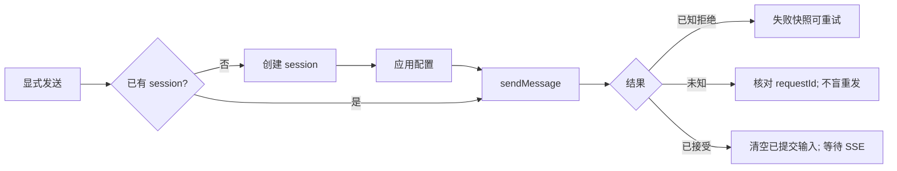

# Web 界面基础规范（Phase 1+）

本文档取代此前「阅读优先 / Crossband」等**旧版视觉与布局规范**。实现与评审以本文为准；`web/src/styles.css` 等遗留样式在迁移完成前仍可能体现旧外观，但**新功能与改版不得再按旧规范扩展**。

各屏幕的组件级规格、响应式细节与验收矩阵将在后续阶段逐屏补充；Phase 1 仅锁定技术栈、主题令牌、密度与目标信息架构。

---

## 1. 技术栈（`web/`）

| 层级 | 选型 |
| --- | --- |
| 样式 | **Tailwind CSS v4**（无 preflight 作用于遗留 DOM，见 `web/src/styles/globals.css`） |
| 组件 | **shadcn/ui**（Radix 原语），令牌驱动、紧凑密度 |
| 路由 | **react-router-dom**：`/p/:projectId`、`/p/:projectId/s/:sessionId`（与项目/会话选择同步） |
| 文案 | **i18n 字符串表**（当前 zh，结构预留 en），`web/src/i18n/` |
| 字体 | 自托管 **DM Sans**（界面）、**JetBrains Mono**（代码/工具输出），禁止运行时外链 CDN |

业务状态与 API 编排仍经 `useWebAppController`（及拆分后的 state/actions hooks）；**不修改** `src/client/*`、`src/shared/*` 数据契约。

---

## 2. 主题令牌（Pinguo 设计系统）

仅采纳附件设计系统中的 **颜色、阴影、字体** 语义角色（见 `web/src/styles/tokens.css`），与 shadcn 约定对齐：`background`、`foreground`、`primary`、`muted`、`accent`、`border`、`input`、`ring`、`sidebar-*` 等。

- **品牌蓝**：语义 `primary` 锚定在 `#007aff`（非 README 中的 `#0066cc` 叙述色）。
- **明暗**：`:root` 亮色 + `.dark` 暗色；页面级主题与现网一致——跟随系统直至用户手动切换（`data-theme` + `html.dark`）。
- **不采纳**：零售版 1.2rem 全局圆角、胶囊按钮、72–96px 展示字号、设计系统里的营销组件样例。
- **阴影**：使用 token 中的 `shadow-2xs` … `shadow-2xl`；日常界面以边框与留白分层，阴影主要用于浮层。

新 UI 组件只消费上述语义 token，不硬编码旧 `--bg-page` / `--accent` 暖中性栈（遗留 `styles.css` 在完全迁移前可并存）。

---

## 3. 密度与排版

面向 **Agent 工作区**（类似 Cursor 侧栏密度），而非电商留白：

| 用途 | 规则 |
| --- | --- |
| 控件/UI 文案 | **13–14px** |
| 对话正文 | 约 **15px**（可读，略大于壳层 UI） |
| 控件圆角 | 约 **6px**（`--radius` ≈ 0.375rem） |
| 卡片/面板圆角 | 约 **8–10px**（`--radius-card`） |
| 字体 | DM Sans + JetBrains Mono（见上） |

---

## 4. 目标信息架构（改版方向）

**对话优先、单色底 + 单一强调色**，结构目标如下（后续阶段落地，不要求 Phase 1 一次换肤）：

```
┌──────────────┬────────────────────────────┬─────────────┐
│ 左侧边栏      │  居中对话列 (~760px)        │ 右侧 Run 面板 │
│ · 项目切换器  │  · 会话标题 / 时间线        │ （可选）      │
│ · 分组会话列表│  · Composer               │ 事件/审查     │
└──────────────┴────────────────────────────┴─────────────┘
```

- **左侧**：项目切换 + 按项目/分组展示的会话历史；新建会话进入**起始态**，不预创建服务端记录。
- **中间**：阅读列最大宽度约 **760px**，与 Composer 同轴；消息区以内容为主，少装饰容器。
- **右侧**：可选 **Run / Inspector** 面板（事件流、原始数据等），宽屏停靠，窄屏覆盖层。

路由深链与侧栏选择保持一致（`/p/.../s/...`）。

---

## 5. 行为与数据流（沿用，与视觉无关）

以下条款自旧规范保留，**实现必须继续遵守**（细节以代码与 `docs/usage-measurement.md` 为准）。

### 5.1 会话与草稿不变量

- 点击「新建」仅进入起始态；**首次显式发送**才创建会话。
- 未发送正文、附件引用、新会话配置仅存**当前页内存**；不写 localStorage/sessionStorage；刷新/关闭不恢复。
- 提交失败保留**本次提交快照**供重试；之后编辑内容与快照隔离。
- 创建/发送结果**未知**时：先按原 `createRequestId` / `requestId` 核对，**不自动重发未知**、不重复创建会话。
- 请求提交成功 **≠** 助手回复完成。
- 不虚构历史、连接状态或占位对话；错误与未知载荷不伪装成消息。

### 5.2 附件

- 图片：`images/base64` 通道；普通文件：服务端 `fileId` + 可信 Pi 路径，不信任前端回传路径。
- 上传就绪**不会自动发送**；移除引用不删除服务器原件。
- 产品初始限制（须实测）：普通文件单文件 20 MiB、每条最多 5 个、合计 50 MiB；图片限制见 `src/agent/image-input.ts`。

### 5.3 插话（steer）与追加（follow-up）

- 任务**运行中**：可 steer 与 follow-up。
- 任务**仅排队、尚未启动**：仅 follow-up，**不可 steer**。
- 每条控制独立等待；仅按服务端确认更新 UI；无法确认消费时显示「等待确认 / 未知」，**不猜测已处理**。
- steer 消费确认（如 `steering_consumed`）与草稿清除语义以 controller 实现为准。

### 5.4 关键提交流（摘要）



完整分支（配置失败、附件绑定、已有会话发送等）见旧版 §11 流程图；重构 UI 时不得削弱这些边界。

### 5.5 统计与用量

- 底部 StatsBar、轮次/turn/工具计数、上下文估算等：**仅格式化服务端/export 快照**，不自行汇总 token 或捏造速率；按会话隔离快照，切换会话或改模型清空相关上下文展示。口径见 [统计契约](docs/usage-measurement.md)。

---

## 6. 阶段说明

| 阶段 | 范围 |
| --- | --- |
| **Phase 1（当前）** | Tailwind/shadcn 基础、token 主题、路由、i18n、controller 拆分；**遗留屏幕仍用现有 DOM/CSS** |
| **Phase 2+** | 按本架构逐屏替换为 token + shadcn；补充组件规格、断点验收表、无障碍细则 |

实施与评审时：行为条款以 §5 与代码为准；视觉以 §2–§4 与当期 PR 中的屏幕说明为准。
