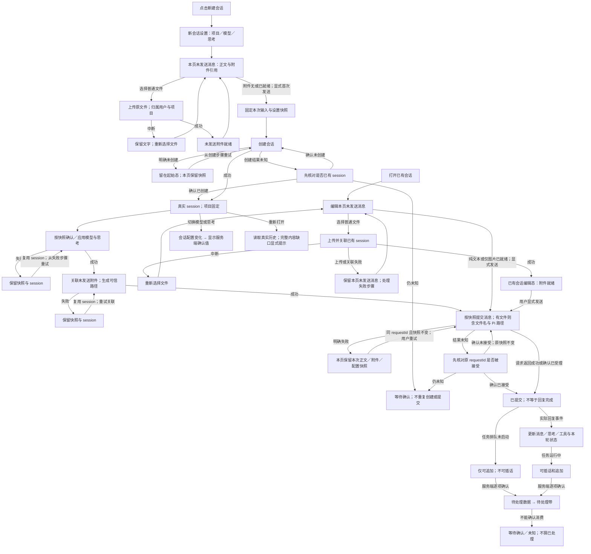

# 界面设计规范 · 阅读优先的对话制（Reading-first）

适用 Web、移动与 TUI。本文件是**待审阅的目标规范**：它规定界面应当采用的视觉语言、必须遵守的业务不变量与需要核验的能力，不代表任何界面已经落地，也不代表用户已批准本方案。

本文档取代此前的「Crossband（横带制）」视觉方案。横带、固定左侧来源槽、表格式固定槽位、用户消息强反相、全屏分割网格与空洞描边等约束**全部废除**，不再作为设计或验收依据。会话与数据不变量、输入/附件与等待规则、部署验收与产品限制等业务条款沿用原文并保留在第 8、9、13、14 节，未作修改。

---

## 1. 设计方向与原则

**单一方向**：现代、简洁、以阅读和输入为中心的对话产品。界面主体是一条可舒适阅读的对话流，其他一切（导航、题头、输入区、详情面板）都是它的支撑结构。

原则：

1. **信息层级优先**。用户先看见内容，再看见结构与控件。层级由排版尺度、间距与留白建立，不由边框、卡片堆叠或装饰建立。
2. **以内容为准的宽度**。正文限制在可读行长内，多余视口宽度转成留白，而不是拉伸文字。
3. **少容器、多留白**。不使用卡片包裹每一段；只有在需要与正文区分时才使用轻底色或分隔。
4. **强调色只有一个**。它用于主操作、焦点、流式进行指示与当前选中；不用于装饰、不用于大段背景。
5. **状态用文字表达，颜色只作辅助**。任何状态、类型、结果都有可读文字。
6. **输入区是重心**。Composer 始终可达、始终不被遮挡、始终反映本页内存中的真实草稿。
7. **不虚构**。没有数据就显示空态；不造占位内容、装饰数据或连接状态。

底部 StatsBar 保持在 Composer 下方，模型选择不移动。轮数和 model turn 数采用服务端 JSONL 持久记录的宿主实际执行累计，按所有分支稳定 ID 去重（重试/活动 follow-up 同轮、多 turn；idle 新任务新轮），不以用户消息数推算；工具数仅计当前已加载分支时间线。旧历史无记录显示未知，有缺口只显示已记录数并在详情说明全历史未知；按 [统计契约](docs/usage-measurement.md) 使用单行 13px 中性文字与 14/16px SVG：`1轮 · 3 turn · 工具2次`、速度、末次响应 totalTokens（K/M）、缓存命中、上下文百分比；390px 隐藏次要缓存，不换行、不横向溢出。整行按钮打开现有 Modal，全部原值按「末次响应」「会话累计」「上下文」分组保留；无有效值不显示空组标题，默认不在文档流展开详情。仅格式化后端值，不自行加总 token、计算缓存命中率或估算速度。数字 compact、tooltip 保留完整值；null/缺失/非法值省略，真实 0 保留，USD 费用始终为估算（0 不宣称免费）。末次为最后 assistant 的 SDK usage，输入不含缓存，输出含 reasoning；完成速度只显示生成时段至少 10ms 的后端 output tok/s，不以请求总耗时或字符数计算。活动输出仅显示服务端现有字符估算的 ~N tok/s，沿用最近两秒 delta 失活门槛；暂停、工具等待、断线不显示旧速度。请求耗时与首段延迟独立；无 delta 的相等回填延迟不显示。流式/排队旧快照的口径、非实时说明和估算说明收进 title 与详情，不在主栏常驻状态文案；累计和上下文在详情标上次结算/export 快照、非实时。累计是 SDK allEntries、含所有分支条目，非 active branch、不另加独立 subagent ledger；上下文是估算而非累计，压缩后可仅有窗口。已有授权 export 的 optional usageSnapshot 可恢复，不读取全局历史或主动创建 runtime；旧服务无计数字段时未知；无 runtime 的 JSONL 历史可只读恢复执行计数，其他统计缺失仍未知。controller 按会话隔离快照，导航和模型变更清 context，取消的旧导出不能覆盖新会话或新模型上下文。

明确不使用：固定来源槽列、横向色带/分割线网格、全屏多栏仪表盘式布局、大面积反相的短消息块、纯装饰性描边与玻璃拟态、插画与渐变背景。

---

## 2. 设计令牌

### 2.1 色彩

暖中性体系：亮色为纸白偏暖，暗色为中性暖墨。两套主题共用布局与令牌名，只替换取值。单一强调色为蓝。

| 令牌 | 亮色「纸白」 | 暗色「暖墨」 | 用途 |
|---|---|---|---|
| `--bg-page` | `#FAF9F7` | `#191817` | 页面底色 |
| `--bg-surface` | `#FFFFFF` | `#211F1D` | 题头、侧栏、Composer、浮层 |
| `--bg-raised` | `#F2F0EC` | `#2A2825` | 用户消息底、代码块底、控件底 |
| `--bg-hover` | `#EDEAE5` | `#322F2B` | 悬停/按压 |
| `--text-primary` | `#1E1D1B` | `#EFECE6` | 正文（对 `--bg-page` ≥ 13:1） |
| `--text-secondary` | `#5B5852` | `#B0ABA2` | 次要说明、标签（≥ 4.5:1） |
| `--text-tertiary` | `#8B867E` | `#89847B` | 时间戳、计数（≥ 3:1，仅辅助信息） |
| `--line` | `#E4E1DA` | `#37342F` | 结构分隔（仅用于必要的单条分隔线） |
| `--accent` | `#2A55C8` | `#8FB0FF` | 主操作文字/图标、焦点环、流式指示、当前选中 |
| `--accent-solid` | `#2A55C8` 底 + `#FFFFFF` 字 | `#8FB0FF` 底 + `#141311` 字 | 主按钮（≥ 4.5:1） |
| `--accent-soft` | `#E9EEFB` | `#232C3B` | 选中背景、强调标签底 |
| `--success` | `#2E7D57` | `#7BC9A0` | 成功 |
| `--warning` | `#8A6212` | `#E0B25C` | 注意、等待确认 |
| `--danger` | `#B3392F` | `#F09A90` | 失败、破坏性操作 |
| `--thinking` | `#4A5A7A` | `#9FA8BC` | 思考内容左标记与标签（不作大面积底色） |

规则：
- 状态色只出现在小面积（图标、短标签、状态词），任何信息不单靠颜色区分。
- 不给正文、消息流或整屏加背景色块；背景层级最多两级（page / surface / raised）。
- 分隔线只在必要处出现（题头下沿、Composer 上沿、面板边界），不使用网格交叉线。

### 2.2 字体

只使用系统字体，不加载网络字体。

- 界面与正文比例字体栈：`-apple-system, BlinkMacSystemFont, "Segoe UI", Roboto, "PingFang SC", "Hiragino Sans GB", "Microsoft YaHei", "Noto Sans CJK SC", sans-serif`
- 等宽字体栈：`ui-monospace, SFMono-Regular, "SF Mono", Menlo, Consolas, "Liberation Mono", monospace`
- 等宽用途：模型完整 ID、session/请求 ID、路径、`provider/model`、思考档位原值、工具名称与参数、代码、结果数据、数值统计。
- 其余文字使用比例字体；代码块保留语法底色 `--bg-raised`，不加边框。

### 2.3 字号与行高

| 令牌 | 值 | 行高 | 用途 |
|---|---|---|---|
| `--font-micro` | 12px | 1.4 | 时间戳、附件大小、状态计数 |
| `--font-small` | 13px | 1.5 | 侧栏项、标签、按钮说明 |
| `--font-body` | 16px（≥640px）/ 15px（<640px） | 1.65 | 消息正文、Markdown 正文 |
| `--font-ui` | 14px | 1.5 | 按钮、输入、菜单、Composer |
| `--font-title` | 18px, 600 | 1.35 | 会话标题（题头） |
| `--font-h1` | 22px, 600 | 1.3 | Markdown 一级标题（流内最高） |
| `--font-h2` | 19px, 600 | 1.3 | Markdown 二级标题 |
| `--font-h3` | 17px, 600 | 1.3 | Markdown 三级及更低 |
| `--font-mono-body` | 14px | 1.55 | 代码块、工具参数与结果 |
| `--font-metric` | 13px, 等宽 | 1.3 | token/耗时等数值 |

不使用超过以上尺度的展示型大字；首屏没有营销式标题。

### 2.4 间距、圆角与层次

- 间距基数 4px，刻度：`4 / 8 / 12 / 16 / 24 / 32 / 48 / 64`。
- 消息条目之间 `--space-16`；同一消息内段落 `--space-12`；标题上 `--space-24` 下 `--space-8`。
- 列表项左右内边距 `--space-12`，上下 `--space-8`。
- 正文列左右内边距：`--space-24`（≥640px）/ `--space-16`（<640px）。
- 圆角：控件与小消息底 `8px`；代码块与面板 `6px`；圆形仅用于图标按钮。不使用胶囊化大块或全圆角容器。
- 阴影仅用于浮层（菜单、对话框、悬浮提示）。页面内结构不用阴影制造层次。
- 动效只用于状态变化反馈：展开/收起、进入/退出、流式光标，时长 120–180ms，无入场动画、无视差、无循环装饰动画。尊重「减少动态效果」。

### 2.5 宽度与断点令牌

| 令牌 | 值 |
|---|---|
| `--sidebar-width` | 264px（停靠时固定） |
| 外壳宽度 | 100% 视口（侧栏贴左；额外留白位于主区阅读列两侧） |
| `--reading-max` | 760px（正文列与 Composer 共用的最大内容宽度，约 72ch 中文/英文混排） |
| `--user-bubble-max` | `min(520px, 76% of --reading-max)` |
| `--panel-width` | 380px（详情/工具原始数据面板，停靠时） |
| 断点 | `640px`（窄屏）、`905px`（侧栏收起阈值）、`1180px`（侧栏可停靠）、`1440px`（面板可并排停靠） |
| 高度阈值 | `480px`（矮视口紧凑模式）、`360px`（极矮视口） |

---

## 3. 布局与响应式

### 3.1 结构

三层结构，从左到右：导航侧栏（可选停靠）→ 对话主区（题头 + 消息流 + Composer）→ 详情面板（按需）。

- **导航侧栏**：项目与会话列表、项目过滤、搜索、新建会话入口。停靠时宽 264px，`--bg-surface`，无边框包裹，仅以背景差与一条 `--line` 分隔。列表项单行文本 + 次要信息，选中项使用 `--accent-soft` 底与 `--accent` 左侧 2px 标记。
- **题头**：最小高 56px（紧凑模式 44px），左侧为导航入口与会话标题，右侧仅保留详情入口及必要操作。模型与思考选择统一放在 Composer 配置行，本轮数值置于输入区下方或详情面板，不在题头重复堆叠。标题可省略并提供完整名称；模型触发器始终显示完整 ID（见 5.4）。整个界面不显示连接状态。
- **消息流**：单一居中列，宽度 `--reading-max`，与 Composer 同宽同轴，滚动到底时末条内容与 Composer 之间保留 `--space-24`。
- **Composer**：视觉上停靠底部，使用正常 flex/grid 文档流占位，不以 absolute/fixed 覆盖消息流；`--bg-surface` 轻量输入容器，随可见区域（键盘弹出时保持可达），不遮住末条内容。配置、附件和错误增高时同步缩小消息滚动区。
- **详情面板**：显示会话属性与真实事件记录（工具原始参数/结果、事件原值、可复制），宽屏（≥1440px）可停靠右侧 380px；更窄时按需覆盖层打开，初始关闭。面板内不使用连接状态相关条目。

### 3.2 响应式行为

- **≥1180px**：侧栏停靠，消息流居中于剩余空间内的 `--reading-max`。
- **905–1180px**：侧栏收起为可达的覆盖层（按钮或 Tab 打开），消息流占满可用宽度但仍受 `--reading-max` 限制。
- **<905px**：仅对话主区；侧栏与详情面板均为可达的覆盖抽屉，初始收起，打开时保留滚动位置。
- **超宽视口**：外壳占满视口，侧栏贴左并保留现有宽度与拖拽；主区填满剩余空间，多出的宽度成为主区阅读列两侧留白；正文列、题头与 Composer 仍受 `--reading-max` 限制，同宽同轴，不放大文字填空。
- **视口高度 <480px（短宽视口）**：题头压缩到 44px 并把次要数值收进详情面板；Composer 起始单行，最多增至视口高度的 40%；侧栏与面板默认收起；滚动定位保证末条消息与 Composer 输入行同时可见；不出现整屏空白填充。
- **视口高度 <360px**：进一步隐藏本轮统计，仅保留标题、模型 ID、输入行与必要图标按钮。
- **移动端（约 390px）**：正文 15px；侧边栏全宽覆盖；题头只保留导航入口、标题与详情入口，模型配置仍在 Composer 内，其余操作进溢出菜单；触控目标 ≥ 44×44px；Composer 随键盘上移。

以上宽度与断点属于本规范的设计取舍，不是产品硬约束。

### 3.3 TUI（设计建议）

- 单列阅读流，宽度按终端可用列自适应，正文建议不超过 100 列。
- 不使用固定来源槽或横带：内容类型以**行首短标签 + 缩进**区分（如「你」「助手」「思考」「工具」），标签后跟一个空格，不用反相大块。
- 用户消息用轻缩进与浅色底纹（若终端支持），助手正文不缩进、无背景。
- 工具过程未结束时默认展开、结束后自动折叠为紧凑可读摘要（并行任务/等待快照可多行），用户手动开合后保留偏好；展开显示原始参数与结果，顺序与真实时间线一致。
- Tab 可到达导航、消息列表、Composer 与其他可用区域；焦点行有清晰反相或下划线标记，且不引起重排。
- 不照搬 CSS 尺寸或颜色令牌，按终端调色板等义映射。

---

## 4. 对话内容呈现

### 4.1 用户消息

- 自然宽度：贴合内容，上限 `--user-bubble-max`，右对齐于正文列。
- 轻量背景：`--bg-raised`，`--text-primary` 文字，8px 圆角，**无反相、无描边、无头像与姓名前缀**。
- 保留原文换行；附件以 chip 形式显示在气泡内正文之下（见 5.5）。
- 时间戳 `--font-micro`、`--text-tertiary`，置于气泡下方右侧，仅在悬停/聚焦或紧凑模式常显。

### 4.2 助手消息

- **无卡片**：正文直接落在页面底色上，左对齐、占满 `--reading-max`。
- Markdown 层级按 2.3 的标题尺度；列表、引用、表格按标准排版，表格用行间隔线而非全边框网格。
- 代码块：`--bg-raised` + 等宽字体 + 6px 圆角，右上角提供复制按钮（图标带可访问名称）；长行内部横向滚动，不换行时保留缩进。
- 流式输出：末尾使用 1 个 `--accent` 光标点，完成后消失；不显示「正在输入」装饰条。
- 不显示「模型」标签、来源槽或头像。

### 4.3 思考内容

- 默认可见的折叠行（标签「思考」+ 状态/时长文字），展开原文无装饰边线、无缩进、无卡片；字号 13px、行高 1，正文 secondary、预览更浅。
- 思考与原消息的真实先后顺序保留；不聚合、不重排、不改原文。text.trim() 为空时不渲染行或箭头（含历史与流式初始空白），同 id 的手动开合状态仍保留；真实文本到达后正常展示。header 预览先对完整文本归一空白再取前 60 字，展开正文保留完整原文，reducer/export/raw history 不过滤数据。

### 4.4 工具过程（渐进披露，顺序不变）

- 每条工具调用保留摘要行：工具名（等宽）+ 展开/收起一致的可读摘要 + SVG 状态 + 紧随右侧的 12px chevron；整行可点击。工具与思考采用生命周期默认：tool_start 的 done=false 默认展开，tool_update 的 partialResult 实时替换正文并保持展开，tool_end 的 done=true 自动收起（含 isError 失败）；恢复历史 done=true 初始收起。用户手动展开或收起后，partial/done 更新不覆盖该选择。仅使用现有 done/isError，不新增 pending 或子 run 状态；工具自身结束不代表 subagent 子任务完成。展开完整参数在上、结果在下，raw 原值保留。折叠不渲染正文，但摘要随真实最新快照刷新、不累加重复输出；最终结果优先于 partial（含 0、false、空字符串）。摘要仅预览限行截断，不截断展开原文。bash 展示 command 与最新输出末尾非空行，read/write/edit 展示路径及修改批次数，未知字段安全文本 fallback。subagent 展示每个代理名与 task；wait 展示目标 runIds / 全部待收集及最新真实等待文本；status/logs/steer/stop 仅显示目标参数与真实返回快照，不猜测跨工具关联或持续进度。SVG 仅依据工具 done/isError：进行中 spinner（尊重 reduced motion）、成功 check、失败圈叉，aria-label/title 保留状态文字，错误不全靠颜色，不造百分比。工具块状态 SVG、展开 chevron、更多 ellipsis 在桌面与触屏始终可见（opacity:1），包括成功、失败、进行中，不依赖 hover 或焦点；Inspector 的独立规则不变。当前协议无 pending/waiting 枚举，不将已返回结果中的子任务 waiting 文本映射为工具等待状态。工具调用完成不等于后台子任务完成，wait 超时或子任务失败不自行改成工具失败。工具摘要焦点不显示 outline 或阴影，以强调文字与轻背景保留键盘焦点反馈，其他按钮焦点不变。
- Web 每条工具调用使用统一轻量块：亮色极浅暖中性底 `#f3f1ee`，暗色 `#22201e`（比 page 稍亮），8px 圆角，无外边框、阴影或彩色竖线。header 与展开正文在同一浅底内，左右及正文底部 12px 内边距。左侧类别 SVG 与 Inspector 共享 name→icon 映射：bash terminal、subagent agents、wait clock、read file、未知 tool。正文仍自然无底，思考弱化，无新增「工具调用」可见标签。
- subagent 仅在 args.tasks 为非空且每项含真实 agent 字符串与 task 字符串的数组时识别任务；多项在完整工具名旁独立弱化显示「并行 N」，不从结果文本推断数量或 run 关联。摘要先列全部代理名（保留同名与完整长名），再显示截断任务；窄屏分层，数量不收缩，两短名不被任务挤掉。展开以原顺序轻间距/细分隔展示各代理完整 task 与 cwd 等其他字段，去掉笼统 tasks 标签，不套厚卡；单项不标并行，非法/空 tasks 安全回退。长名可在摘要视觉省略，但展开与 raw 可完整查看；状态仅属于调用自身。
- header 保持工具完整名称与真实参数/最新快照摘要同行，仅摘要 ellipsis；极长工具名可换行全显。保留独立状态、12px chevron 尾槽与兄弟 more 按钮，三个图标始终可见、相邻 SVG 间距一致，并相对整个 header 垂直居中（一行、parallel 两行及极长名称换行均如此）；左右 glyph inset 保持校准，菜单 width:max-content、对称内边距。嵌套 CodeBlock 仅轻底与弱边框，不形成厚卡片，保留高亮、diff、复制及段落/code 间 12px 间距。
- 展开默认显示参数字段名/值与可读结果正文：字符串保留原文；标准 `content` 中的文本块按顺序完整显示，保留换行，不摘要、不截断。运行中随真实 partialResult 最新快照更新（不追加快照、不人造打字），最终结果替换部分结果；没有中间事件不虚构流式输出。运行中默认展开，用户主动展开/收起选择保留。
- 工具信息采用 Web 阅读层级，不照搬 TUI 外观或全等宽排版：工具名与简短参数同行，正文紧接完整参数与实际进度/输出；不显示重复「参数」「结果」标题，但保留参数先、结果后的 semantic region / aria-label。CodeBlock margin 归零，Markdown/原文切换贴输出右侧，不为标题预留空行；保留代码高亮复制与 edit DiffBlock。
- 参数采用紧凑键值布局：多个短键值同行并按可用宽度换行，简单数组使用完整紧凑 JSON（如 runIds=["1","2"]），不拆成 ol 或增加横分隔；长提示词使用自然宽正文，复杂数组按条目分组，不逐层增加字段缩进。undefined、null、空对象及空数组不渲染可读参数区；false、0 与含字段的对象仍展示。所有参数（含空值）的原值均可通过独立更多菜单查看或复制。write 顶层 content 复用代码组件，由同级 language 或 path 扩展名指定高亮，未知语言使用 plain，不自动识别自然语言；保留缩进、空行和复制原文，不作为 Markdown 渲染。代码复制使用 SVG，小型工具栏不重复参数已有的语言语境。
- edit 参数区已由 header 展示完整 path（title 可达），合法单项或 edits 批次直接按原顺序展示 diff，不重复 path、edits 标签、编号或修改前/后标题。片段 scope 仅 aria-label 表明，不渲染说明段落；正文不提供重复原文 details/面板。保留 +/-、无末尾换行标志及简短无修改语义标记；超大输入不伪造 diff，以简短状态与 raw Modal 查看/复制完整 oldText/newText。未知字段紧凑 generic 展示，非法 edit/batch 完整 generic 回退；更多菜单仍保留完整参数 JSON 和复制，write 合法参数仅展示写入 CodeBlock，不重复 content 标签或 header path；edit/write 仅对已完成且非错误的准确已知常规成功回执隐藏正文、空结果区与摘要重复回声，失败、警告、未知结构及运行中 partial 保留，raw 查看/复制始终完整不变。
- 结果中明确文件语言的代码优先高亮；日志使用 pre 保留空格与换行。仅 subagent / subagent_wait 适配器的文本结果（含 partial）默认安全 Markdown，手动原文选择跨快照与完成保留，无文本结构数据仍安全回退；其他非日志文本采用保守的 Markdown 信号（独立标题加列表或行内代码）自动展示，并提供可访问的原文/Markdown 手动切换；不依赖工具名称制作子任务专属卡片。沿用安全 Markdown renderer，不启用原始 HTML 执行或 rehypeRaw；完整结果 raw 独立保留，不以渲染后的文字代替原值复制。
- 通用参数 renderer 按字段递归展示嵌套对象及数组条目，保留完整值和顺序（包括 agent/task/tasks/cwd），除上述已知 subagent 任务结构的轻分组外，不猜测未知工具结构。结果正文原位显示，结构数据完整可读；多 run 文本保留原文顺序，不搬移或重复展示。仅真实 partial snapshot 更新，不伪造无中间事件工具的打字效果。
- 原始数据入口统一收进摘要行右侧独立 SVG ellipsis 更多按钮（与主 toggle 为兄弟控件，禁止 button 嵌 button），菜单仅「查看原始数据」「复制原始数据」。更多操作不切换主展开状态；菜单支持键盘上下/Home/End、Enter/Space、Esc 恢复焦点、外部点击与离开焦点关闭。桌面与触控均始终显示；触控保持独立 ≥44px 目标，不覆盖主 toggle。查看通过独立受控 Modal 打开原始数据对话框，不展开卡片、不改变手动偏好或自动生命周期；partial 快照实时替换，tool_end 切换最终数据但不关闭弹窗。通用 Modal 使用原生 dialog.showModal() 使背景不可交互，锁定背景滚动；标题完整换行、关闭按钮初始聚焦，Tab/ShiftTab 限定在弹窗内，Esc / 关闭按钮 / 遮罩点击关闭（跨边界拖拽不关闭），关闭后焦点回到更多按钮。正文独立滚动、标题与关闭稳定，390px 下保留安全边距和 44px 触控目标，明暗使用中性遮罩和轻阴影。弹窗 CodeBlock 与菜单复制共用完整 JSON：argsProvided/resultProvided 明确根值是否为 undefined，缺失时省略 args 或结果键，不改成 null；resultKind=partial/final，仅包含当前 partialResult 或最终 result，不冒用旧 partial。0、false、空字符串、null 保留，原始字符串经 JSON 编码可 roundtrip，不截断。未知/非文本 structured 结果保留可读 fallback，并在正文明确提供「查看原始数据」按钮，metadata 通过 raw 可达，不声称正文已显示全部数据。复制成功/失败有可读反馈，clipboard 不可用亦明确失败，可选择原文手动复制。失败细节原文展示；所有内容安全文本渲染，不把工具数据当 HTML，不引入隐藏网络。
- **真实时间顺序是硬约束**：折叠、分组视觉或连续多步只影响可见性，绝不重排、合并或按类型分区。
- 连续多步时，各步之间 `--space-8`，形成一条纵向顺序列表；不使用网格。

#### 工具展示实现边界

- `web/src/tools/contract.ts` 统一定义结构化 header（icon、badge、priorityLabels、summary/preview）与参数/结果 React slots；`ToolCallCard` 仅持有通用容器、调用状态、手动开合、菜单与 Modal 状态，不识别工具参数 schema。
- 纯数据入口 `tools/metadata.ts` 按 toolName 注册摘要与图标；React 入口 `tools/presentation.ts` 注册 renderer，专属 bash、文件与 subagent 模块单向依赖通用 renderer。Inspector 复用纯数据入口，不重复推断 subagent。新增工具未注册时仍以 generic 字段/数组/文本及 raw 入口完整、安全展示。
- adapter 不执行网络请求、不拥有运行生命周期、不推断子任务状态、不改写输入；raw 序列化独立放在 `tools/raw.ts`。`tool-summary.ts` 与旧 helper 导出仅为兼容 facade；纯摘要模块不得导入 React renderer 或全量 barrel。CodeBlock、DiffBlock、Modal 继续是独立组件。提取不得更改既有 DOM/class、视觉或数据契约。

### 4.5 系统与错误内容

- 错误显示在 Composer 之上的独立状态条（`--danger` 文字与左侧标记，`--accent` 不用于错误），可展开详情、可复制、可清除；**不插入对话正文，不伪装成消息**。
- 未知载荷、无法识别的事件同样不伪装成消息：以待核实的状态条目呈现。
- 一次性提示（成功/注意）用同一条状态带位置、对应语义色文字，数秒后淡出且可停留（减少动态效果时常显并可手动关闭）。

### 4.6 长对话

- 虚拟化不影响顺序与滚动位置恢复；向上翻页加载历史时在顶部显示一条「加载更早内容」的次要文字行。
- 历史缺口（含思考、附件等不完整）必须显式提示为次要文字行，不能用占位内容填补。
- 无会话时不造对话、历史、事件或 Inspector。

---

## 5. 状态与边界情形

### 5.1 起始态（没有活动会话）

- 页面为自然留白：正文列区不放置 Logo、标语、插画或示例数据。
- 起始提示位于弹性消息区底部、紧邻 Composer 上方，与阅读列同轴；保持自然文档流，长草稿与短屏不遮挡控件。
- Composer 与已有会话保持同一底部位置，避免首次发送时大幅跳动；输入容器内显示**新会话配置行**（项目、模型、思考），来源为当前页面内存中的选择，不在消息区重复展示设置。
- 新建只进入此起始态；**首次显式发送才创建会话**。

### 5.2 空历史（已有会话且确认历史为空）

- 单行次要文字说明「该会话暂无历史消息」，与起始态在文案与位置上可区分；不显示装饰图形。

### 5.3 加载与等待

- 局部使用文字进度（如「读取历史…」）或极轻量骨架（不超过两行、无闪烁动画），不显示连接状态。
- 提交后的待处理项显示在 Composer 上方的**待处理带**，逐条列出并只按服务端确认更新（见第 9 节）。

### 5.4 长标识符与不可截断信息

- 模型触发器必须直接显示完整 model ID，不中段省略、不依赖悬停 title 补全；长 ID 允许换行，配置行自然增高，手机同样适用。`provider/model` 列表项保留完整值。
- session/请求 ID、文件路径与名称可在紧凑摘要中中段省略，但必须有键盘和触控均可用的展开/复制入口，不仅依赖 title；详情与破坏性操作中的 ID 不省略。
- chip 内的 ID 可换行，容器随之增高，不使用固定宽度硬裁切。

### 5.5 附件

- 附件以 chip 呈现：文件名（可中段省略，支持键盘/触控展开全名）+ 大小/类型（`--font-micro`）+ 真实状态文字。仅未发送附件提供移除按钮和上传状态；已发送附件只展示服务端已提供的信息及可用操作，不提供解除已发送引用的虚假按钮。
- 图片 chip 为缩略图 + 状态；点击后可预览（浮层，含关闭与可访问名称）。
- 附件条位于输入框上方，横向可滚动，不占用正文列宽度也不撑破 `--reading-max`。
- 未就绪的 chip 显示原因文字，不显示假成功态；移除按钮只解除本页未发送消息中的引用（原件保留，见第 9 节）。

### 5.6 长草稿

- Composer 输入区随内容自动增高：最小 1 行（约 44px），最大 12 行（约 260px）或视口高度 40%（取小者），超出后内部滚动。
- 输入框有明确的可访问名称与占位提示；不显示字符计数装饰。
- 提交失败时保留**本次提交快照**供重试，之后继续编辑的新内容与该快照隔离（见第 8、9 节）；界面须让「快照待重试」与「当前编辑内容」视觉可区分，例如在输入区上方显示一条「本次提交内容已保留」的次要状态行。

---

## 6. 交互与可访问性

- 所有展开/收起 chevron 统一为 12px SVG，保留占位，以 inline-flex / align-items:center 与关联文字/状态行中心对齐，SVG display:block，不用位移修正。思考、工具摘要、原始数据及事件详情箭头紧随内容右侧；项目/模型菜单保留固定右侧操作槽，完整模型 ID 可换行，箭头与触发器中心对齐。工具块 chevron 例外：与状态及更多图标一起始终可见、相对完整摘要行居中。其他 chevron 桌面 hover:hover + pointer:fine 默认透明，仅交互区域 hover 或真正 focus-visible（嵌套控件 :has(:focus-visible)）显示；点击后残留 focus 不显示。触屏 nohover/coarse 常显；透明不影响点击、键盘导航或可访问名称。

- **焦点**：2px `--accent` 轮廓 + 2px 偏移；在 `--bg-raised` 与 `--bg-surface` 上与相邻背景对比 ≥ 3:1；获得焦点不引起布局重排。Tab 顺序：题头操作 → 消息流（含展开控件）→ 待处理带 → 附件 chip → 输入区 → 动作按钮 → 侧栏/面板。
- **键盘**：所有可用操作键盘可达；展开/收起可用 Enter 或 Space；图标按钮必须有可访问名称（含中止用的纯图标按钮）。
- **Web 图标**：统一使用本地可复用 SVG（24×24 viewBox、currentColor、统一线宽与尺寸），装饰 SVG 使用 aria-hidden，按钮保留可访问名称；不以文字符号或默认 details marker 充当图标。停止保持实心方块语义，系统主题跟随不受图标切换影响。
- **对比度**：正文与必要标签 ≥ 4.5:1；大号文字（≥18px 或 14px 粗体）≥ 3:1；图标、状态标记与焦点 ≥ 3:1。`--text-tertiary` 只用于辅助信息，不承载唯一含义。
- **触控**：目标 ≥ 44×44px；相邻 chip 间距 ≥ 8px。
- **减少动态效果**：去除所有过渡与流式动画，仅保留状态文字变化。
- **放大阅读**：页面在 200% 缩放与窄宽度下不丢内容、不隐藏操作；正文列宽度按视口收缩而不固定为像素硬值。
- **状态可理解**：所有状态有文字，明暗两套使用相同布局与相同层级。
- Composer 交互：Enter 发送、Shift+Enter 换行；输入法合成期间不误发；同一次提交进行中避免重复提交。

---

## 7. 视觉验收矩阵

以下矩阵定义「需要实际运行并在目标呈现中观察」的组合。**本文件不声称任何组合已经验证通过**；未执行的行必须记录为未验证或阻塞。

| 编号 | 视口/条件 | 必须观察的要点 | 通过判据 |
|---|---|---|---|
| V1 | **1235×390**（短宽） | 题头压缩、侧栏/面板收起、Composer 高度上限、末条消息与输入行同时可见 | 无整屏空白；Composer ≤ 视口高 40%；无遮挡、无横向滚动 |
| V2 | **2470×780**（超宽） | 外壳占满视口、侧栏贴左、`--reading-max` 生效 | 正文与 Composer ≤760px 同轴；控件未被拉宽变形；留白位于主区内 |
| V3 | **1280×800**（桌面基准） | 侧栏停靠、题头、消息流、Composer 对齐同轴 | 正文列与 Composer 同宽；焦点顺序清晰；对比度达标 |
| V4 | **390×844**（手机） | 覆盖式导航/面板、键盘弹出、触控目标 | Composer 随键盘可达；chip 可点区域 ≥44px；无内容被裁切 |
| V5 | 长标识符（完整模型 ID、`provider/model`、长路径、长 session ID） | 模型 ID 完整换行；其他摘要可展开 | 模型触发器无省略；完整值键盘/触控可读出与复制；容器不横向溢出；破坏性操作不省略 ID |
| V6 | 附件（多图 + 普通文件混合，含上传中/失败/已就绪/仅引用） | chip 状态、预览浮层、移除仅解除引用 | 状态有文字；无假成功；不显示原件被删除的暗示 |
| V7 | 长草稿（数十行文本） | Composer 增高到上限后内部滚动、快照保留提示 | 输入不被裁切；重试快照与当前编辑内容视觉可分 |
| V8 | 长对话 + 工具多步 | 渐进披露、真实顺序、原始参数/结果完整 | 折叠不重排；原文不摘要；向上加载不跳位 |
| V9 | 起始态 / 空历史 / 错误条 / 待处理带 | 四类非正文状态的区分 | 起始态无装饰数据；空历史 ≠ 起始态；错误不进正文 |
| V10 | 明暗主题 × 200% 缩放 × 减少动态效果 | 层级、对比度、可达性 | 布局一致；对比度满足第 6 节；无动画依赖 |
| V11 | TUI（终端呈现，若适用） | 标签 + 缩进代替槽位与横带；Tab 可达；焦点清晰 | 顺序与 Web 一致；不照搬 CSS 尺寸 |

每行验收需在真实运行环境中以截图、录屏或终端画面取证，逐项与第 2–6 节令牌比对；仅凭代码或样式声明不视为视觉验收。

---

## 8. 会话与数据不变量（业务契约，沿用）

- 新建只进入起始态，**首次显式发送才创建会话**。
- 新会话设置（项目、模型、思考）与未发送消息正文、未发送附件引用及尚未提交的配置变更仅保存在当前页面内存。
- 未发送状态不写入 localStorage/sessionStorage；刷新或关闭页面即失去，不能刷新恢复或跨设备同步。已上传的服务器原件不因此自动删除。
- 提交失败时，只要页面仍打开，就保留**本次提交快照**（正文、附件引用、配置）；之后继续编辑的新内容与该快照隔离。
- 真实历史照实显示。
- 完整内容回放是目标。
- 项目创建前选定，创建后只读。
- 模型与思考可在会话中切换。
- 模型触发器显示完整 model ID。
- 列表可写 `provider/model`。
- 思考档位保留原值。
- 无会话时不造对话、历史、事件或 Inspector。
- 起始态自然留白，不用 Logo、标语或假数据填空。
- 整个界面不显示连接状态。
- 中止用有可访问名称的纯图标。
- 统一状态词「排队中 / 进行中 / 已完成 / 已中止 / 失败 / 未设置」。
- 缺省不造值。
- 数值 `0` 不当成缺失。
- 工具名称、参数、结果和失败细节完整原文可展开；未结束默认展开、结束默认折叠，保留用户手动偏好；折叠仅提供真实快照摘要预览，不改写原值。
- 错误与未知载荷不伪装成消息。

## 9. 输入、附件与等待（业务契约，沿用）

- 图片可粘贴、选择并预览；首版沿用现有 `images/base64` 通道，不与普通文件的路径方式混同，也不扩张现有限制。
- 非图片原件上传应用服务器受控目录；服务器登记 `fileId`、文件名、大小、类型、状态及 Pi 可见路径（也可在发送时解析路径）。
- 未发送附件可在创建 session 前上传，按用户与项目归属；首次显式发送创建 session 后再关联，已有会话直接关联。
- 当前消息用服务器记录的文件名和 Pi 可见路径供 Agent 使用现有文件工具按需读取；`fileId` 只用于应用内部归属核验，不信任前端回传路径，不保证所有格式可解析。
- 不采用 CDN、前端转换／全文提取或统一服务端解析层；不新增附件读取工具。
- 纯路径粘贴只作为文字，不读取本机文件。
- 上传中、上传中断、上传失败或关联验证失败均不得把文件当作就绪附件发送；中断后须重新选择文件，不显示假成功。
- 上传完成只更新本页未发送附件状态，**不会自动发送**；已有会话的纯文本、仅图片或普通附件就绪，也都由用户显式发送。
- 移除附件仅解除未发送消息中的引用，不删除服务器原件；取消、放弃或删除会话也不触发服务器文件清理。
- 运行中的任务允许插话（steer）和追加（follow-up）；任务已排队但尚未启动时，仅允许追加，不允许插话。
- 每条插话和追加都可独立等待、连续提交；只按服务端确认逐项更新，不把待处理项冒充聊天消息，无法确认消费时显示「等待确认／未知」，不猜作「已处理」。

## 10. 区域结构

```yaml
# when = 出现条件；source = 可显示的数据；action = 用户可做的事
regions:
  - name: 导航侧栏
    source: 真实项目与会话列表
    responsive: ≥1180px 停靠；更窄时为初始收起的覆盖抽屉，可达且保留滚动位置
    children:
      - name: 项目过滤与搜索
        action: 切换列表视图，不改变会话归属
      - name: 项目管理
        action: 新建或删除项目
      - name: 会话行
        action: 进入已有会话、读取历史、改名、导出或删除
      - name: 新建会话
        action: 仅进入起始态；不立即创建记录
  - name: 对话主区
    responsive: 单一居中正文列，宽度 --reading-max；窄屏全宽；TUI 单列并以行首标签+缩进区分内容类型
    children:
      - name: 题头
        when: 有活动会话
        source: 会话标题、固定项目、模型完整 ID、思考及本轮统计
        action: 改标题、切换模型和思考；次要数值在矮视口收进详情面板
      - name: 消息流
        when: 有活动会话
        source: 实际返回的历史与实时消息、思考、工具
        action: 按原顺序阅读、展开工具/思考原始内容、复制
      - name: 起始留白
        when: 没有活动会话
        source: 当前页面内存中的新会话设置与未发送消息；不伪造历史
      - name: 空历史说明
        when: 已有会话且确认历史为空
        source: 真实历史结果；区别于起始态
      - name: 提示与错误状态条
        when: 有真实的一次性提示或错误
        source: 实际事件、操作结果或当前错误状态；独立于对话正文
        action: 查看、复制、清除
      - name: Composer
        responsive: 窄屏随键盘保持可见；附件条横向可滚动；高度受视口约束
        children:
          - name: 新会话设置带
            when: 没有活动会话
            source: 当前页内存中的项目、模型、思考选择
          - name: 附件条
            when: 已选择图片或普通文件
            source: 本页未发送附件引用；上传中、失败或服务器已确认的文件信息
            action: 预览、移除引用、重新选择中断的文件；未就绪时说明原因
          - name: 待处理带
            when: 有插话或追加等待
            source: 服务端可确认的逐条状态；无法确认则显示等待确认／未知
          - name: 输入与动作
            source: 本页内存的未发送消息；显式发送时固定本次快照
            action: 编辑未发送消息；添加附件、插话、追加、发送或中止
  - name: 详情面板
    when: 有活动会话且用户打开
    source: 会话属性与真实事件记录；不含连接指示
    responsive: ≥1440px 可停靠右侧；更窄时按需覆盖层，初始收起
    action: 查看和复制原值
```

## 11. 关键交互的数据流

箭头按「**用户动作 → 数据变化 → 界面反馈**」阅读；图中的「创建成功」「提交成功」是不同边界，**请求提交成功不代表回复完成**。该流程是本规范的业务依据，与视觉方案无关，未作改动。



上传就绪不会自动发送。提交失败时，只要本页仍打开，就保留**本次**未发送消息与新会话设置快照；之后用户继续编辑的内容与它隔离，修改输入须用新 `requestId`。刷新／关闭不恢复未发送内容；普通文件上传中断须重新选择。图片沿用现有 `images/base64`，普通文件由服务端以文件名及可信 Pi 路径提供给 Agent；纯文本路径不读取本机文件。

## 12. 实现状态说明（历史观察，需代码核验）

以下为制定本规范前遗留的观察记录。**它们已过期风险高，一律不作为现状判断**：任何「已实现／未实现／部分实现」的结论，必须以当前代码与实测为准，核验后再在本节或别处记录。原第 4 节中带行号的断言（如点击新建即创建记录、仅暂存文本、只有 `prompt/images`、仅在 `streaming` 接受插话、有限次重发与回滚等）已移除，不再作为事实陈述，也不得据此声称功能缺失。

需要代码与实测核验、且属于**真实合同缺口**（即无论界面如何实现都必须满足的行为差异点）的条目：

1. **首发创建时机**：起始态与「首次显式发送才创建会话」的一致性，以及创建结果未知时先核对、不重复创建的路径 —— 待核验。
2. **未发送草稿与快照隔离**：正文、附件引用、配置变更是否仅存本页内存；提交失败后快照与后续编辑内容是否隔离；刷新/关闭是否确实不恢复 —— 待核验。
3. **未知结果不盲重试**：请求结果未知时是否先核对原 `requestId` 是否被接受、是否只在快照不变前提下重试；修改输入是否使用新 `requestId` —— 待核验。
4. **附件通道分离**：图片是否仍走 `images/base64`；普通文件是否有独立的上传、`fileId` 归属核验与「服务器生成可信 Pi 路径」链路，且不信任前端回传路径 —— 待核验。
5. **原件不删除**：移除引用、取消、放弃或删除会话是否都不触发服务器文件清理 —— 待核验。
6. **插话/追加门禁**：任务「排队未启动仅可追加、不可插话」在客户端与服务端是否一致；逐条状态是否仅在服务端确认后更新，无法确认时是否显示「等待确认／未知」—— 待核验。
7. **完整历史回放**：历史中思考与附件内容的读取缺口是否显式提示而非静默省略或占位填补 —— 待核验。
8. **工具原始数据可访问性与真实顺序**：名称、参数、结果、失败细节是否完整可展开且不摘要；折叠呈现是否会改变服务端返回的时间顺序 —— 待核验。
9. **完整模型 ID 与思考档位原值显示**：显示的是否为完整 model ID / `provider/model` 与原始档位值，缺省不造值、`0` 不当缺失 —— 待核验。

上述任何一条在核验完成前，都不得在界面或文档中被画成已上线；同样地，也不得继续引用旧清单宣称其「尚未实现」。

## 13. 部署验收

- 验证应用受控目录与 Pi 工作进程／容器文件目录的实际映射及挂载，再使用服务端生成的路径；不得假设目前已有共享文件系统或可见路径。
- 实测 `read/ls/find/grep` 的实际可访问范围与 PDF／Word／Excel／PPT 所需解析器能力。目录分类、路径可见性不等于 Pi 通用工具权限沙箱；允许上传不保证 Agent 能解析。
- 校验用户、项目、会话及 `fileId` 归属，实际内容与 MIME、文件名、路径遍历和符号链接；不信任客户端回传路径。首发创建、设置、附件关联与任务提交跨数据库、文件系统、Pi runtime，不能假装为一个原子事务：须验证失败步骤恢复、重复请求去重及排队中引用始终可用。
- **首版完全不清理服务器原件**：未关联上传和已关联文件均无 TTL、保留期限、租约或引用清理机制；移除只解除未发送消息引用，取消、放弃、删除会话不删除文件。以后若需清理另行设计；任务排队或执行时更不能清理。

## 14. 产品初始限制

- 普通文件：单个 **20 MiB**、每条最多 **5 个**、合计 **50 MiB**；允许文本、代码、CSV、JSON、PDF、Word、Excel、PPT，拒绝压缩包和可执行文件。此为**产品设计初始值，未实测容量**；实际内容安全检查和执行环境可解析性须验收。
- 图片不扩张当前服务端限制：PNG／JPEG／WebP、最多 4 张、单张解码后最多 4 MiB、单条总量最多 6 MiB（`src/agent/image-input.ts`）。普通文件参数按上述初始值设计；部署容量仍需实测验收，不把设计值说成已上线限制。

---

本文件只规定目标视觉语言与需要对齐的能力。本规范尚未运行、尚未截图验证、尚未与任何参考稿比对，也未获得用户批准；实施前须先按第 7 节矩阵在真实呈现中逐项验证。
