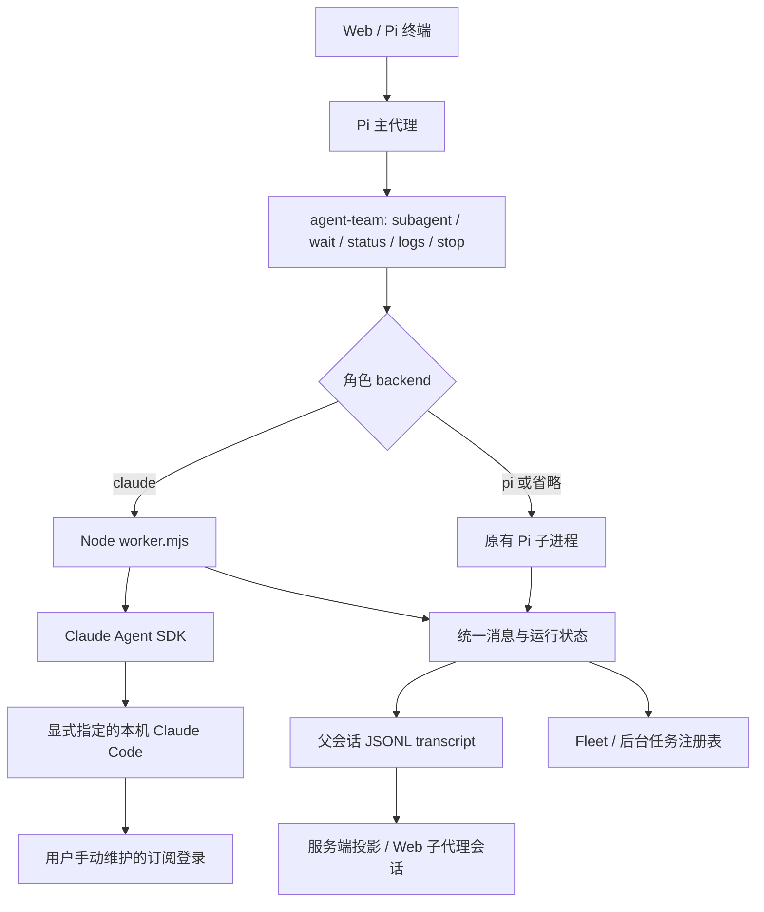

# Claude Agent SDK 子代理（第一阶段）

主代理继续使用 Pi。Claude 角色从独立的全局 JSON 配置加载；Pi 角色继续使用原有 Markdown。两者可以在同一个主会话中并存。



| 层 | 文件 | 职责 |
| --- | --- | --- |
| 角色与调度 | 全局扩展 `agents.ts`、`index.ts`；仓库保存 `integrations/agent-team/claude-backend.patch` | 解析 backend，选择运行入口，复用后台管理 |
| 启动配置 | `integrations/agent-team/claude-backend.ts` | 原生可执行文件路径、任务 stdin、环境隔离 |
| 独立进程入口 | `integrations/agent-team/claude-sdk/worker.mjs` | 加载 SDK、接收任务、输出事件、接收停止信号 |
| SDK 边界 | 同目录 `runner.ts`、`environment.mjs` | SDK 参数、事件转换、终态检查、流式输入与引导 socket、环境变量清理 |
| 持久化 | `integrations/agent-team/transcript.ts` | 向主会话追加消息，记录 backend 与 canSteer |
| 服务端与 UI | `src/agent/subagent-transcript.ts`、`web/src/components/Subagents.tsx` | 回复行标为 CLAUDE，信息条显示 anthropic/ 模型名；按 canSteer 启用或禁用运行中引导 |

## 安装与角色配置

运行环境：Node >= 22.19；SDK 固定为 `0.3.307`。SDK 安装在扩展自己的 `claude-sdk` 目录，不改变主代理的模型提供者。

本次开发已同步代码到 `/Users/mz/.pi/agent/extensions/agent-team`，并安装 SDK 依赖；没有重启服务或运行真实 Claude。已经加载扩展的进程需要由用户重新加载或重启才能使用新代码。

其他安装环境需要先备份现有扩展，在扩展目录对 `claude-backend.patch` 执行 `patch --dry-run -p1`。此补丁基于已有 transcript 功能的扩展，不替代旧的 `index.patch`。`claude-backend-baseline.json` 记录 index.ts、agents.ts 修改前后的 SHA-256；基线不匹配时人工合并，不强行覆盖。应用补丁后复制仓库的 `claude-backend.ts`、`transcript.ts` 和 `claude-sdk/` 源文件（不复制 node_modules），在目标 claude-sdk 目录执行：

```sh
npm ci --ignore-scripts --omit=optional
```

省略可选的捆绑原生程序，使用用户已安装的 Claude Code。默认路径为 `$HOME/.local/bin/claude`，也可为宿主进程设置绝对路径 `PI_CLAUDE_EXECUTABLE`。这里没有检查该文件或执行登录检测。

Claude 使用单独的全局文件 `~/.pi/agent/claude-agents/claude-worker.json`，不放进 Pi 的角色目录，不再解析 Markdown 中的 Claude backend。JSON 的 systemPrompt 指向提示词 Markdown 文件：

```json
{
  "name": "claude-worker",
  "description": "承担架构设计、前端设计与代码实现，并完成验证。",
  "tools": ["Read", "Glob", "Grep", "Edit", "Write", "Bash"],
  "permissionMode": "acceptEdits",
  "systemPrompt": "./claude-worker.prompt.md"
}
```

完整提示词保存在同目录 `claude-worker.prompt.md`。相对路径以 JSON 所在目录为基准，也支持绝对路径；文件缺失、不可读或为空会明确报错。旧的 `profiles/project/agents/claude-worker.md` 已移除。

查询可用角色时调用 `subagent({"list": true, "agentScope": "both"})`，它返回实际发现的名称、后端、描述和配置路径，不启动子进程。不要只扫描 Pi Markdown 目录推断角色列表。

调用 `subagent` 时使用 `agent: "claude-worker"`、`agentScope: "user"` 或 `"both"`，以及 `task`。`project` 范围不会加载全局 Claude 配置。随后通过 runId 调用 wait/status/logs/steer/stop。

| 字段 | 默认与限制 |
| --- | --- |
| name | 当前固定为 claude-worker；与 Pi 角色重名时保留 Pi 角色，list 的 diagnostics 说明 Claude 角色被跳过 |
| description | 必填非空描述 |
| systemPrompt | 必填提示词文件路径；加载文件内容传给 SDK，不把路径当作提示词 |
| model | 可省略，使用 Claude 默认；显式值使用 Claude 模型名 |
| tools | 默认 Read、Glob、Grep；字符串数组，空数组禁用内置工具 |
| permissionMode | 默认 dontAsk；支持 acceptEdits、plan。到达 canUseTool 的调用自动允许；dontAsk 提前拒绝的请求不会进入回调。工作代理使用 acceptEdits |
| effort | 可省略；low / medium / high / xhigh / max |

JSON 配置不应用 Pi 的 `agents.override.json`，不接受 backend、thinking 或其他未知字段。格式或字段错误会指出具体字段，不悄悄退回 Pi 执行。配置损坏不影响 Pi 角色：`subagent list` 中 claude-worker 显示 `available: false`，`diagnostics` 给出原因；调用它时直接返回同一原因，不启动子进程。

## 行为与边界

- 任务输入、助手消息、工具调用及结果进入现有 transcript；文本和思考增量用于实时更新。相同 API 消息的分块合并，避免重复累计 token。
- 只有成功 SDK result 且事件流正常结束才算完成；缺少终态、异常、取消分别处理。不会以已有部分文本推断成功。
- 停止等待不会终止后台子代理；显式 stop 或主会话退出会停止。macOS/POSIX 使用现有进程组管理；Windows 沿用现有 best-effort 进程树停止方式。
- 运行中引导：worker 以流式输入模式启动 SDK，并在 agent-team 分配的控制 socket 上监听，协议与 Pi 子进程的 `control-ext.js` 相同。`subagent_steer` 和 Web 引导框发出的 `steer` 以 `priority: "next"` 送入会话，在两轮工具调用之间并入当前回合；`followUp` 以 `"later"` 在当前回合结束后处理。每条输入带 uuid，直到 result 的 `user_message_uuids` 确认全部被消费、且 `queued_turn_count` 为 0 才结束输入；CLI 一直不确认的输入在 15 秒无活动后放弃，避免运行挂起。SDK 取走一条引导后，worker 在下一个边界（工具结果之后，或本轮结束时）回显一条同文的用户消息，从不插进仍在流式输出的助手消息；服务端据此把引导标为「已送达」，并在 Claude 对话流中显示在对应位置，与 Pi 子进程一致。引导会产生多个 result，以最后一个为准。主代理拿到的结果是最后一条回复；引导在 Claude 答完后才到时会开启新一轮，所以 worker 在系统提示末尾追加一句说明，要求最终回复独立完整（之前的结论加上改动），而不只是增量。兜底超时只把助手输出、工具结果和 `command_lifecycle: started` 视为活动；CLI 每轮前后的 `command_lifecycle` queued/completed、`post_turn_summary` 等记账消息不会推迟它。真实 CLI 中第一轮结束时 `queued_turn_count` 可能为 0，即使下一条已排队，因此以 uuid 为准。运行结束后 socket 关闭，迟到的引导会报告发送失败。Windows 没有控制 socket，仍不能引导。
- `persistSession: false`，没有 resume、Claude Desktop 会话接管。SDK 内嵌子代理的独立消息不展开，保留父级工具结果。
- 工具审批回调按宿主授权自动允许，不提供人工确认界面，也不切换到 bypassPermissions。AskUserQuestion、ExitPlanMode 仍禁用；elicitation 和用户对话仍不支持交互。
- 配置：`settingSources: ["user", "project", "local"]`，与 Claude Code 一样加载 `~/.claude/settings.json`、项目的 `.claude/settings.json` 和 `.claude/settings.local.json`。随之生效的有：其中的 model、permissions、env、hooks；Claude Code 自己发现的 CLAUDE.md 与 AGENTS.md（cwd 及上级目录，经内置的 agents-md 插件）；Claude 自己的 MCP 配置（`~/.claude.json`、项目 `.mcp.json`、claude.ai 账号连接器）。settings 中的 model 会覆盖 Claude 默认模型；claude-worker.json 显式写了 model 时以它为准。settings 中的 env 或 apiKeyHelper 可以改变认证与计费来源，维护时需注意。
- 项目规则：宿主仍用 Pi 的 `loadProjectContextFiles` 发现规则文件，但只把 Claude 不会自己读的部分（Pi 全局 agentDir 下的文件、`AGENTS.override.md`）按 Pi 格式追加到系统提示词，cwd 及上级目录的 AGENTS.md / CLAUDE.md 交给 Claude 自己加载，避免重复。
- Skills：宿主用 Pi 的 `DefaultResourceLoader`（关闭扩展、模板、主题、上下文文件）发现 Pi 子代理在该 cwd 下能看到的 skills，包括 `~/.agents/skills`、包里的 skills、settings 配置的路径，并遵循项目信任。worker 把它们软链进一个临时本地插件 `pi`，以 `pi:<name>` 出现，不与 Claude 自己的 skills 冲突；插件声明 `skipMcpDiscovery`，运行结束删除插件目录（只删软链）。worker 设置 `skills: "all"`，并在 tools 白名单非空时自动补上 `Skill` 工具。不共享 Pi 的 MCP；工具审批仍由 worker 自动允许。
- 失败原因：配置错误、可执行文件不存在（提示设置 `PI_CLAUDE_EXECUTABLE`），以及 CLI 报告的失败 result（如额度用尽、需要登录，截取前 300 字）会原样显示；SDK 抛出的原始异常仍不写入 transcript，只显示通用提示。
- 子进程清理从 Pi 宿主继承的 ANTHROPIC、Claude provider/auth override 等环境变量，避免沿用 Pi 的 API 配置（Claude 自己 settings 中的 env 不受此限）；没有读取或修改登录凭据。实际账户类型、订阅可用性和额度必须由用户手动确认，本次离线验证不能证明认证来源。
- token 可用于工作量展示；未把 SDK API 价格估算当作订阅实际费用。

## 验证

自动测试全部使用模拟 SDK / 模拟 Pi，禁止真实模型请求。覆盖配置隔离与字段级报错、配置损坏时 Pi 角色可用、项目规则注入、事件去重、终态与多轮 result、失败原因、取消、持久化、通过 `subagent_steer` 的运行中引导、HTTP/终端停止等待、显式停止、退出清理、同会话两种后端，以及成功/失败结果收集。

```sh
node node_modules/vitest/vitest.mjs run tests/agent/claude-subagent.test.ts
PI_AGENT_TEAM_EXTENSION_UNDER_TEST=/Users/mz/.pi/agent/extensions/agent-team/index.ts node node_modules/vitest/vitest.mjs run tests/agent/subagent-real-extension-lifecycle.test.ts
```

第二条只读取已安装扩展并在临时副本运行；Claude SDK 在该副本内被替换为模拟模块，原生可执行文件是一个从不执行的空 fixture 文件。

用户手动验收：

1. 自行确认本机 Claude Code 的可执行文件路径、登录的订阅账号和可用额度。
2. 重新加载扩展，确认上述 JSON 已加载，发送一个只读任务。
3. 确认可看到过程、工具结果、最终文本，并能收集任务结果。
4. 发起较长任务，验证 stop；确认原有 Pi 角色仍能运行。
5. 运行中从 Web 引导框和 `subagent_steer` 各发一条引导，确认 Claude 在下一轮工具调用前采纳；刷新 Web，检查历史消息和引导记录仍在，回复行标为 CLAUDE。

没有执行上述人工验收；没有启动真实 Claude、验证订阅、提交或推送代码。
